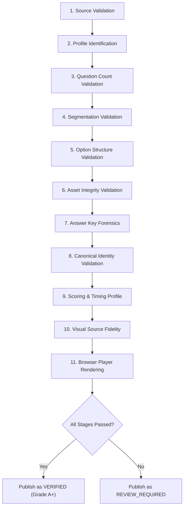

# MOCK.AI — SSC Future-Paper Validation & Acceptance Specification
## Multi-Stage Acceptance Gate, Profile Definitions, and Automated Quality Certification

**Document ID:** `SPEC-SSC-FUTURE-GATE-2026`  
**Target:** Future SSC CBT Response Sheets (CHSL, CGL, MTS, GD, CPO, Stenographer 2024–2027)  
**Authority:** Mock.AI Automated Ingestion Quality Gate  
**Version:** `4.0-PRODUCTION`  

---

### 1. Future-Paper Acceptance Gate (11-Stage Gate)

No newly uploaded or ingested examination paper may be published to production with status `VERIFIED` without passing all eleven verification stages sequentially.

---

### 2. Detailed Stage Requirements

#### Stage 1: Source Validation
- The input document must be a valid, uncorrupted PDF file.
- Header stamp must confirm authentic Staff Selection Commission or TCS iON CBT formatting.
- File hash (SHA-256) is calculated and recorded in `.manifests/`.

#### Stage 2: Paper Profile Identification
- `SourceAdapter.resolve_profile(filename, header_text)` must successfully resolve a matching `PaperProfile`.
- Profile sets `col_bound` ($98.0$ for Tier 1, $146.0$ for Tier 2), top/bottom margins, and scoring rules.
- If no matching profile exists, engine falls back to standard Tier 1 profile and flags the paper for profile review.

#### Stage 3: Question Count Validation
- The extracted question count must exactly match the profile specification:
  - **SSC CHSL Tier 1:** Exactly 100 questions (25 English, 25 Reasoning, 25 Quant, 25 GA).
  - **SSC CHSL Tier 2:** Exactly 135 questions across 5 sections.
  - **SSC CGL Tier 1:** Exactly 100 questions.
  - **SSC MTS:** Exactly 90 questions.
- A missing or extra question is a blocking condition that sets status to `REVIEW_REQUIRED`.

#### Stage 4: Question Segmentation Validation
- Every question must have an immutable `QuestionBoundaryEvidence` tuple `[start_pos, end_pos)`.
- Boundary clamping must prevent inter-question image or block bleed.
- Question prompt text or diagram URL must be present (neither may be empty).

#### Stage 5: Option Structure Validation
- Exactly 4 option slots must be present for every question.
- Every slot must contain non-empty text OR a verified image URL.
- **Collision Invariant:** $A \ne B \ne C \ne D$. If identical option text or images are detected, duplicate detector flags `REVIEW_REQUIRED`.
- Spatial matching must verify that option images fall within the designated option column and vertical tolerance ($\le 75\text{pt}$). Blind greedy zip assignment is strictly forbidden.

#### Stage 6: Asset Integrity Validation
- All referenced image URLs (`/exam-assets/...`) must physically exist on the local filesystem.
- Asset files must have size $> 0$ bytes and valid MIME headers (`image/jpeg` or `image/png`).
- **Single-Ownership Invariant:**
  $$\text{Assets}_{\text{stem}} \cap \text{Assets}_{\text{option}} = \emptyset$$
  Stem assets must match `q{N}_diag.*` and option assets must match `q{N}_opt_{a..d}.*`.

#### Stage 7: Answer Key Forensics
- Answer keys must be derived from official TCS iON green checkmark icons using RGB saturation analysis ($G \ge R + 30$ and $G \ge B + 30$).
- Spatial correlation must assign the tick to the nearest option slot.
- Correct answer letter must be within `['A', 'B', 'C', 'D']` and index within `[0, 1, 2, 3]`.

#### Stage 8: Canonical Identity Validation
- Question ID must follow the immutable canonical pattern:
  $$\text{id} = \text{\{paperId\}-q\{overall\_q\_num\}}$$
- No ID collisions may exist across the entire platform.

#### Stage 9: Scoring & Timing Profile
- Scoring metadata must match profile:
  - Tier 1: `marks = 2.0`, `negativeMarks = 0.5`, `duration = 60`
  - Tier 2: `marks = 3.0`, `negativeMarks = 1.0`, `duration = 135`

#### Stage 10: Visual Source Fidelity
- High-risk questions (mirror images, folded paper, dice, pattern series, math equations) must preserve authentic visual assets.
- Mathematical expressions must pass LaTeX syntax validation (`MathEngine.validate_latex`).

#### Stage 11: Browser Player Rendering
- All questions must render cleanly inside `CompetitiveExamPlayerScreen.tsx` and `StructuredContentRenderer.tsx`.
- Option choices in `IMAGE_ONLY` mode must display authentic figures with OCR text isolated to `ocrText` metadata.

---

### 3. Publication Rules

| Condition | Status Assigned | Action Taken |
| :--- | :--- | :--- |
| **All 11 Stages Pass** | `VERIFIED` | Paper promoted to active production catalog. |
| **Missing stem, empty option, duplicate option, or asset 404** | `REVIEW_REQUIRED` | Paper accessible with warning flag; flagged in dashboard. |
| **Corrupted PDF or critical parse crash** | `FAILED` | Paper rejected; error logged to manifest. |

**Strict Mandate:** Never publish a question or paper as `VERIFIED` if any critical condition fails.

---
*End of Future-Paper Validation Specification.*
