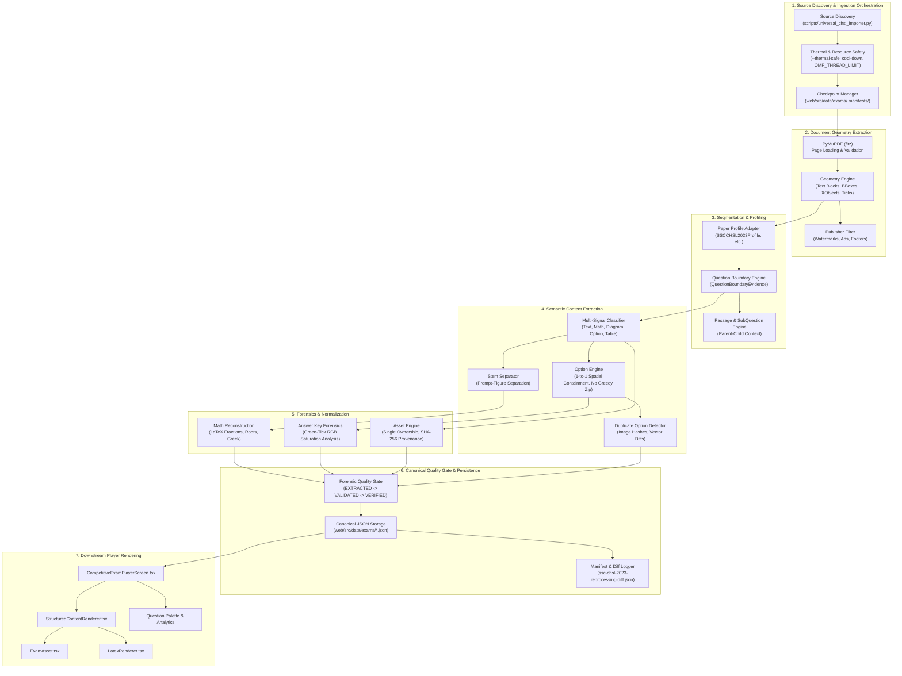

# MOCK.AI — Universal SSC Question Ingestion Engine
## Complete Ingestion Architecture Audit (PDF Source → Geometry → Extraction → Normalization → DB → Player)

**Document ID:** `DOC-SSC-AUDIT-2026-V4`  
**Scope:** Complete End-to-End Ingestion Call Graph, Data Flow, Failure Taxonomy, and Component Interactions  
**Platform:** Mock.AI Competitive Examination Platform  
**Target Corpus:** SSC CHSL (2019–2025), SSC CGL, SSC MTS, and Multi-Exam Adaptations  

---

### Executive Summary

An exhaustive forensic architectural audit was conducted across the Mock.AI question ingestion subsystem, evaluating the pathway from raw PDF response sheet bytes to active browser test presentation in `CompetitiveExamPlayerScreen.tsx`.

The audit uncovered critical algorithmic vulnerabilities in earlier ingestion iterations (V1–V3) that manifested prominently across the SSC CHSL 2023 corpus:
1. **Geometric Boundary Bleed:** Upward tolerance assumptions (`y - 15`) and unconstrained multi-page coordinate comparisons allowed images from succeeding questions (such as Q27, Q30, Q35, Q44, Q49, Q54, Q67, Q69, Q75, Q93) to spill over question boundaries.
2. **Greedy Positional Option Fallback:** When option markers lacked explicit OCR text coordinates, the engine executed an unvalidated zip operation (`zip(unassigned_slots, unassigned_imgs)`), blindly stuffing rogue stem crops into Option D.
3. **Premature Stem Strip Demotion:** Heuristics designed to demote text-strip images to native text frequently destroyed complex tabular data, mathematical notations, or formula graphics.
4. **OCR Duplication & Hallucination:** Under low-resolution chip conditions, repeated OCR bounding boxes produced duplicate options ($A = B = C = D$).
5. **Architectural Branch Coupling:** Engine logic contained hardcoded conditional paths for specific years rather than utilizing profile-driven adapters.

This document formalizes the complete architecture audit, traces every caller and callee in the processing hierarchy, establishes a 34-category Failure Taxonomy, and defines the structural requirements for the **V4 Universal Ingestion Engine**.

---

### 1. Source-of-Truth Hierarchy

Mock.AI enforces an absolute, unidirectional Source-of-Truth Hierarchy:

```
┌──────────────────────────────────────────────┐
│           1. OFFICIAL SOURCE PDF             │ (Immutable byte-level ground truth)
└──────────────────────┬───────────────────────┘
                       │
                       ▼
┌──────────────────────────────────────────────┐
│            2. SOURCE GEOMETRY                │ (Physical bounding boxes, vector paths, XObjects)
└──────────────────────┬───────────────────────┘
                       │
                       ▼
┌──────────────────────────────────────────────┐
│          3. EXTRACTED STRUCTURE              │ (QuestionBoundaryEvidence, raw chips, ticks)
└──────────────────────┬───────────────────────┘
                       │
                       ▼
┌──────────────────────────────────────────────┐
│            4. CANONICAL MODEL                │ (Immutable question identity, richOptions, LaTeX)
└──────────────────────┬───────────────────────┘
                       │
                       ▼
┌──────────────────────────────────────────────┐
│            5. PERSISTENCE (DB/JSON)          │ (Normalized schemas, checkpoints, manifests)
└──────────────────────┬───────────────────────┘
                       │
                       ▼
┌──────────────────────────────────────────────┐
│            6. BROWSER PLAYER (UI)            │ (CompetitiveExamPlayerScreen, StructuredContent)
└──────────────────────────────────────────────┘
```

**Golden Principle:**  
- Downstream layers must NEVER override upstream evidence.
- Existing JSON files, previous verification flags, cached image crops, and answer mappings are secondary evidence, not ground truth.
- When ambiguity arises between extraction and source, the system must emit `REVIEW_REQUIRED`, never hallucinate or invent data.

---

### 2. Complete End-to-End Call Graph



---

### 3. Detailed Component Interaction & Caller/Callee Audit

#### 3.1 Source Ingestion & Execution Controller
- **Primary Script:** `scripts/universal_chsl_importer.py`
- **Callers:** CLI commands, migration pipelines (`scripts/ingest_all_chsl_papers.py`), automated CI/CD validation.
- **Callees:**
  - `fitz` (PyMuPDF): Low-level document structure, page coordinate transforms, raster extraction.
  - `PIL.Image`, `PIL.ImageOps`: High-fidelity image manipulation, scaling, padding, binarization.
  - `pytesseract`: OCR extraction with process-level semaphore synchronization (`call_tesseract_safely`).
  - `hashlib`: SHA-256 asset content addressability and deduplication.
  - Checkpoint Manifest Subsystem: Atomic state preservation in `.manifests/`.

#### 3.2 Page Geometry & Layout Extraction
- **Input:** Raw PDF file stream.
- **Processing:**
  - Page block extraction using `page.get_text("blocks")`.
  - Image instance extraction using `page.get_images()`.
  - Bounding box calculation via `page.get_image_rects(xref)`.
  - Content column discrimination (`col_bound = 98.0` for Tier 1, `146.0` for Tier 2) separating question content from response status panels (`Question ID`, `Status`, `Chosen Option`).
- **Callees:**
  - `clean_watermarks()`: Cleans background watermarks and Adda247/Testbook promotional text.
  - `clean_option_text()`: Normalizes whitespace, stripped parentheticals, and option indices.

#### 3.3 Question Segmentation & Passage Subsystem
- **Mechanism:**
  - Scans for section headers (`Section : General Intelligence`, `Section : Quantitative Aptitude`).
  - Identifies question start markers (`Q.1`, `Q 1`, `Q. 1`, `SubQuestion No : X`).
  - Identifies comprehension parent blocks (`Comprehension: In the following passage...`).
  - Generates immutable boundary intervals `[start_pos, end_pos)`.

#### 3.4 Multi-Signal Classifier & Visual Separator
- **Signals Evaluated:**
  - Spatial coordinates: vertical distance from `Ans` marker (`ans_pos`), horizontal column positioning.
  - Aspect ratio: width-to-height ratio ($W/H$).
  - Physical dimensions: bounding box width ($W$) and height ($H$).
  - OCR lexical density: presence of natural language words vs mathematical symbols vs noise tokens.
  - Visual reasoning keywords: `mirror image`, `folded to form a cube`, `embedded figure`, `pie chart`, `bar graph`.
- **Classification Outputs:**
  - `TEXT_ONLY`: Rendered as clean typography.
  - `GENUINE_VISUAL` (Stem Diagram): Cropped with prompt text removed, saved to `web/public/exam-assets/.../q{N}_diag.jpeg`.
  - `IMAGE_OPTION`: Preserved as high-resolution visual choices, saved to `q{N}_opt_{a..d}.jpeg`.
  - `MATH_ONLY`: Converted to LaTeX expressions (`\frac{a}{b}`, `\sqrt{x}`).

#### 3.5 Answer Key & Green-Tick Forensics
- **Algorithm:**
  - Scans image instances located in the status/indicator column (`x0 < col_bound`).
  - Checks dimensions matching TCS iON green checkmark icons (`16x16`, `23x22`, `23x23`, `19x22`, `18x21`).
  - Evaluates RGB color saturation: green ticks exhibit high saturation in the G channel ($G > R + 30$ and $G > B + 30$).
  - Measures Euclidean/vertical distance between the detected tick coordinate `(page, y)` and each option's anchor coordinate.
  - Minimum distance selects the official correct option index ($0 \rightarrow A, 1 \rightarrow B, 2 \rightarrow C, 3 \rightarrow D$).

#### 3.6 Downstream Browser Presentation Subsystem
- **Consumer Components:**
  1. `web/src/screens/CompetitiveExamPlayerScreen.tsx`: Manages active exam state, timer, section switching, question palette, flagging, and answer submission.
  2. `web/src/components/StructuredContentRenderer.tsx`: Renders rich question stems and options:
     - Handles `IMAGE_ONLY` mode (renders authentic visual figure, suppresses OCR alt-text duplication).
     - Handles `TEXT_ONLY` mode (renders clean text and LaTeX formulas).
     - Handles markdown tables via `splitTableRow()` with math delimiter preservation.
  3. `web/src/components/ExamAsset.tsx`: Handles responsive image rendering, loading states, error states, and modal zoom.
  4. `web/src/components/LatexRenderer.tsx`: High-performance KaTeX rendering for algebraic and trigonometric notation.

---

### 4. Comprehensive Failure Taxonomy (34 Categories)

Based on forensic analysis of the user screenshots and corpus-wide audits, all observed defects are classified into the following permanent taxonomy:

| Category Code | Failure Description | Root Cause Mechanism | Engine Defense / Fix |
| :--- | :--- | :--- | :--- |
| **A. Missing Question Stem** | Stem text is completely empty (`""` or `None`) and no diagram is linked. | Question text was in an image strip that was neither transcribed nor preserved as a diagram. | Demotion fallback: if OCR produces valid text, assign to stem; if visual/table, preserve as `q{N}_diag`. |
| **B. Truncated Question Stem** | Stem starts mid-sentence (e.g. `In a certain code language,`). | Greedy regex split on prompt words or premature truncation at line breaks. | Full vertical block aggregation between start marker and `Ans` marker. |
| **C. Footer/Header Contamination** | Page numbers or candidate credentials appear inside question stem. | Bounding box failed to clip top ($y < 50$) or bottom ($y > 780$) margins. | Hard geometric margin clipping ($y0 \ge 50$, $y1 \le 780$). |
| **D. Wrong Reading Order** | Question parts appear scrambled out of physical reading order. | Blocks sorted by PDF content-stream index instead of `(page, y0, x0)`. | Geometric sort key `(page, round(y0, 1), round(x0, 1))`. |
| **E. Option Merged into Stem** | Stem text contains option labels `1.`, `2.`, etc. | Missing or misdetected `Ans` delimiter allowing option blocks to append to stem. | Multi-variant `Ans` detection (case-insensitive, vertical `A\nn\ns`, regex guard). |
| **F. Stem Merged into Option** | Option contains question instructions or table headers. | Option bounding box extended upwards past option marker. | Strict upper boundary clipping at option marker $y$-coordinate. |
| **G. Duplicate Option** | Multiple options contain identical text or images ($C == D$). | Fallback OCR matched identical chip, or single image assigned to multiple slots. | Duplicate collision detector forces `REVIEW_REQUIRED` or authentic image fallback. |
| **H. Wrong Option Image** | Option D contains next question's stem crop (e.g. Q26, Q29, Q43, Q48, Q53, Q66). | Inter-question boundary spillover + greedy slot assignment `zip(unassigned, imgs)`. | Strict question boundary clamping + 1-to-1 geometric containment inside option column. |
| **I. Missing Option Image** | Option slot is completely blank because image failed to save. | Unhandled exception during crop saving or missing XObject. | Integrity invariant: every slot must have non-empty text or verified image asset. |
| **J. Broken Option Image** | Image URL produces 404 in browser. | Relative URL mismatch or asset file omitted from `web/public/exam-assets/`. | Hard pre-publication validation: every asset URL must exist on disk and be $> 0$ bytes. |
| **K. Duplicate Question Image** | Same diagram URL linked across different questions. | Global content hash cache reused stem diagram across different questions. | Asset isolation: stem assets are strictly scoped to `paper_id/q{N}_diag.*`. |
| **L. Diagram Labels Leaking** | OCR text of a diagram appears in the stem text. | Text strip extractor ran OCR on a genuine diagram and prepended it to stem. | Multi-signal classifier: genuine diagrams are quarantined from text concatenation. |
| **M. Text Incorrectly to Image** | Plain text question rendered as an unsearchable bitmap image. | Importer failed to demote high-aspect-ratio text strips. | Certified Stem Strip Demotion evaluates text density and font features. |
| **N. Image Incorrectly to Text** | Visual reasoning puzzle mangled into garbled OCR letters. | Importer aggressively ran OCR without checking visual reasoning keywords. | Visual keyword check protects diagrams from destructive OCR demotion. |
| **O. Table Flattened Incorrectly** | Tabular data rendered as garbled single-line string. | Standard text block extractor stripped column whitespace and newlines. | Markdown table reconstruction or table-strip image preservation. |
| **P. Graph/Chart Misclassified** | Data interpretation chart treated as an option image. | Missing $y$-boundary check on charts placed below `Ans` marker. | Column-width check: charts have $W \ge 250\text{pt}$, option images have $W \le 180\text{pt}$. |
| **Q. Passage Detached** | Reading comprehension passage omitted from sub-questions. | Sub-questions extracted individually without inheriting preceding passage. | Parent-child context model: questions inherit `passage` from parent block. |
| **R. Multi-Page Question Broken** | Question split across page boundary loses options on page 2. | Bounding box evaluation clamped strictly to single page. | Multi-page tuple comparisons `(start_page, y0) <= pos < (end_page, y1)`. |
| **S. Math Corruption** | Formulas mangled (e.g. `cot6 = = .`, `cosec7@`, `22` for $2\sqrt{2}$). | Low-res OCR failed on mathematical glyphs ($\theta \rightarrow 6, \text{pow} \rightarrow @$). | Structured math normalization and LaTeX validation. |
| **T. OCR Character Substitution** | Common typos (`‘umber` $\rightarrow$ `number`, `‘OTE:` $\rightarrow$ `NOTE:`). | Tesseract dictionary misses under non-standard fonts. | Deterministic post-OCR correction dictionary with high-confidence rules. |
| **U. Answer-Key Mismatch** | Correct answer mapped to wrong option index. | Green tick matched to wrong radio button due to vertical coordinate drift. | Coordinate proximity matching with vertical distance minimization. |
| **V. Question-Number Mismatch** | Extracted question number does not match source. | Skipped questions or false positive question markers. | Sequential validation: $N$ questions must map strictly to $1..N$. |
| **W. Section-Numbering Mismatch** | Section boundary detected at wrong question. | Inconsistent section header regex matching. | Section header anchoring to known syllabus sections. |
| **X. Cross-Paper Asset Reference** | Paper A links to image stored in Paper B directory. | Asset manager searched global directory for missing images. | Strict paper asset encapsulation: assets only resolved from `exam-assets/.../{paperId}/`. |
| **Y. Stale Asset** | Outdated or corrupted asset from previous run preserved. | Importer skipped asset generation when file already existed. | Content-hash validation: overwrite stale assets on re-ingestion. |
| **Z. Orphan Asset** | Unreferenced image files cluttering public directory. | Previous runs saved temporary or misclassified crops. | Dry-run asset audit and automated garbage collection. |
| **AA. Placeholder Question** | Question text is generic placeholder `Question 12`. | Extraction failed and fallback string was generated. | Strict rule: FORBID generic placeholder generation; mark `REVIEW_REQUIRED`. |
| **AB. False VERIFIED Status** | Question with defects marked as `VERIFIED`. | Quality gate only checked JSON generation success, not data validity. | Multi-point quality gate requiring zero defects before `VERIFIED`. |
| **AC. Player Rendering Mismatch** | Content renders correctly in JSON but breaks in player. | Player component lacked support for specific display mode or markdown block. | End-to-end component testing with `StructuredContentRenderer`. |
| **AD. Canonical Identity Collision** | Two questions share the same `id`. | ID generation used non-unique sequential integers. | Immutable canonical format `{paper_id}-q{overall_num}`. |
| **AE. Topic Metadata Masking** | Topic classifier assigned valid topic to corrupted question. | Topic engine ran independently of data quality gate. | Topic classification executed ONLY on `VERIFIED` questions. |
| **AF. Scoring Metadata Mismatch** | Marks/negative marks incorrect for tier/exam. | Hardcoded scoring constants ignored paper tier. | Profile-driven scoring rules (`Tier 1`: +2.0/-0.5, `Tier 2`: +3.0/-1.0). |
| **AG. Interrupted/Partial Ingestion** | Ingestion crashed mid-paper leaving incomplete dataset. | Unhandled exceptions or thermal throttling without checkpoints. | Atomic paper transactions and persistent checkpoint manifests. |
| **AH. Excessive Resource Usage** | System thrashing or thermal overheating on Mac. | Unbounded parallel processes running PyMuPDF and Tesseract. | Bounded concurrency, OCR semaphore, `--thermal-safe` cool-down intervals. |

---

### 5. Architectural Remediation Plan (V4 Engine)

To permanently resolve these failure classes without paper-specific hacks, the following architectural updates are mandated for the V4 engine:

1. **Profile-Driven Architecture:** Replace all `if year == ...` logic with `SourceAdapter` and `PaperProfile` objects encapsulating layout geometry, section structures, and scoring policies.
2. **Strict Geometric Clamping:** Constrain all image and block searches strictly within the current question's boundary interval. Prohibit upward tolerance from crossing prior question boundaries.
3. **1-to-1 Spatial Option Matching:** Map option images to slots strictly through spatial containment inside designated option column bounds. Eliminate greedy zip assignments completely.
4. **Deterministic Typographic Repair:** Implement a reversible, evidence-backed text repair engine for known OCR substitutions.
5. **Quality Gate Hardening:** Enforce strict validation rules: any question with missing stems, duplicate options, or missing assets is marked `REVIEW_REQUIRED` and prevented from receiving `VERIFIED` status.

---
*End of Complete Architecture Audit Report.*
