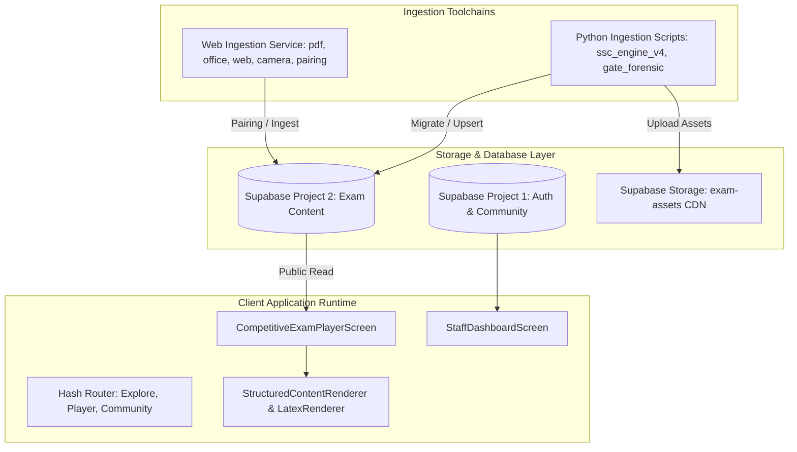
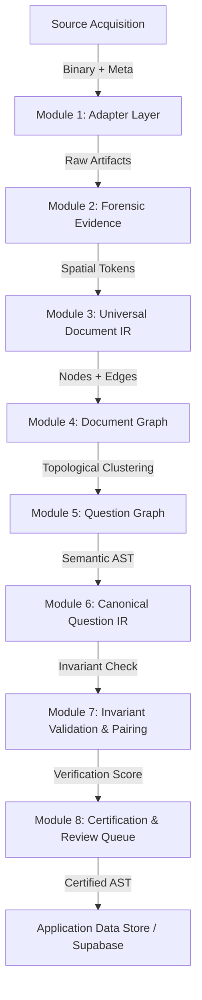
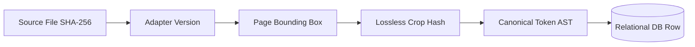
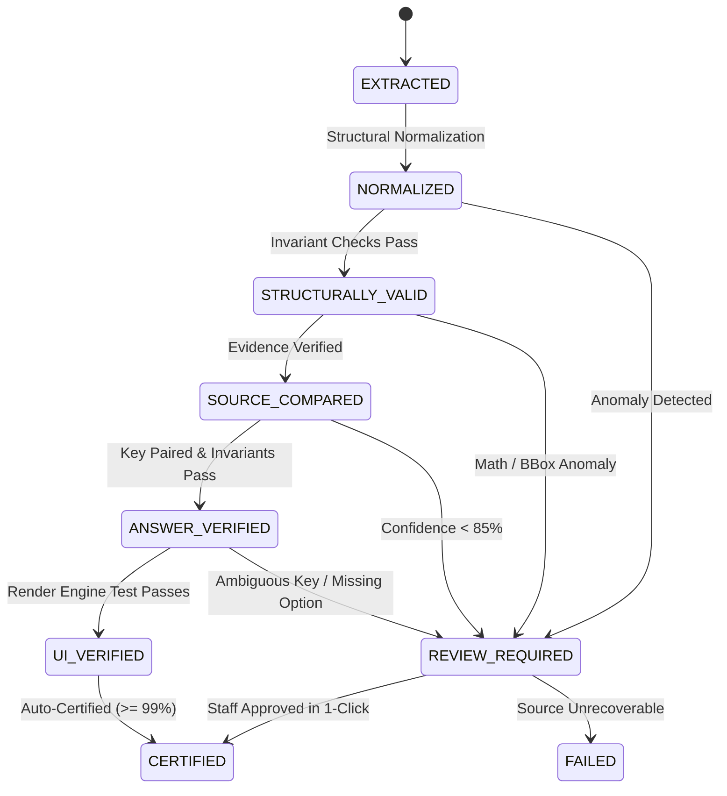
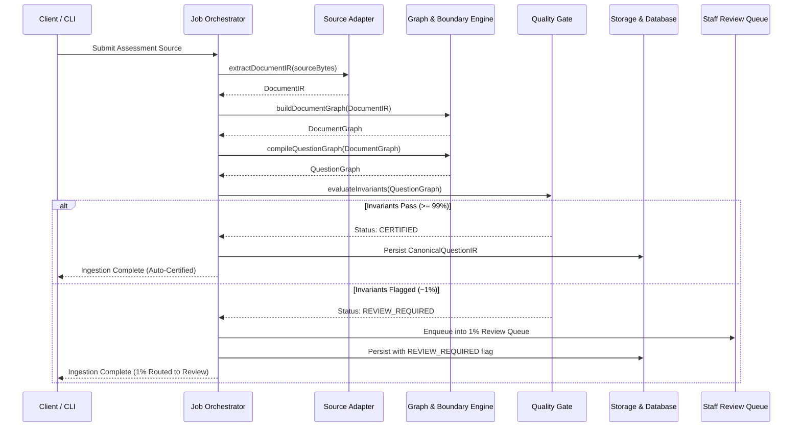

# UADUE — Universal Assessment Document Understanding Engine
## Foundational Architecture Audit & System Design Specification

**Author:** Principal Architect & Lead Engineer, Mock.AI  
**Date:** October 6, 2026  
**Status:** Architecture Proposal / Pre-Implementation Audit  
**Document ID:** `MOCKAI-ARCH-2026-UADUE-01`

---

## Executive Architectural Manifesto

Mock.AI is an assessment understanding and simulation platform. An assessment is **not a file format**, nor is it an exam-specific idiosyncrasy of SSC CHSL response sheets or GATE master booklets. An assessment is a **structured academic stimulus** consisting of:
1. Intent & Pedagogical Classification
2. Natural, Mathematical, and Visual Context
3. Interaction Mechanics (MCQ, MSQ, NAT, Matching, Descriptive, Matrix)
4. Evaluation Rules, Scoring Rubrics, and Answer Provenance.

The current codebase contains high-value domain intelligence, but suffers from **format conflation**: PDF-specific parsing, layout assumptions, and examination-specific heuristics bleed across the ingestion pipeline.

**UADUE (Universal Assessment Document Understanding Engine)** establishes an uncompromised separation of concerns:
```
SOURCE
  ↓ (Source Adapter)
FORENSIC EVIDENCE
  ↓ (Structural & Spatial Parser)
UNIVERSAL DOCUMENT IR
  ↓ (Topological Relational Linker)
DOCUMENT GRAPH
  ↓ (Boundary & Ownership Resolver)
QUESTION GRAPH
  ↓ (Semantic Compiler)
CANONICAL QUESTION IR
  ↓ (Invariant Verifier)
VALIDATION → VERIFICATION → CERTIFICATION
```

Downstream components never inspect raw PDF bytes or regex tokens. The core engine operates exclusively on **Universal Document IR**, **Document Graph**, and **Question Graph** contracts.

---

## Section A: Current Architecture

Mock.AI's system architecture spans two primary runtimes: a Python ingestion toolchain and a React 18 / TypeScript / Vite client-server platform backed by Supabase.



### Key Subsystems
1. **Catalog & Data Layer (`web/src/data/exams/catalog.ts`):** In-memory and local JSON cache containing over 190 certified exam papers (2019–2024), partitioned by authority (`ssc-chsl`, `gate`, etc.).
2. **Supabase Split-Project Topology:**
   - **Project 1 (`oczbznehlsdmgjdzdeax`):** Identity, auth sessions, profile records, and community reports (`community_posts`, `staff_roles`).
   - **Project 2 (`nvvscqxsrechenyqcwli`):** Public content store (`competitive_exams`, `exam_papers`, `exam_sections`, `questions`, `question_options`, `content_assets`).
3. **Client-Side Test Engine (`web/src/services/examService.ts`):** R1 security quarantine (`toExamPresentationPaper` strips answer keys from active exam sessions), offline attempt caching in `localStorage`, and timer orchestration.
4. **Rendering Core (`web/src/components/StructuredContentRenderer.tsx`):** Block-level UI renderer with KaTeX math parsing, markdown table splitting, and raster image zooming.

---

## Section B: Current Extraction Architecture

The repository currently maintains three disconnected extraction architectures:

```
┌────────────────────────────────────────────────────────────────────────┐
│                   CURRENT FRAGMENTED EXTRACTORS                        │
├────────────────────────┬──────────────────────┬────────────────────────┤
│ 1. SSC Engine v4       │ 2. GATE Forensic     │ 3. Browser-Side Web    │
│ (Python / PyMuPDF)     │ (Python / PyMuPDF)   │ (TypeScript / PDF.js)  │
├────────────────────────┼──────────────────────┼────────────────────────┤
│ • scripts/ssc_engine_v4│ • scripts/gate_      │ • web/src/services/    │
│ • TCS iON dual-anchor  │   forensic_pipeline  │   ingestion/pdf/       │
│ • Assumes Q.N header   │ • Assumes 65 Qs      │ • Ingests via web UI   │
│ • Assumes 'Question ID'│ • Assumes GA + Core  │ • Direct to            │
│   footer bounding      │ • Regex-based options│   CanonicalQuestion[]  │
└────────────────────────┴──────────────────────┴────────────────────────┘
```

1. **`scripts/ssc_engine_v4/`:**
   - Designed for TCS iON candidate response sheets.
   - Relies on string anchors (`Section :`, `Q.N`, `Question ID : \d+`).
   - Performs geometric raster vs. native text classification.
   - Extracts mathematical options via heuristic OCR chip splitting.
2. **`scripts/gate_forensic_pipeline.py` (2,256 lines):**
   - Monolithic batch script processing 76 GATE papers (5,344 questions).
   - Hardcoded to 65 questions per paper, with two sections: General Aptitude (Q1–Q10) and Core Discipline (Q11–Q65).
   - Regex-based question and option splitting (`OPTION_REGEX = re.compile(r'^(?:(?:\([A-D]\)|\([a-d]\)|[A-D][\.\:\)])...')`).
3. **`web/src/services/ingestion/` (TypeScript Ingestion Framework):**
   - Modular adapters (`PdfSourceAdapter`, `OfficeSourceAdapter`, `WebUrlSourceAdapter`, `YouTubeSourceAdapter`, `CameraSourceAdapter`).
   - Browser-side PDF.js layout extraction (`layoutExtractor.ts`).
   - Ingestion result immediately maps to `CanonicalQuestion[]` without an immutable intermediate representation.

---

## Section C: Current Data Model

The data model exists across four distinct representations:

```
┌──────────────────────┐     toLegacyQuestion     ┌──────────────────────┐
│  CanonicalQuestion   │ ───────────────────────► │   Legacy Question    │
│ (Rich AST & Scoring) │                          │ (Exactly 4 options)  │
└──────────┬───────────┘                          └──────────────────────┘
           │
           │ generateMockPaperFromQuestions
           ▼
┌──────────────────────┐      Relational Sync     ┌──────────────────────┐
│     ExamPaper        │ ───────────────────────► │ Supabase Project 2   │
│ (CompetitiveQuestion)│                          │ (questions, options) │
└──────────────────────┘                          └──────────────────────┘
```

### 1. `CanonicalQuestion` (`web/src/types/canonicalQuestion.ts`)
The most mature interface in the system:
- `questionType`: `'MCQ' | 'MSQ' | 'NAT' | 'TRUE_FALSE' | 'MATCHING' | 'ASSERTION_REASON' | 'DESCRIPTIVE' | 'SUBJECTIVE' | 'UNKNOWN'`
- `contentBlocks`: Array of `CanonicalContentBlock` (`text`, `math`, `table`, `diagram`, `code`, `mixed`)
- `answer`: `CanonicalAnswer` supporting `natRange`, `correctOptionIds`, `matchingMapping`, `isMta`
- `provenance`: Bounding box coordinates, source file, page number, extraction timestamp
- `confidence`: Granular confidence scores (`extraction`, `structure`, `answer`, `asset`)

### 2. `ExamPaper` & `CompetitiveQuestion` (`web/src/types/index.ts`)
The active runtime model consumed by the exam player:
- `markingScheme`: `marksPerCorrect`, `negativeMarks`, `unansweredMarks`
- `sections`: `ExamSection[]` (`start_index`, `end_index`, `question_count`)
- Denormalized fields: `correctAnswer: string`, `correctAnswerIndex: number`

### 3. PostgreSQL Relational Model (`supabase/schema_content_project2.sql`)
- `competitive_exams`
- `exam_papers`
- `exam_sections`
- `content_assets`
- `questions`
- `question_options`

### 4. Legacy Prototype Model (`web/src/types/index.ts: Question`)
- `options: string[]` (hardcoded contract: exactly 4 items always)
- `correctAnswerIndex: number` (0 to 3)

---

## Section D: Existing Extraction Failure Points

A forensic audit of historical git commits, bug logs, and codebase exceptions reveals recurring failure patterns:

| Failure ID | Failure Mode | Root Cause in Current Architecture |
| :--- | :--- | :--- |
| **FP-01** | Option bleeding into stems | Fixed-height heuristics and regex boundaries fail when an option contains newlines or diagrams. |
| **FP-02** | Multi-page boundary truncation | Segmenter assumes questions never span more than one page break. |
| **FP-03** | Mathematical power corruption | OCR character collisions (`\cos^2` misread as `\cos-` or `\cos"`) because raster chips enter fraction parsers. |
| **FP-04** | Table flattening | Tables without explicit vector borders are flattened into noisy strings by PDF text line extractors. |
| **FP-05** | Diagram / option confusion | Stem diagrams demoted to option chips when text extractors fail to find stem tokens between image and options. |
| **FP-06** | Hardcoded option limits | Banking exams (5 options) or NAT (0 options) trigger database constraint violations in `schema_content_project2.sql`. |
| **FP-07** | Answer key mispairing | Importers assume Question $N$ maps to Answer $N$ without cross-checking official question ID tokens. |
| **FP-08** | Monolithic adapter failure | If Question 37 fails OCR, the entire paper ingestion fails or drops subsequent questions. |

---

## Section E: Existing Reusable Components

The following modules represent high engineering value and must be preserved, formalized, and wrapped into UADUE:

1. **`web/src/services/ingestion/qualityGate.ts`:**
   - Comprehensive invariant validator: unescaped math delimiters, LaTeX syntax verification, zero Option-A coercion, NAT range checks.
2. **`web/src/services/ingestion/pairing/` (`sourcePairingEngine.ts`, `paperIdentityResolver.ts`, `deterministicMatcher.ts`):**
   - Independent question paper and answer key pairing logic.
   - Late answer key attachment capability.
3. **`scripts/ssc_engine_v4/geometry.py`:**
   - 2D coordinate intersection, containment, vertical gap measurement, and bounding box algebra.
4. **`web/src/components/StructuredContentRenderer.tsx`:**
   - Production-tested rendering engine for LaTeX formulas, markdown tables, code syntax, and visual assets.
5. **`web/src/services/ingestion/office/ommlToLatex.ts`:**
   - Robust OpenXML Math Markup (OMML) to LaTeX converter for Word/PowerPoint ingestion.
6. **`supabase/schema_source_pairing.sql`:**
   - Relational tables for independent source ingestion (`exam_sources`, `source_questions`, `source_answers`, `question_answer_matches`).

---

## Section F: Components that Violate the New Architecture

The following code segments directly violate UADUE principles and must be isolated, refactored, or replaced:

```
┌────────────────────────────────────────────────────────────────────────┐
│                   CRITICAL ARCHITECTURAL VIOLATIONS                    │
├────────────────────────────────────────────────────────────────────────┤
│ 1. Database Option Constraint (schema_content_project2.sql:156-157)    │
│    CHECK (option_label IN ('A','B','C','D'))                           │
│    CHECK (option_index BETWEEN 0 AND 3)                                │
│    VIOLATION: Fails on 5-option exams (Banking), NAT (0), 6-option SAT │
├────────────────────────────────────────────────────────────────────────┤
│ 2. Hardcoded UI Option Array (CompetitiveExamPlayerScreen.tsx:1214)    │
│    const optLetter = ['A', 'B', 'C', 'D'][optIdx];                     │
│    VIOLATION: Undefined behavior for Option E, Roman numerals, numbers │
├────────────────────────────────────────────────────────────────────────┤
│ 3. Target Exam Enum Branching (SourceAdapter.ts:13, types.ts:158)      │
│    targetExamType?: 'GATE' | 'SSC' | 'GENERAL'                         │
│    VIOLATION: Core engine branches on exam names instead of topologies │
├────────────────────────────────────────────────────────────────────────┤
│ 4. Direct Source-to-Canonical Bypass (SourceAdapter.ts:38)             │
│    process(input): Promise<IngestionResult>                            │
│    VIOLATION: Skips DocumentIR and DocumentGraph entirely              │
├────────────────────────────────────────────────────────────────────────┤
│ 5. TCS iON Footer Anchor Dependency (segmentation.py:78-80)           │
│    if 'Question ID :' in t: ... b['bbox'][0] < 160                     │
│    VIOLATION: Fails on UPSC, university booklets, non-TCS exams        │
└────────────────────────────────────────────────────────────────────────┘
```

---

## Section G: Proposed UADUE Module Boundaries

UADUE enforces a unidirectional pipeline of 8 isolated, single-responsibility modules:



### Module Responsibilities & Contracts
1. **Module 1: Source Adapters (`uadue-adapters`):** Decodes physical files (PDF, DOCX, Scans, Images) into raw spatial primitives (spans, paths, bitmaps). No assessment logic permitted.
2. **Module 2: Forensic Evidence Engine (`uadue-evidence`):** Captures cryptographic hashes, page dimensions, color profiles, DPI, font metadata, and high-res source crops.
3. **Module 3: Document IR Constructor (`uadue-ir`):** Normalizes spatial elements into uniform `DocumentIR` objects.
4. **Module 4: Document Graph Builder (`uadue-docgraph`):** Connects elements via 2D spatial relationships (`ABOVE`, `BELOW`, `ALIGNED_WITH`, `CONTAINED_IN`).
5. **Module 5: Question Graph Engine (`uadue-qgraph`):** Segments assessment boundaries, stimuli, subquestions, and option clusters.
6. **Module 6: Canonical Compiler (`uadue-compiler`):** Emits structured UTF-8 text, KaTeX LaTeX, tables, and asset references into `CanonicalQuestionIR`.
7. **Module 7: Answer Key & Scoring Resolver (`uadue-pairing`):** Aligns independent answer keys, validates NAT ranges, and assigns marks.
8. **Module 8: Quality Gate & Review Dispatcher (`uadue-certifier`):** Asserts invariants. Publishes certified items ($\ge 99\%$), isolates ambiguous items ($1\%$) to the staff review queue.

---

## Section H: Proposed Package / Module Structure

To maintain clean separation between the frontend React runtime, Python batch workers, and shared core contracts, UADUE is organized into a modular monorepo structure:

```
packages/uadue-core/                     # Shared TypeScript Core Contracts
├── src/
│   ├── contracts/
│   │   ├── evidence.ts                 # Source Evidence Models
│   │   ├── documentIR.ts               # Universal Document IR
│   │   ├── documentGraph.ts            # Spatial & Reading-Order Graph
│   │   ├── questionGraph.ts            # Assessment Topology Graph
│   │   ├── canonicalQuestionIR.ts      # Canonical Assessment AST
│   │   ├── provenance.ts               # Cryptographic Audit Chain
│   │   └── certification.ts            # Quality & Lifecycle States
│   ├── adapters/
│   │   └── SourceAdapterInterface.ts   # Stable Adapter Contract
│   ├── invariants/
│   │   ├── mathInvariants.ts           # KaTeX syntax & balance rules
│   │   ├── layoutInvariants.ts         # Geometry bounding assertions
│   │   └── scoringInvariants.ts        # Marks & options invariants
│   └── index.ts

packages/uadue-engine-py/                # High-Throughput Batch Python Engine
├── uadue/
│   ├── adapters/
│   │   ├── pdf_native.py               # Native vector PDF extractor
│   │   ├── pdf_scanned.py              # Optical layout & OCR extractor
│   │   ├── docx_adapter.py             # OpenXML Word extractor
│   │   └── image_adapter.py            # High-res image extractor
│   ├── layout/
│   │   ├── geometric_indexer.py        # R-Tree 2D spatial index
│   │   ├── reading_order.py            # Column & flow detector
│   │   └── table_engine.py             # Line-based & implicit table parser
│   ├── math/
│   │   ├── math_classifier.py          # Math vs Text chip classifier
│   │   └── latex_synthesizer.py        # OCR-to-KaTeX synthesizer
│   ├── segmentation/
│   │   ├── boundary_detector.py        # Universal boundary finder
│   │   └── stimulus_linker.py          # Passage/stimulus hierarchy linker
│   └── cli.py

packages/uadue-engine-ts/                # Web / Browser-Safe Client Ingestion
├── src/
│   ├── adapters/                       # Browser adapters (PDF.js, Office, Web)
│   ├── parsers/                        # Client-side graph & boundary builders
│   └── quality/                        # Client-side validation runner

web/src/services/uadue/                  # Mock.AI Application Integration
├── uadueClient.ts                      # Client API for UADUE operations
├── reviewQueueService.ts               # 1% Staff Moderation Queue service
└── mappers/                            # Maps CanonicalQuestionIR to ExamPaper
```

---

## Section I: Proposed DocumentIR

`DocumentIR` is the **exclusive interface** between file decoders and assessment logic. Downstream logic never inspects file formats.

```typescript
export interface DocumentIR {
  documentId: string;
  sourceHash: string;
  sourceFormat: 'PDF_NATIVE' | 'PDF_SCANNED' | 'DOCX' | 'PPTX' | 'HTML' | 'IMAGE' | 'AUDIO_TRANSCRIPT';
  totalPages: number;
  pages: DocumentIRPage[];
  embeddedMedia: DocumentIRMediaAsset[];
  metadata: Record<string, unknown>;
}

export interface DocumentIRPage {
  pageNumber: number; // 1-indexed
  dimensions: { width: number; height: number; unit: 'pt' | 'px' | 'mm' };
  elements: DocumentIRElement[];
  readingOrder: string[]; // Ordered list of elementIds
}

export type DocumentIRElementType =
  | 'TEXT_LINE'
  | 'GLYPH_RUN'
  | 'IMAGE_BITMAP'
  | 'VECTOR_GRAPHIC'
  | 'TABLE_STRUCTURE'
  | 'EQUATION_CONTAINER'
  | 'WHITE_SPACE';

export interface DocumentIRElement {
  elementId: string;
  type: DocumentIRElementType;
  bbox: [number, number, number, number]; // [x0, y0, x1, y1]
  polygon?: [number, number][]; // Non-rectangular bounding zones
  rawContent?: string;
  confidence: number; // 0.0 - 1.0
  style?: {
    fontFamily?: string;
    fontSize?: number;
    isBold?: boolean;
    isItalic?: boolean;
    colorHex?: string;
  };
  tableData?: {
    rows: number;
    cols: number;
    cells: {
      rowSpan: number;
      colSpan: number;
      bbox: [number, number, number, number];
      elements: DocumentIRElement[];
    }[];
  };
  mediaRefId?: string; // Reference to DocumentIRMediaAsset
}
```

* **WHY it exists:** Decouples file decoders from cognitive parsers.
* **WHAT problem it solves:** Eliminates PDF/DOCX-specific code in question extractors.
* **WHAT failure it prevents:** Stops parser bugs from leaking into assessment models.
* **HOW it will be tested:** Golden snapshot tests asserting identical `DocumentIR` structures across varying input formats.

---

## Section J: Proposed Evidence Model

The `EvidenceModel` guarantees that source truth is **never discarded or mutated**.

```typescript
export interface SourceEvidence {
  evidenceId: string;
  sourceId: string;
  pageNumber: number;
  bbox: [number, number, number, number];
  contentHash: string; // SHA-256 of visual crop
  rasterCropUrl: string; // High-res lossless PNG snippet
  rawTextStream: string; // Original extracted text before any normalization
  extractionMethod: 'NATIVE_VECTOR_STREAM' | 'TESSERACT_OCR' | 'VISION_OCR' | 'OMML_XML';
  detectorConfidence: number;
  timestamp: number;
}
```

* **WHY it exists:** Preserves verifiable proof of what physically existed on paper.
* **WHAT problem it solves:** Resolves exam disputes and community feedback without guessing.
* **WHAT failure it prevents:** Prevents permanent data loss caused by imperfect OCR.
* **HOW it will be tested:** Cryptographic round-trip checks comparing visual crop hashes with source page regions.

---

## Section K: Proposed Document Graph

Assessments rely heavily on 2D layouts (multi-column layouts, side-by-side figures, callout boxes). Flat lists destroy these relationships.

```typescript
export type SpatialRelationType =
  | 'ABOVE'
  | 'BELOW'
  | 'LEFT_OF'
  | 'RIGHT_OF'
  | 'CONTAINS'
  | 'INSIDE'
  | 'ALIGNED_LEFT'
  | 'ALIGNED_RIGHT'
  | 'ALIGNED_BASELINE'
  | 'OVERLAPPING'
  | 'CONTINUATION_OF';

export interface DocumentGraphEdge {
  sourceElementId: string;
  targetElementId: string;
  relation: SpatialRelationType;
  distancePt: number;
  weight: number;
}

export interface DocumentGraph {
  nodes: Map<string, DocumentIRElement>;
  edges: DocumentGraphEdge[];
  spatialIndex: unknown; // R-Tree spatial indexing for spatial window queries
}
```

* **WHY it exists:** Preserves 2D layout semantics.
* **WHAT problem it solves:** Distinguishes multi-column text flows from horizontal tables and side-by-side diagrams.
* **WHAT failure it prevents:** Eliminates inter-column text bleeding and out-of-order reading.
* **HOW it will be tested:** Directional topology tests validating directed acyclic reading graphs.

---

## Section L: Proposed Question Graph

A question is a structured sub-graph, not a database row.

```typescript
export type QuestionTopologyType =
  | 'STANDALONE_MCQ'
  | 'STANDALONE_MSQ'
  | 'STANDALONE_NAT'
  | 'STIMULUS_PARENT'          // Reading comprehension passage, caselet, shared figure
  | 'STIMULUS_CHILD'           // Child item referencing a parent stimulus
  | 'ASSERTION_REASON'
  | 'MATRIX_MATCH'
  | 'DESCRIPTIVE';

export interface QuestionGraphNode {
  nodeId: string;
  topology: QuestionTopologyType;
  stimulusRefId?: string; // Links child to parent stimulus
  headerElementId?: string; // Anchor token (e.g., 'Q.1', '1.', 'Question 1:')
  promptElements: string[]; // Ordered list of DocumentIRElement IDs
  options: {
    optionKey: string; // 'A', 'B', '1', 'i', '(a)'
    markerElementId: string;
    contentElements: string[];
  }[];
  footerElementId?: string;
  evidence: SourceEvidence[];
}
```

* **WHY it exists:** Accommodates complex assessment topologies (passages, multi-part items, matrix match).
* **WHAT problem it solves:** Replaces rigid 4-option assumptions with graph relationships.
* **WHAT failure it prevents:** Prevents orphaned questions that depend on earlier passages or shared diagrams.
* **HOW it will be tested:** Complex structure tests on CAT reading comprehensions, GATE linked questions, and JEE matrix matches.

---

## Section M: Proposed Canonical Question IR

This represents the clean, validated semantic truth compiled from the Question Graph:

```typescript
export interface CanonicalQuestionIR {
  id: string; // Deterministic hash: sha256(sourceHash + sourceQuestionNumber)
  sourceId: string;
  questionNumber: number;
  officialId?: string;
  sectionKey: string;
  questionType: QuestionType;
  stimulus?: {
    type: 'PASSAGE' | 'CASELET' | 'CODE_SNIPPET' | 'SHARED_DIAGRAM';
    contentBlocks: CanonicalContentBlock[];
  };
  prompt: {
    text: string;
    contentBlocks: CanonicalContentBlock[];
  };
  options: {
    key: string; // Preserves authentic key: 'A', '1', '(a)', etc.
    index: number; // Normalized 0-indexed position
    contentBlocks: CanonicalContentBlock[];
  }[];
  answer?: {
    type: QuestionType;
    correctKeys: string[];
    numericValue?: number;
    numericRange?: { min: number; max: number };
    mapping?: Record<string, string>;
    isMta?: boolean;
    provenance: string;
  };
  scoring: {
    marks: number;
    negativeMarks: number;
    isConfigured: boolean;
  };
  evidenceChain: SourceEvidence[];
  verification: {
    status: 'CERTIFIED' | 'REVIEW_REQUIRED' | 'FAILED';
    reasons: string[];
    confidenceScore: number;
  };
}
```

* **WHY it exists:** Provides a standardized target for application consumers and UI renderers.
* **WHAT problem it solves:** Unifies heterogeneous exam styles into a single semantic format.
* **WHAT failure it prevents:** Stops exam-specific formatting quirks from reaching client players.
* **HOW it will be tested:** Schema validation suites checking type invariants on 100% of parsed questions.

---

## Section N: Proposed Provenance Model

Every extracted datum maintains an unbroken chain of custody back to its physical coordinates:



```typescript
export interface ProvenanceRecord {
  sourceHash: string;
  adapterVersion: string;
  parserVersion: string;
  timestamp: number;
  pageNumber: number;
  bbox: [number, number, number, number];
  operator: 'DETERMINISTIC_ENGINE' | 'STAFF_MODERATOR';
  operatorId?: string;
  auditTrail: {
    action: string;
    previousValue?: unknown;
    newValue?: unknown;
    reason: string;
    timestamp: number;
  }[];
}
```

* **WHY it exists:** Enforces total accountability and transparent auditability.
* **WHAT problem it solves:** Identifies exactly which parser, model, or staff member created or modified a question.
* **WHAT failure it prevents:** Eliminates unexplained question regressions.
* **HOW it will be tested:** Audit chain verification tests asserting valid parent hashes back to source files.

---

## Section O: Proposed Validation / Certification Model

UADUE replaces binary "success/fail" flags with an explicit 7-stage verification lifecycle:



### Invariant Rules
1. **Mathematical Invariant:** Every math block must parse cleanly via KaTeX with zero unmatched delimiters.
2. **Option Invariant:** MCQ items must have $\ge 2$ options; option keys must be unique.
3. **Scoring Invariant:** $marks > 0$, $negativeMarks \ge 0$.
4. **Answer Invariant:** No question may default to Option A. Missing answers must be explicitly flagged as `UNRESOLVED`.

---

## Section P: Proposed Adapter Interface

Source adapters must be **pure decoders**, free from assessment heuristics:

```typescript
export interface UadueSourceAdapter<TInput = unknown> {
  readonly adapterId: string;
  readonly adapterVersion: string;
  readonly supportedMimeTypes: string[];

  validateInput(input: TInput): Promise<{ valid: boolean; error?: string }>;
  extractDocumentIR(input: TInput, options?: { maxPages?: number }): Promise<DocumentIR>;
}
```

* **Contract Rule:** Adapters transform input bytes into `DocumentIR`. They **never** segment questions or assign answer keys.
* **WHY it exists:** Isolates file-format dependencies (PyMuPDF, PDF.js, Mammoth, Tesseract).
* **WHAT problem it solves:** Adding a new file format requires only a single new adapter without touching core logic.
* **WHAT failure it prevents:** Prevents library upgrades from breaking question segmentation.
* **HOW it will be tested:** Isolated adapter unit tests parsing synthetic test documents into `DocumentIR`.

---

## Section Q: Proposed Processing Lifecycle



---

## Section R: Proposed Reprocessing Strategy

UADUE guarantees **deterministic, isolated, and targeted reprocessing**:
1. **Granular Unit Reprocessing:** A fix to Question 37 reprocesses *only* Question 37. Questions 1–36 and 38–100 remain untouched.
2. **Deterministic Inputs:**
   $$\text{Output} = f(\text{SourceBytes}, \text{AdapterVer}, \text{ParserVer}, \text{Config})$$
   Identical versions and configuration always produce bit-for-bit identical `CanonicalQuestionIR`.
3. **Diff Auditing:** Reprocessing generates a structured JSON diff of affected fields before writing to production tables.

---

## Section S: Proposed Test Strategy

Testing follows a strict four-tiered pyramid:

```
                      ┌──────────────────────┐
                      │ Tier 4: Browser E2E  │ (10%)
                      ├──────────────────────┤
                      │ Tier 3: Pair & Gate  │ (20%)
                      ├──────────────────────┤
                      │ Tier 2: Graph Tests  │ (30%)
                      ├──────────────────────┤
                      │ Tier 1: Invariants   │ (40%)
                      └──────────────────────┘
```

1. **Tier 1: Deterministic Invariant Test Suites (Unit Level):**
   - Pure mathematical, topological, and syntax assertions.
   - Example: Testing LaTeX bracket balance across 10,000 equations.
2. **Tier 2: Graph & Segmentation Invariance (Integration Level):**
   - Asserts non-bleeding invariants: Question $N$ never owns content below its footer anchor.
   - Tests multi-column reading order and multi-page question continuity.
3. **Tier 3: Golden Document Pairing & Quality Gates:**
   - Regression testing against certified papers (UPSC 2023, SSC CHSL 2024, GATE 2025, JEE Main 2024).
   - Zero tolerance for Option A coercion or dropped options.
4. **Tier 4: Live UI & Presentation Fidelity (Browser Level):**
   - Automated Headless Chrome runs asserting zero visual overlap, zero broken images, and clean KaTeX layout.

---

## Section T: Migration Strategy from Existing Extractor

The migration must preserve live production stability and avoid regressions across the 190+ certified papers:

```
Phase 1: Shadow Pipeline
Run UADUE in parallel with legacy extractors on identical PDFs.
Compare diffs automatically. Zero production writes.

Phase 2: Adapter Wrapping
Wrap existing scripts/ssc_engine_v4 and scripts/gate_forensic_pipeline 
as UadueSourceAdapter implementations emitting DocumentIR.

Phase 3: Database Schema Expansion
Apply non-destructive migrations: relax option_label constraints 
(allow 'E', '1'-'6') and add question_graph metadata columns.

Phase 4: Full Cutover
Promote UADUE to primary engine. Deprecate legacy monolithic extractors.
```

---

## Section U: Risks and Unresolved Architectural Questions

### Critical Risks & Mitigations
1. **Risk: OCR Performance Overhead on Low-Tier Machines:**
   - *Mitigation:* Two-pass execution. Native vector PDFs bypass OCR entirely; OCR runs only on raster bounding boxes.
2. **Risk: Complex Reading Comprehension Stimulus Ambiguity:**
   - *Mitigation:* Under ambiguity, the engine flags items as `REVIEW_REQUIRED` with high-resolution visual crops instead of mis-segmenting.

### Unresolved Architectural Questions for Stakeholder Alignment
1. **Cross-Document Stimulus Referencing:** Should shared reading comprehension passages spanning multiple distinct test files be stored as independent top-level entities, or nested within paper schemas?
2. **Subjective Grader Pipeline:** For descriptive exams (UPSC Mains), should handwritten answer booklet evaluation rubrics be included in UADUE Core or isolated to a specialized evaluation service?
3. **OCR Engine Standardization:** Should cloud-based fallback OCR (Tesseract / Vision API) be bundled directly in adapters or orchestrated via external microservices?

---

## Section V: Implementation Phases

```
┌────────────────────────────────────────────────────────────────────────┐
│                      FIVE-PHASE IMPLEMENTATION PLAN                    │
├────────────────────────────────────────────────────────────────────────┤
│ PHASE 1: Core Contracts & DocumentIR (Weeks 1-2)                       │
│ • Implement packages/uadue-core contracts & invariant suites           │
│ • Database schema updates (relax option constraints in Project 2)      │
├────────────────────────────────────────────────────────────────────────┤
│ PHASE 2: Source Adapters & Spatial Indexing (Weeks 3-4)                 │
│ • Build native vector PDF adapter & OpenXML DOCX adapter               │
│ • Implement 2D R-Tree spatial indexing & reading-order graph           │
├────────────────────────────────────────────────────────────────────────┤
│ PHASE 3: Question Graph & Topology Compiler (Weeks 5-6)                │
│ • Implement universal boundary detector & option cluster engine        │
│ • Implement mathematical KaTeX synthesizer & table structure parser    │
├────────────────────────────────────────────────────────────────────────┤
│ PHASE 4: Answer Key Pairing & 1% Review Queue UI (Weeks 7-8)           │
│ • Port deterministic answer key matcher to UADUE contracts             │
│ • Build Staff Dashboard side-by-side 1-click approval UI               │
├────────────────────────────────────────────────────────────────────────┤
│ PHASE 5: Certification, Shadow Auditing & Migration (Weeks 9-10)       │
│ • Execute shadow comparison across all 190+ existing papers            │
│ • Certify 100% test pass rate and cut over production pipeline         │
└────────────────────────────────────────────────────────────────────────┘
```

---

*This architecture audit concludes the design phase. No code or database migrations have been executed. Standing by for principal review.*
