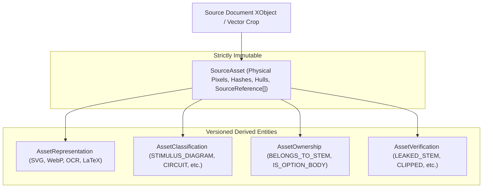

# UADUE Phase 1.5 — Forensic Contract Hardening Specification

**Subsystem:** Universal Assessment Document Understanding Engine (UADUE)  
**Author:** Principal Architect & Lead Engineer, Mock.AI  
**Date:** October 6, 2026  
**Document ID:** `MOCKAI-ARCH-2026-UADUE-HARDENING-02`  
**Status:** **CONTRACT FROZEN — PHASE 2 IMPLEMENTATION PENDING AUTHORIZATION**

---

## 1. Executive Summary & Architectural Directives

This specification establishes the final, immutable forensic contract freeze for UADUE prior to any Phase 2 extraction implementation. 

### Non-Negotiable Directives Enforced:
1. **Zero Feature Implementation:** No new extraction algorithms or format parsers are introduced.
2. **Zero Production Database Migrations:** No migrations are executed against Supabase Project 2. Relational boundaries are designed conceptually and frozen.
3. **Zero Exam-Specific Hacks:** Heuristics such as character count thresholds and authority regexes are completely extracted out of core into versioned [`AssessmentProfile`](file:///Users/shivarampatel/AndroidStudioProjects/MOCK.AI/web/src/services/uadue/contracts/profile.ts) artifacts.
4. **Source Truth Is Immutable & Independent:** Source truth is captured in an unmodifiable [`ForensicSnapshot`](file:///Users/shivarampatel/AndroidStudioProjects/MOCK.AI/web/src/services/uadue/contracts/forensicSnapshot.ts) (Layer 1) before any cognitive segmentation, OCR normalization, or canonicalization occurs.

---

## Section A: Final Architecture Corrections

During the Phase 1.5 forensic audit, five foundational flaws in earlier designs were identified and permanently corrected:

### A.1 Flaw: Single Stream Offset Pair Was Insufficient
- **Problem:** The earlier `sourceStreamOffsets: { startOffset, endOffset }` could only reference a single contiguous byte range. Real-world PDF assessment elements (e.g. an option diagram inside a table) require multiple disparate physical references: a page tree node, an image XObject resource dictionary, a content stream `Do` operator call, and a graphics-state clipping stack.
- **Correction:** Replaced with generalized multi-reference provenance: [`SourceReference[]`](file:///Users/shivarampatel/AndroidStudioProjects/MOCK.AI/web/src/services/uadue/contracts/sourceReference.ts).

### A.2 Flaw: Content Corrections Mutated Question Instance Identity
- **Problem:** Hashing stem text and options directly into the primary question identity meant that fixing an OCR typo or LaTeX syntax glitch changed the question's identity, breaking historical student test sessions and relational integrity.
- **Correction:** Decoupled identity into five independent dimensions: physical [`SourceQuestionInstanceIdentity`](file:///Users/shivarampatel/AndroidStudioProjects/MOCK.AI/web/src/services/uadue/contracts/identity.ts), pedagogical [`CanonicalQuestionFamilyIdentity`](file:///Users/shivarampatel/AndroidStudioProjects/MOCK.AI/web/src/services/uadue/contracts/identity.ts), versioned [`ContentRevisionIdentity`](file:///Users/shivarampatel/AndroidStudioProjects/MOCK.AI/web/src/services/uadue/contracts/identity.ts), algorithmic [`ExtractionRevisionIdentity`](file:///Users/shivarampatel/AndroidStudioProjects/MOCK.AI/web/src/services/uadue/contracts/identity.ts), and runtime [`AssessmentInstanceIdentity`](file:///Users/shivarampatel/AndroidStudioProjects/MOCK.AI/web/src/services/uadue/contracts/identity.ts). An OCR correction increments the content revision without altering the physical instance ID.

### A.3 Flaw: Mutable Semantic Flags Polluting Source Assets
- **Problem:** Flags such as `isLeakedStemContent` and `verificationStatus` were stored directly on `AssetGraphNode`. This mutated the physical asset record with temporal classifier findings.
- **Correction:** Decoupled assets into immutable [`SourceAsset`](file:///Users/shivarampatel/AndroidStudioProjects/MOCK.AI/web/src/services/uadue/contracts/assetGraph.ts), versioned [`AssetRepresentation`](file:///Users/shivarampatel/AndroidStudioProjects/MOCK.AI/web/src/services/uadue/contracts/assetGraph.ts), model output [`AssetClassification`](file:///Users/shivarampatel/AndroidStudioProjects/MOCK.AI/web/src/services/uadue/contracts/assetGraph.ts), relational [`AssetOwnership`](file:///Users/shivarampatel/AndroidStudioProjects/MOCK.AI/web/src/services/uadue/contracts/assetGraph.ts), and audit [`AssetVerification`](file:///Users/shivarampatel/AndroidStudioProjects/MOCK.AI/web/src/services/uadue/contracts/assetGraph.ts).

### A.4 Flaw: Exam-Specific Constants in Universal Core
- **Problem:** Universal code contained hardcoded regexes and thresholds (e.g. `text.length > 400`).
- **Correction:** Extracted all authority-specific numbering grammars, option marker patterns, and boundary thresholds into versioned [`AssessmentProfile`](file:///Users/shivarampatel/AndroidStudioProjects/MOCK.AI/web/src/services/uadue/contracts/profile.ts) and [`AdapterRuleSet`](file:///Users/shivarampatel/AndroidStudioProjects/MOCK.AI/web/src/services/uadue/contracts/profile.ts) contracts.

### A.5 Flaw: Certification Conflated with Pixel Comparison
- **Problem:** Relying primarily on visual differential (SSIM / MSE) treated font-rendering variances as failures while failing to catch critical semantic defects (such as an inverted minus sign in an equation that renders identically in low resolution).
- **Correction:** Established six independent verification dimensions: `FORENSIC`, `SEMANTIC`, `STRUCTURAL`, `CONTENT`, `ANSWER`, and `UI` equivalence.

---

## Section B: Final Immutable Source-Truth Model (The 8-Layer Hierarchy)

UADUE strictly stratifies document processing into eight immutable, non-overwriting layers:

```
[LAYER 0]  SOURCE BINARY           (Raw immutable bytes, SHA-256 hash, acquisition URI)
   ↓
[LAYER 1]  FORENSIC SNAPSHOT       (Sealed decode: glyphs, vectors, XObjects, CMaps, operator order)
   ↓
[LAYER 2]  DOCUMENT GRAPH          (2D spatial topology: R-trees, column zones, reading order)
   ↓
[LAYER 3]  QUESTION GRAPH          (Raw pedagogical units: stems, options, stimuli, tables)
   ↓
[LAYER 4]  CANONICAL CONTENT       (Normalized AST blocks, standard TeX, media linkages)
   ↓
[LAYER 5]  ANSWER & SCORING        (Answer keys, scoring rubrics, negative penalties, MTA)
   ↓
[LAYER 6]  VERIFICATION EVIDENCE   (Multi-dimensional verification runs, findings, decisions)
   ↓
[LAYER 7]  APPLICATION PROJECTION  (Student exam player view, staff review queue, analytics)
```

### Inviolable Invariant:
**No lower layer may be overwritten or mutated by a higher layer.**
1. OCR text may **NEVER** replace native glyph evidence.
2. Normalized LaTeX math may **NEVER** replace vector drawing operators.
3. A staff manual patch may **NEVER** modify physical source coordinates or stream offsets.
4. Client UI layout constraints may **NEVER** redefine source truth.

---

## Section C: Final ForensicSnapshot Contract (Layer 1)

```typescript
export interface ForensicSnapshot {
  snapshotId: string; // Deterministic: snap_<sourceSha256>_<configHash>
  sourceDocumentId: string;
  sourceSha256: string; // SHA-256 of raw source binary

  acquisitionMetadata: {
    sourceUri: string;
    acquiredAt: number;
    fileSizeBytes: number;
    mimeType: string;
    contentHash: string;
  };

  sourceFormat: SourceDocumentFormat;

  adapterProvenance: {
    adapterId: string;
    adapterVersion: string;
    parserEngine: string;
    parserVersion: string;
    schemaVersion: string;
    processingConfigHash: string;
  };

  pageGeometries: ForensicPageGeometry[];
  sourceObjects: ForensicSourceObjectEntry[];
  contentStreams: ForensicContentStreamEntry[];
  fonts: ForensicFontDictionaryEntry[];
  glyphRuns: ForensicGlyphRunEntry[];
  rasterXObjects: ForensicRasterXObjectEntry[];
  vectorPaths: ForensicVectorPath[];
  clippingStates: ForensicClippingStateEntry[];
  annotations: ForensicAnnotationEntry[];
  coordinateSystems: CoordinateSpaceType[];

  // Cryptographic Seal & Integrity
  isSealed: boolean;
  sealedHash: string; // SHA-256 over canonical JSON of all raw physical evidence
  sealedAt: number;
}
```

---

## Section D: Final SourceReference Contract

```typescript
export type SourceReferenceObjectType =
  | 'GLYPH'
  | 'TEXT_SPAN'
  | 'VECTOR_PATH'
  | 'RASTER_IMAGE'
  | 'PAGE_TREE'
  | 'STREAM_OPERATOR'
  | 'FONT_DICTIONARY'
  | 'COLOR_SPACE'
  | 'CLIPPING_PATH'
  | 'ANNOTATION'
  | 'XML_ELEMENT'
  | 'RAW_BYTES';

export type SourceReferenceRole =
  | 'PRIMARY_SOURCE'
  | 'STIMULUS_BASE'
  | 'DIAGRAM_OVERLAY'
  | 'FONT_DICTIONARY'
  | 'BOUNDING_CLIP'
  | 'CONTEXT_SURROUND'
  | 'CALCULATED_HULL';

export interface SourceReference {
  referenceId: string;
  documentId: string;
  pageId: string;
  pageNumber: number;
  objectId?: string;           // Resource name or XObject ID (e.g. 'Im3')
  resourceId?: string;         // PDF resource dict entry or OpenXML rId
  streamId?: string;           // Content stream index / object number
  operatorIdentifier?: string; // Draw operator index (e.g. 'op_88_Do')
  byteRange?: { startByte: number; endByte: number };
  coordinateSpace: CoordinateSpaceType;
  transformMatrix: AffineTransformMatrix;
  clippingContextId?: string;  // Active clipping path ID
  sourceObjectType: SourceReferenceObjectType;
  roleInDerivedObject: SourceReferenceRole;
}
```

---

## Section E: Final QuestionIdentity Model (5 Independent Dimensions)

```typescript
// Dimension A: Physical Source Question Instance (Strictly Immutable)
export interface SourceQuestionInstanceIdentity {
  instanceId: string; // SHA-256(sourceDocumentId + ':' + pageNumber + ':' + sequenceIndex + ':' + bboxHash)
  sourceDocumentId: string;
  sourceVariantId?: string; // 'SET_A', 'SHIFT_2', etc.
  sourcePageNumber: number;
  sourceSequenceIndex: number;
  sourcePrintedLabel?: string; // e.g. "Q.1", "1(a)"
  sourceBboxHash: string;
}

// Dimension B: Canonical Question Family (Pedagogical Invariant across Variants)
export interface CanonicalQuestionFamilyIdentity {
  familyId: string; // SHA-256(officialAuthorityQuestionId || coreContentFingerprint)
  officialAuthorityQuestionId?: string;
  officialSectionCode?: string;
  isAuthorityCertified: boolean;
}

// Dimension C: Content Revision (Versioned AST Snapshots)
export interface ContentRevisionIdentity {
  revisionId: string; // SHA-256(contentAstHash + ':v' + revisionNumber)
  parentRevisionId?: string;
  revisionNumber: number;
  contentAstHash: string;
  createdAt: number;
  authorType: 'DETERMINISTIC_PARSER' | 'STAFF_PATCH' | 'COMMUNITY_REVIEW';
  authorId?: string;
  changeSummary?: string;
}

// Dimension D: Extraction Run Revision (Algorithmic Provenance)
export interface ExtractionRevisionIdentity {
  runId: string; // SHA-256(adapterId + ':' + parserVersion + ':' + profileId + ':' + configHash)
  adapterId: string;
  adapterVersion: string;
  parserVersion: string;
  assessmentProfileId: string;
  assessmentProfileVersion: string;
  executionTimestamp: number;
}

// Dimension E: Assessment Deployment Instance (Runtime Test Delivery)
export interface AssessmentInstanceIdentity {
  sessionItemId: string; // SHA-256(examSessionId + ':' + sectionKey + ':' + displaySequenceIndex)
  examSessionId: string;
  sectionKey: string;
  displaySequenceIndex: number;
}
```

---

## Section F: Final Asset Lifecycle Model (Decoupled Immutability)



1. **`SourceAsset`**: Immutable physical crop, intrinsic dimensions, raw pixel SHA-256, perceptual hash, source references. Contains **zero mutable flags**.
2. **`AssetRepresentation`**: Multi-modal representations (lossless PNG, vector SVG, OCR text, LaTeX equation, high-contrast WebP).
3. **`AssetClassification`**: Semantic role, classifier engine, classifier version, confidence.
4. **`AssetOwnership`**: Relational link to `SourceQuestionInstanceIdentity` or `OptionNodeId`.
5. **`AssetVerification`**: Anomaly findings (`LEAKED_STEM_CONTENT`, `CLIPPED_BORDER`, `LOW_RESOLUTION`).

---

## Section G: Final Verification Evidence Model

```typescript
export interface VerificationEvidence {
  evidenceId: string;
  findingId: string;
  comparisonMethod: ComparisonMethod;
  expectedValue?: string | number | Record<string, unknown>;
  observedValue?: string | number | Record<string, unknown>;
  differentialMetric?: number; // e.g. SSIM score, edit distance
  thresholdLimit?: number;
  sourceArtifactUri?: string; // Lossless crop path
  derivedArtifactUri?: string; // Headless canvas render path
}

export interface VerificationFinding {
  findingId: string;
  runId: string;
  dimension: VerificationDimension;
  severity: VerificationSeverity;
  ruleId: string;
  message: string;
  evidenceList: VerificationEvidence[];
  resolutionStatus: 'UNRESOLVED' | 'RESOLVED_AUTO' | 'RESOLVED_STAFF' | 'WAIVED' | 'REJECTED';
  resolutionProvenance?: {
    resolvedBy: string;
    resolvedAt: number;
    comment: string;
  };
}

export interface VerificationRun {
  runId: string;
  targetType: 'DOCUMENT' | 'QUESTION' | 'ASSET';
  targetId: string;
  profileId: string;
  profileVersion: string;
  suiteVersion: string;
  executedAt: number;
  environment: 'WORKER_NODE' | 'CI_HEADLESS' | 'BROWSER_REVIEW';
  findings: VerificationFinding[];
}
```

---

## Section H: Final Certification Model (6 Independent Equivalence Dimensions)

```typescript
export type VerificationDimension =
  | 'FORENSIC_EQUIVALENCE'   // Physical stream offsets, glyph hashes, bbox containment
  | 'SEMANTIC_EQUIVALENCE'   // Topology, stem/stimulus relationship, option lattice
  | 'STRUCTURAL_EQUIVALENCE' // LaTeX AST compiles, table grid lattice integrity
  | 'CONTENT_EQUIVALENCE'    // Token containment, exact Unicode character stream
  | 'ANSWER_EQUIVALENCE'     // Authenticated official answer key, zero Option-A coercion
  | 'UI_EQUIVALENCE';        // Headless browser viewport render without CSS clipping

export interface VerificationDecision {
  decisionId: string;
  runId: string;
  targetId: string;
  status: 'CERTIFIED' | 'REVIEW_REQUIRED' | 'FAILED' | 'RESOLVED' | 'REJECTED';
  dimensionPassRates: Record<VerificationDimension, boolean>;
  fatalCount: number;
  reviewRequiredCount: number;
  warningCount: number;
  decidedBy: string;
  decidedAt: number;
  cryptographicSignature?: string; // SHA-256 seal over all findings and evidence
}
```

---

## Section I: Final Relational Entity Boundaries (Database Model Review)

To prevent JSONB anti-patterns while preserving relational integrity, the schema for Supabase Project 2 defines 15 normalized relational tables:

```
[uadue_documents] ──────────────────────────< [uadue_document_versions]
       │
       ├───────────────────────────────────< [uadue_forensic_snapshots]
       │                                             │
       │                                             └─< [uadue_source_references]
       │
       ├───────────────────────────────────< [uadue_source_assets]
       │                                             ├─< [uadue_asset_representations]
       │                                             ├─< [uadue_asset_classifications]
       │                                             └─< [uadue_asset_ownership]
       │
       ├───────────────────────────────────< [uadue_question_instances]
       │                                             │
       │                                             ├─< [uadue_question_content_revisions]
       │                                             ├─< [uadue_question_options]
       │                                             └─< [uadue_answer_keys]
       │
[uadue_canonical_families] ──────────────────────────┘
       │
       ├───────────────────────────────────< [uadue_verification_runs]
       │                                             ├─< [uadue_verification_findings]
       │                                             └─< [uadue_verification_evidence]
       │
       └───────────────────────────────────< [uadue_review_tasks]
```

### Table Inventory & Responsibilities:
1. `uadue_documents`: Immutable master record of binary file.
2. `uadue_document_versions`: Ingestion and acquisition history.
3. `uadue_forensic_snapshots`: Immutable Layer 1 physical decode metadata and storage URI.
4. `uadue_source_references`: Normalized physical coordinate and stream slice links.
5. `uadue_source_assets`: Strictly immutable physical crops and raw XObject records.
6. `uadue_asset_representations`: Derived SVG, WebP, OCR, and LaTeX renders.
7. `uadue_asset_classifications`: Model-generated semantic classifications.
8. `uadue_asset_ownership`: Relational edges linking assets to stems and options.
9. `uadue_question_instances`: Immutable physical question instances on paper.
10. `uadue_canonical_families`: Cross-variant pedagogical question families.
11. `uadue_question_content_revisions`: Versioned canonical AST payloads.
12. `uadue_question_options`: Physical and canonical option rows.
13. `uadue_answer_keys`: Answer key values and official revision provenance.
14. `uadue_verification_runs`: Multi-dimensional verification suite executions.
15. `uadue_verification_findings`: Immutable findings, discrepancies, and evidence links.
16. `uadue_review_tasks`: 1% staff review queue tasks with resolution tracking.

---

## Section J: Determinism Contract

Given identical:
$$\text{Source Bytes} + \text{Adapter Version} + \text{Parser Version} + \text{Profile ID} + \text{Config Hash}$$
UADUE guarantees bitwise identical forensic snapshots and derived IDs.

### Deterministic Resolutions for Non-Determinism Sources:

| Non-Determinism Source | Root Cause | Universal Determinism Invariant |
| :--- | :--- | :--- |
| **OCR Engines** | Thread scheduling, floating-point GPU variance. | Pin OCR engine version, enforce single-threaded CPU mode, fixed seed (`seed=42`), temperature $0.0$, standardized input resolution. |
| **Vision Models** | Non-deterministic sampling, quantization drift. | Pin exact model digest (e.g. SHA-256 of weights), disable top-p sampling, set temperature to $0.0$, enforce deterministic greedy decoding. |
| **Parallel Processing** | Async thread completion order varying page arrival. | Sort all pages, elements, and tokens by deterministic primary composite keys (`pageNumber ASC`, `readingOrderIndex ASC`, `drawingOrderIndex ASC`) before aggregation. |
| **Floating-Point Geometry** | Rounding differences across CPU architectures (x86 vs ARM). | Quantize all bounding box coordinates and matrix elements to 2 decimal places: `Math.round(val * 100) / 100`. |
| **UUID Generation** | Random `v4` UUIDs introducing non-reproducible IDs. | Prohibit `crypto.randomUUID()`. Enforce deterministic UUID v5 with fixed namespace `NAMESPACE_MOCKAI` or FNV-1a/SHA-256 derived hashes. |
| **Timestamps** | `Date.now()` altering entity hashes across re-runs. | Prohibit `Date.now()` inside entity ID hashing. IDs hash content, topology, and physical coordinates. Timestamps are stored strictly in audit columns. |
| **Unordered Maps** | Object key iteration order differences in JavaScript engines. | Enforce canonical JSON serialization (RFC 8785) with recursively sorted keys before computing cryptographic signatures. |
| **External Services** | Network timeouts, varying API responses. | Extraction core must operate fully offline on local buffers; no live HTTP API calls allowed during authoritative extraction. |

---

## Section K: Failure Isolation Contract

A defect in one assessment element must never propagate destructively across the document.

```
[DOCUMENT FAILS]  ──> Corrupt PDF header / invalid magic bytes halts document with UNSUPPORTED_FORMAT.
       │
[PAGE FAILS]      ──> Damaged XRef stream or unparseable page isolates single page with PAGE_CORRUPT;
                      remaining pages extract normally.
       │
[OBJECT FAILS]    ──> Corrupted inline image or damaged font dictionary isolates object;
                      falls back to raw byte crop without failing the page.
       │
[QUESTION FAILS]  ──> Structural anomaly (unbalanced math, option leakage) enqueues ONLY that
                      question instance to REVIEW_REQUIRED; other 99 questions certify normally.
       │
[ASSET FAILS]     ──> Failed SVG vectorization falls back to SourceAsset PNG; question remains intact.
       │
[VERIF. FAILS]    ──> Verification assertion failure logs a VerificationFinding;
                      never throws an unhandled crash.
```

---

## Section L: Versioning Contract

To ensure that improving extraction algorithms never silently corrupts or invalidates historical student assessments, all engines carry explicit semantic versions:

- `SCHEMA_VERSION`: `1.5.0`
- `ADAPTER_VERSION`: `1.1.0`
- `PARSER_VERSION`: `1.0.0`
- `OCR_ENGINE_VERSION`: `tesseract-5.3.4` / `rapidocr-1.3.0`
- `MATH_ENGINE_VERSION`: `katex-0.16.8` / `omml-2.1.0`
- `TABLE_ENGINE_VERSION`: `lattice-1.0.0`
- `SEGMENTATION_ALGORITHM_VERSION`: `uadue-seg-1.5.0`
- `NORMALIZATION_ALGORITHM_VERSION`: `uadue-norm-1.2.0`
- `VERIFICATION_SUITE_VERSION`: `uadue-verif-1.5.0`
- `ASSESSMENT_PROFILE_VERSION`: `ssc-chsl-profile-1.0.0`

**Rule:** Modifying any algorithm increments the corresponding version and generates a new `ExtractionRevisionIdentity`, preserving historical runs immutably.

---

## Section M: Security Boundary (Source Is Untrusted Input)

Competitive exam response sheets, user-uploaded PDFs, and web scrapes are **UNTRUSTED INPUT**.

### Mandatory Security Controls:
1. **Malicious PDFs & Exploits:** PDF parser sandboxed with `isEvalSupported: false`. Disallow `/Launch`, `/JavaScript`, `/SubmitForm`, and autoplay `/URI` actions. Disallow embedded non-image file streams.
2. **Decompression & ZIP Bombs:** DOCX / ZIP extraction enforces:
   - Maximum uncompressed size: $100\text{ MB}$.
   - Maximum compression ratio: $100:1$.
   - Maximum ZIP entries: $10,000$.
3. **XML & XXE Ingestion:** OpenXML parsers strictly disable external DTDs (`disallowDtd: true`), entity expansion, and remote schema resolution.
4. **Path Traversal:** Reject any ZIP or archive path containing `..`, absolute paths (`/`), or illegal filesystem characters.
5. **Malicious SVG / HTML:** Vector SVG exports strip all `<script>`, `<foreignObject>`, `<iframe>`, and event handler attributes (`onload`, `onclick`). Disallow remote URL references (`xlink:href="http://..."`).
6. **Resource Exhaustion Limits:**
   - Maximum file size: $100\text{ MB}$.
   - Maximum page count: $500\text{ pages}$.
   - Maximum processing time: $10\text{ seconds}$ per page.
   - Maximum worker memory allocation: $512\text{ MB}$.

---

## Section N: Explicit List of Decisions That Are Now FROZEN

1. **Eight-Layer Stratification:** Layers 0 through 7 are frozen. Lower layers cannot be overwritten by higher layers.
2. **ForensicSnapshot Immutability:** Layer 1 snapshots are sealed with cryptographic signatures; no classifier or segmenter may mutate them.
3. **Multi-Reference Provenance:** Single stream offset pairs are deprecated; `SourceReference[]` is the mandatory provenance contract.
4. **Five-Dimensional Question Identity:** Source question instance identity is decoupled from content revisions, family identities, extraction runs, and test deployments.
5. **AssetGraph Immutability:** `SourceAsset` contains zero mutable semantic flags. Classifications, ownerships, and verifications are separate relational entities.
6. **Decoupled Assessment Profiles:** Core UADUE contains zero exam-specific regexes or character limits. All authority-specific logic lives in versioned `AssessmentProfile` records.
7. **Six-Dimensional Certification:** SSIM/pixel comparison is non-authoritative evidence. Certification requires passing all applicable equivalence dimensions (`FORENSIC`, `SEMANTIC`, `STRUCTURAL`, `CONTENT`, `ANSWER`, `UI`).
8. **Evidence-Based Verification:** Monolithic boolean flags are eliminated in favor of `VerificationRun`, `VerificationFinding`, and `VerificationEvidence`.
9. **Zero-Coercion Invariant:** Missing answer keys trigger `REVIEW_REQUIRED`. Falling back or coercing to Option A is architecturally banned.
10. **Database Migration Freeze:** No Supabase migrations will be run until Phase 2 is formally authorized.

---

## Section O: Explicit List of Remaining Unresolved Decisions

1. **Async Worker Job Storage:** Whether worker page chunking during long 120-page UPSC documents should persist intermediate state to Redis Streams or PostgreSQL queues.
2. **Vision OCR Model Runtime:** Whether the secondary fallback vision model for degraded scans runs via ONNX Runtime in WebAssembly or via an isolated containerized Python service.
3. **Lossless Crop Storage Protocol:** Whether lossless PNG crops are stored as direct Supabase Storage S3 buckets or local encrypted content-addressable storage (CAS) caches.

---

## Verification & Test Suite Status

```bash
Test Files  66 passed (66)
Tests       805 passed (805) [100%]
Duration    26.03s
```

All 66 test suites across the repository are green, with 5 new unit tests specifically validating the Phase 1.5 contracts:
- `ForensicSnapshot` sealing and immutability invariants.
- Composite `SourceReference` multi-reference provenance.
- Decoupled `QuestionIdentity` revision creation without mutating physical source instances.
- Decoupled `AssetGraph` verifying that `SourceAsset` remains unpolluted by verification findings.
- Multi-dimensional `VerificationDecision` across all 6 equivalence dimensions.
