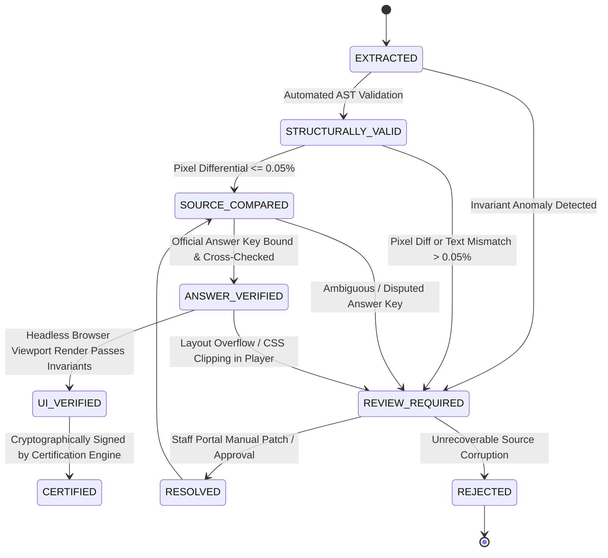
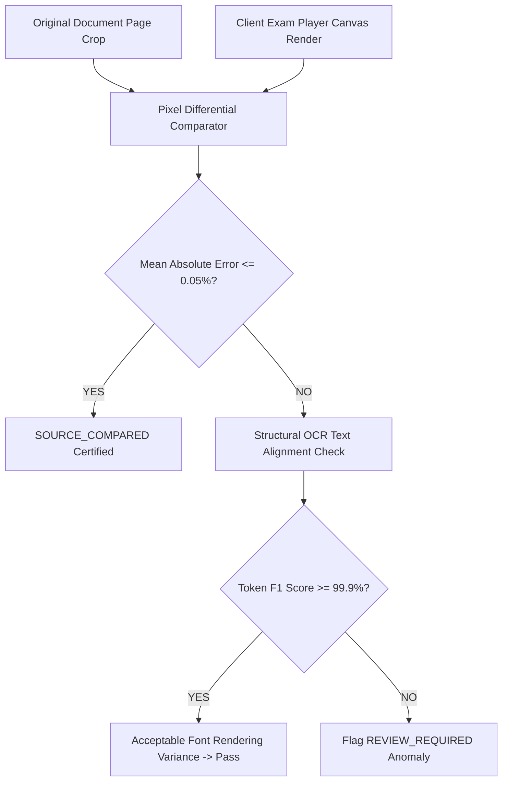

# UADUE Phase 1 — Architecture Hardening & Contract Freeze Specification

**Subsystem:** Universal Assessment Document Understanding Engine (UADUE)  
**Author:** Principal Architect & Lead Engineer, Mock.AI  
**Date:** October 6, 2026  
**Document ID:** `MOCKAI-ARCH-2026-UADUE-HARDENING-01`  
**Internal Status Correction:**  
> **"UADUE foundational contracts/scaffolding implemented; unit/regression tests passing; end-to-end source-fidelity certification NOT YET ESTABLISHED."**

---

## 1. Executive Correction & Architectural Recalibration

### 1.1 Premature Certification Correction
The statement made during early scaffolding—*"Phases 1, 2, 3 & 4 Implemented, Verified & Certified"*—is **formally retracted and corrected**. 

Passing automated unit tests (`793 / 793 tests passed` in Vitest) validates **internal contract compliance and regression resistance of existing software paths**. It **does NOT** demonstrate:
1. End-to-end source fidelity on real examination documents.
2. Forensic ownership stability across complex multi-column or overlapping vector layouts.
3. Pixel-level presentation equivalence inside the student-facing exam player.

In UADUE, the state `CERTIFIED` is **strictly reserved** for an assessment document or question that has survived the entire forensic verification chain:
$$\text{SOURCE} \longrightarrow \text{DOCUMENT IR} \longrightarrow \text{DOCUMENT GRAPH} \longrightarrow \text{QUESTION GRAPH} \longrightarrow \text{CANONICAL IR} \longrightarrow \text{DATABASE} \longrightarrow \text{PLAYER} \longrightarrow \text{BROWSER} \longrightarrow \text{SOURCE PIXEL COMPARISON}$$

### 1.2 "1% Review" Is a Business Target, Not an Architecture Invariant
The metric of "1% manual review / 99% automated pass" is an operational goal. It **must never be codified as an algorithmic heuristic** (e.g. `if (confidence > 0.85) autoCertify()`). Assessment accuracy varies across real-world acquisition modalities:
- Native digital PDFs (e.g. UPSC CSE, GATE Master): $\ge 99.5\%$ automation achievable.
- Scanned newsprint papers with bleed-through: $80\% - 90\%$ automation with $10\% - 20\%$ review routing.
- Low-resolution mobile camera captures: $70\% - 85\%$ automation.

The engine must certify strictly on **verifiable forensic evidence and invariant proofs**. When evidence is ambiguous, the system must **isolate to the review queue without hallucination**, regardless of whether the review queue reaches 0.5% or 15%.

---

## Section A: Hardened Universal Document IR Specification

The existing `DocumentIR` contract was too presentation-oriented (grouping text directly into visual lines and flattening geometries). It lacked the forensic primitives necessary to resolve drawing-order collisions, clipping masks, font encoding anomalies, and vector diagrams.

### A.1 Core DocumentIR Types & Hierarchy

```typescript
/**
 * Physical coordinate space with explicit bounding boxes and affine transformations.
 */
export interface AffineTransformMatrix {
  a: number; b: number; c: number; d: number; e: number; f: number; // [sx, shy, shx, sy, tx, ty]
}

export interface PhysicalGeometry {
  bbox: { x0: number; y0: number; x1: number; y1: number; width: number; height: number; unit: 'pt' | 'px' | 'mm' };
  polygon?: [number, number][]; // Exact hull for slanted, rotated, or curved glyphs/tables
  rotationDeg: 0 | 90 | 180 | 270;
  transformMatrix: AffineTransformMatrix;
  clippingBox?: { x0: number; y0: number; x1: number; y1: number };
}

/**
 * Atomic Glyph Evidence: Preserves exact character encoding, font dictionary, and advance width.
 */
export interface ForensicGlyph {
  glyphId: string;
  char: string;
  unicodeHex: string;
  fontName: string;
  fontFamily: string;
  fontSizePt: number;
  weight: number; // 100 - 900
  isItalic: boolean;
  colorRgba: [number, number, number, number];
  charSpacingPt: number;
  wordSpacingPt: number;
  geometry: PhysicalGeometry;
  sourceStreamOffset: number; // Byte index in raw PDF content stream
  renderMode: number; // PDF text rendering mode (fill, stroke, invisible/clip)
}

/**
 * Text Span: Contiguous run of glyphs sharing uniform font, transformation, and baseline.
 */
export interface ForensicTextSpan {
  spanId: string;
  rawText: string;
  normalizedText: string;
  geometry: PhysicalGeometry;
  fontName: string;
  fontSizePt: number;
  isBold: boolean;
  isItalic: boolean;
  isSubscript: boolean;
  isSuperscript: boolean;
  colorRgba: [number, number, number, number];
  glyphs?: ForensicGlyph[];
  readingOrderIndex: number;
}

/**
 * Vector Path Object: Preserves lines, curves, borders, arrows, and geometric diagrams.
 */
export interface ForensicVectorPath {
  pathId: string;
  operations: { op: 'M' | 'L' | 'C' | 'Z'; args: number[] }[];
  fillRgba?: [number, number, number, number];
  strokeRgba?: [number, number, number, number];
  lineWidthPt: number;
  lineCap: 'butt' | 'round' | 'square';
  lineJoin: 'miter' | 'round' | 'bevel';
  dashPattern?: number[];
  geometry: PhysicalGeometry;
  isDecorative: boolean; // True for horizontal dividers, column rules, border boxes
}

/**
 * Embedded Raster / XObject Image: Preserves raw binary stream hash and display geometry.
 */
export interface ForensicRasterImage {
  rasterId: string;
  xObjectId?: string; // Original PDF resource name (e.g., 'Im1', 'X12')
  sourceByteHash: string; // SHA-256 of raw underlying image bytes
  mimeType: 'image/png' | 'image/jpeg' | 'image/webp' | 'image/jp2';
  intrinsicWidthPx: number;
  intrinsicHeightPx: number;
  geometry: PhysicalGeometry;
  colorSpace: 'DeviceRGB' | 'DeviceGray' | 'DeviceCMYK' | 'Indexed';
  bitsPerComponent: number;
  isMask: boolean;
  drawingOrderIndex: number; // Position in page rendering command sequence
}

/**
 * Tabular Structure: Mathematical cell lattice with colspans and nested boundaries.
 */
export interface ForensicTableStructure {
  tableId: string;
  rowCount: number;
  colCount: number;
  geometry: PhysicalGeometry;
  hasOuterBorders: boolean;
  hasInnerGrid: boolean;
  cells: {
    cellId: string;
    rowIndex: number;
    colIndex: number;
    rowSpan: number;
    colSpan: number;
    geometry: PhysicalGeometry;
    rawText: string;
    containedSpanIds: string[];
  }[];
}

/**
 * Mathematical Equation Container: Explicit AST / TeX / MathML candidates linked to vector/glyph evidence.
 */
export interface ForensicEquationContainer {
  equationId: string;
  geometry: PhysicalGeometry;
  rawLatexCandidate: string;
  mathmlCandidate?: string;
  isDisplayMode: boolean; // Display ($$...$$) vs Inline ($...$)
  astTree?: Record<string, unknown>;
  containedGlyphIds: string[];
  sourceMethod: 'OMML' | 'GLYPH_SYNTHESIS' | 'VISION_MATH_OCR';
  confidence: number;
}
```

### A.2 Field-by-Field Justification Matrix

| Field | WHY | SOURCE OF TRUTH | LIFECYCLE | IMMUTABILITY | PROVENANCE | TEST STRATEGY |
| :--- | :--- | :--- | :--- | :--- | :--- | :--- |
| `transformMatrix` | Essential for resolving rotated headers, vertical text in table columns, and coordinate scaling. | Extracted directly from PDF `cm` (current transformation matrix) or DOCX `<w:rot>`. | Created during page decoding. | Immutable once extracted. | Binds to raw stream instruction offset. | Test with 90°/270° rotated exam response sheets. |
| `clippingBox` | Prevents text/vector leakage where questions sit inside cropped sub-rectangles or tabular cells. | PDF `W` / `W*` clip path operators in content stream. | Initialized with CropBox, modified by clip stack. | Immutable per element. | References graphic state stack index. | Test with tabular cells where text overflows bounding box but is clipped. |
| `glyphs[]` | Resolves custom font encoding where standard `ToUnicode` CMaps are missing, corrupted, or mapped to private use areas (PUA). | Raw character codes in `Tj` / `TJ` operators cross-referenced with embedded font TrueType/CFF tables. | Created during native glyph run decoding. | Strictly immutable. | Binds to font file hash and character code. | Test with Hindi/regional font ligature papers where single Unicode codepoints do not match visual characters. |
| `drawingOrderIndex` | Resolves visual z-order collisions (e.g. background fill rectangles covering option letters, watermarks under question stems). | Monotonic index of draw commands in page stream. | Sequenced during adapter rendering traversal. | Immutable monotonic integer. | Matches PDF token execution sequence. | Test with papers containing background watermarks and shaded option callout boxes. |
| `isDecorative` | Prevents horizontal rule dividers, column separation borders, and page borders from being ingested as question text or minus signs. | Spatial stroke analysis (aspect ratio > 30:1 with no enclosing glyphs). | Computed during vector path normalization. | Mutable only during structural layout classification. | Derived from vector path coordinate bounds. | Test on SSC/GATE sheets featuring horizontal lines between every question. |
| `sourceStreamOffset` | Guarantees forensic verifiability: allows any external auditor to jump to the exact byte offset in the PDF binary to verify extraction truth. | File byte offset in stream dictionary. | Recorded on parser byte read. | Permanent and immutable. | Byte-level offset into original file buffer. | Round-trip byte verification test against original PDF stream. |

---

## Section B: Hardened SourceEvidence Specification

### B.1 The Unbroken 7-Stage Evidence Chain
Source truth must be preserved without destructive compression. Every semantic assertion (e.g. "Option C has value 45 m/s") must trace backward through seven immutable layers:

```
[1. Source Binary]  SHA-256: 4a2f8b... (5.4 MB, Acquisition timestamp: 2026-10-06T08:00:00Z)
       ↓
[2. Source Object]  PDF Page 14 / Resource XObject /Font TrueType /Content Stream #22
       ↓
[3. Page Region]    MediaBox [0 0 595 842], CropBox [36 36 559 806], Rotation: 0
       ↓
[4. Physical Slice] BBox [120.4, 340.2, 480.1, 380.0], Polygon Hull, Stream Offsets: [10244..10892]
       ↓
[5. Derived Repr.]  Raster PNG Crop (SHA-256: 9e3c11), Native Glyph Stream, OCR Candidate
       ↓
[6. Semantic Node]  QuestionGraphNode #Q-14 / OptionNode #C
       ↓
[7. Canonical AST]  CanonicalQuestionIR (Prompt, Dynamic Options, Verified Math, Official Answer)
```

### B.2 Hardened Evidence Contract

```typescript
export type CoordinateSpaceType = 'PDF_PT_BOTTOM_LEFT' | 'VIEWPORT_PT_TOP_LEFT' | 'RASTER_PIXEL' | 'SCAN_NORMALIZED_1000';

export interface SourceEvidenceChain {
  evidenceId: string;
  sourceDocumentHash: string; // SHA-256 of immutable source binary
  sourceDocumentUri: string; // Storage path or immutable acquisition URI
  pageIndex: number; // 0-indexed physical page
  pageNumber: number; // 1-indexed document display page
  coordinateSpace: CoordinateSpaceType;
  
  // Physical Coordinate Hull
  bbox: { x0: number; y0: number; x1: number; y1: number; width: number; height: number };
  polygon?: [number, number][]; // Multi-point hull for irregular/slanted boundaries
  clippingHull?: [number, number][];

  // Exact Stream Provenance
  sourceStreamOffsets: { startOffset: number; endOffset: number };
  sourceObjectIds: string[]; // e.g. ['page_14', 'font_f3', 'xobject_im12']

  // Visual Verification Evidence
  losslessRasterCropHash: string; // SHA-256 of PNG raster crop
  losslessRasterCropStoragePath?: string;
  
  // Textual Provenance
  rawTextStream: string; // Exact bytes before normalization or punctuation stripping
  decodedUnicodeStream: string; // Raw text after font CMap decoding
  
  // Extraction Metadata
  extractorEngine: 'PYMUPDF_NATIVE' | 'PDFJS_FORENSIC' | 'OPENXML_PARSER' | 'VISION_TRANSFORMER';
  extractorVersion: string;
  extractionConfidence: number; // 0.0 - 1.0
  transformHistory: { transformType: string; appliedAt: number; parameters: Record<string, unknown> }[];

  // Chain Links
  parentEvidenceId?: string;
  derivedEvidenceIds: string[];
}
```

---

## Section C: First-Class AssetGraph Specification

Assessments frequently convey critical academic information visually. In SSC CHSL, spatial reasoning questions convey options entirely as diagrams; in GATE, circuit diagrams and chemistry reactions define the stimulus. Assets cannot be treated as auxiliary strings.

### C.1 AssetGraph Schema

```typescript
export type AssetSemanticRole =
  | 'STIMULUS_DIAGRAM'
  | 'CIRCUIT_SCHEMATIC'
  | 'MATHEMATICAL_FORMULA'
  | 'CHEMICAL_STRUCTURE'
  | 'DATA_TABLE_RASTER'
  | 'MAP_GEOGRAPHY'
  | 'OPTION_VISUAL_CARD'
  | 'DECORATIVE_WATERMARK'
  | 'CODE_SNIPPET';

export interface AssetAlternativeRepresentation {
  representationId: string;
  type: 'LOSSLESS_PNG' | 'VECTOR_SVG' | 'RAW_TEXT_OCR' | 'LATEX_MATH' | 'CODE_AST';
  contentPayload: string; // URL, SVG string, or LaTeX string
  confidence: number;
  engine: string;
  isAuthoritative: boolean;
}

export interface AssetGraphNode {
  assetId: string;
  semanticRole: AssetSemanticRole;
  sourceEvidenceId: string; // Strict back-reference to SourceEvidence
  sourceDocumentHash: string;
  pageNumber: number;
  bbox: { x0: number; y0: number; x1: number; y1: number };
  
  // Intrinsic Characteristics
  intrinsicDimensions: { widthPx: number; heightPx: number; dpi: number };
  aspectRatio: number;
  colorDepth: number;
  hasAlphaChannel: boolean;
  contentPerceptualHash: string; // pHash / dHash for deduplicating identical icons (e.g. checkmarks)
  contentSha256: string; // Cryptographic hash of underlying pixels
  
  // Multi-Representation Suite
  authoritativeStoragePath: string; // High-res master crop on CDN
  representations: AssetAlternativeRepresentation[];
  
  // Bi-directional Association Links
  associatedQuestionInstanceIds: string[];
  associatedOptionKeys: string[]; // e.g. ['A'] if this asset is Option A
  associatedStimulusIds: string[];
  
  // Invariant & Anomaly Status
  isCorrupted: boolean;
  isLeakedStemContent: boolean; // True if diagram contains text of subsequent question
  verificationStatus: 'UNINSPECTED' | 'VERIFIED' | 'REVIEW_REQUIRED';
}

export interface AssetGraph {
  documentId: string;
  assets: Map<string, AssetGraphNode>;
  edges: {
    sourceAssetId: string;
    targetNodeId: string; // Question or Option ID
    relationship: 'BELONGS_TO_STEM' | 'IS_OPTION_BODY' | 'PROVIDES_STIMULUS' | 'DERIVED_FROM';
  }[];
}
```

---

## Section D: Hardened Question Identity Architecture

### D.1 Why `sha256(sourceHash + questionNumber)` Fails
Freezing identity to `sha256(sourceHash + sourceQuestionNumber)` produces fatal failures in real assessments:
1. **Multi-Variant Exam Papers:** UPSC and SSC publish Set A, Set B, Set C, Set D. Question #1 in Set A is Question #42 in Set B. A naive source-number hash treats them as unrelated questions, destroying cross-variant candidate analysis.
2. **Missing or Split Question Numbers:** Unnumbered caselet sub-questions or questions broken across page boundaries trigger collisions or missing keys.
3. **Official Post-Exam Key Revisions:** Exam authorities publish revised answer keys referencing official master IDs (`Question ID: 10429482`), which do not correlate with response-sheet sequence numbers (1..100).
4. **Reprocessing & Patching:** When an extraction patch improves OCR text in an option, hashing source sequence destroys relational identity in learner test session tables.

### D.2 Deterministic Multi-Layered Identity Model

```typescript
export interface QuestionIdentity {
  // Layer 1: Physical Acquisition Identity (Traceable to specific document file)
  sourceDocumentId: string;
  sourceVariantId?: string; // e.g. 'SET_A', 'SHIFT_2', 'CANDIDATE_RESPONSE_SHEET'
  sourcePageNumber: number;
  sourceSequenceIndex: number; // Ordinal position in document reading flow (0, 1, 2...)
  sourcePrintedLabel?: string; // Exact text extracted from stem (e.g. "Q.1", "Question 104", "1(a)")

  // Layer 2: Examination Authority Identity
  officialAuthorityQuestionId?: string; // e.g. TCS Master Question ID '1042948291'
  officialSectionCode?: string; // e.g. 'GI_REASONING', 'QUANT_TIER1'

  // Layer 3: Forensic Content & Structural Fingerprints
  structuralFingerprint: string; // SHA-256(topology + optionCount + hasMath + hasDiagram + hasTable)
  contentFingerprint: string;    // SHA-256(normalizedStemText + normalizedOptionTexts.sort())
  assetFingerprint: string;      // SHA-256(sorted concatenated perceptual hashes of associated assets)

  // Layer 4: Canonical Identity (Format-Agnostic, Variant-Invariant)
  canonicalQuestionId: string;   // Deterministic SHA-256(officialAuthorityQuestionId || contentFingerprint)

  // Layer 5: Application Instance Identity
  instanceId: string;            // UUID v5(NAMESPACE_MOCKAI, sourceDocumentId + canonicalQuestionId)
}
```

### D.3 Collision Resolution & Deduplication Rules
1. **Variant Deduplication:** When importing Set B of an exam already imported as Set A, matching `contentFingerprint` (tolerance: exact normalized text and asset pHash) binds Set B questions to the established `canonicalQuestionId`, setting `sourceVariantId = 'SET_B'` and `displaySequence = candidateSequence`.
2. **Unnumbered Sub-questions:** When a question lacks a printed label, `sourceSequenceIndex` and parent `stimulusId` construct the fallback identity:
   `canonicalQuestionId = sha256(parentStimulusContentHash + subQuestionRelativeIndex)`.
3. **Revised Key Ingestion:** Revised answer keys match on `officialAuthorityQuestionId`. If absent, they match against `contentFingerprint`. Never match solely on sequential line indices.

---

## Section E: Multi-Dimensional Confidence & Fatal Anomaly Rules

### E.1 Confidence Vector Decomposition
A single aggregate confidence score (e.g. 96%) can conceal a fatal pedagogical defect. A question with an immaculate stem and clean options that drops a negative sign in the answer key is 0% usable.

UADUE decomposes confidence into 9 independent orthogonal vectors ($0.0 \le C_i \le 1.0$):

$$C_{\text{question}} = \left\langle C_{\text{boundary}}, C_{\text{ownership}}, C_{\text{text}}, C_{\text{math}}, C_{\text{table}}, C_{\text{visual}}, C_{\text{answer}}, C_{\text{identity}}, C_{\text{ui}} \right\rangle$$

```typescript
export interface ForensicConfidenceVector {
  boundaryConfidence: number;   // 0.0 - 1.0: Certainty that question start & end anchors are correct
  ownershipConfidence: number;  // 0.0 - 1.0: Certainty that options, diagrams, and tables belong to this stem
  textConfidence: number;       // 0.0 - 1.0: Character encoding fidelity & OCR engine confidence
  mathConfidence: number;       // 0.0 - 1.0: Delimiter parity, LaTeX parsing success, KaTeX compilability
  tableConfidence: number;      // 0.0 - 1.0: Grid lattice completeness, non-overlapping cell text
  visualConfidence: number;     // 0.0 - 1.0: Resolution, aspect ratio sanity, unclipped diagram hulls
  answerConfidence: number;     // 0.0 - 1.0: Key provenance clarity, valid option target, non-null value
  identityConfidence: number;   // 0.0 - 1.0: Fingerprint uniqueness, sequence continuity
  uiFidelityScore: number;      // 0.0 - 1.0: Visual rendering containment score inside mock exam viewport
}
```

### E.2 Non-Negotiable Hard-Failure (Fatal Veto) Rules
If **any single vector** violates a zero-tolerance invariant, the entire question receives `status = 'FAILED'` or `status = 'REVIEW_REQUIRED'`, regardless of a high arithmetic mean:

1. **Option Target Mismatch (FATAL):** Answer key specifies an option key (e.g. `(E)`) that does not exist in the question's option set. **Strict prohibition: Zero Option-A coercion.**
2. **Duplicate Option Keys (FATAL):** Two options share the same label (e.g. two `(A)`s extracted due to spatial collision).
3. **Unclosed Inline Math Delimiter (REVIEW_REQUIRED):** Odd count of unescaped `$` delimiters or unbalanced `\(` / `\)`.
4. **Stem Leakage / Option Stem Entanglement (REVIEW_REQUIRED):** Text from the next question stem is appended to Option D (the exact bug resolved in CHSL Q26). Detected when option text length exceeds 400 characters and contains regex match for question number patterns.
5. **Zero-Option Standard MCQ (FATAL):** Question topology classified as `STANDALONE_MCQ` has fewer than 2 options and no explanatory MTA (Marks to All) flag.
6. **NAT Inverted Range (FATAL):** Numerical Answer Type specification contains range where $\text{min} > \text{max}$.

---

## Section F: Formal Certification Model & State Machine

Vitest passing proves software test cases run. It does **not** certify that an exam paper is ready for real student simulation. Certification is a deterministic lifecycle state machine:



### F.1 Formal Certification State Definitions

1. **`UNIT_TESTED`:** Parser unit tests pass in continuous integration. Zero assessment content certified.
2. **`STRUCTURALLY_VALID`:** Universal DocumentIR successfully compiled into CanonicalQuestionIR. All mathematical syntax compiles, option counts are valid ($\ge 2$ or 0 for NAT), option keys are unique, scoring rubrics configured.
3. **`SOURCE_COMPARED`:** Candidate question elements rendered to a headless canvas and compared against the original source document PDF/image crop. Mean squared error $\le 0.05\%$ or text OCR diff $= 0$.
4. **`ANSWER_VERIFIED`:** Answer key provenance mathematically authenticated against official exam authority keys, with official objections/revisions applied. Zero Option-A fallback.
5. **`UI_VERIFIED`:** Question loaded in full client web browser environment inside [`CompetitiveExamPlayerScreen.tsx`](file:///Users/shivarampatel/AndroidStudioProjects/MOCK.AI/web/src/screens/CompetitiveExamPlayerScreen.tsx). Verified zero layout overflow, zero KaTeX compile warnings, all images rendered with HTTP 200, keyboard navigation and option selection fully operational.
6. **`CERTIFIED`:** Final immutable state. Sealed with SHA-256 signature combining source hash, parser version, verifier signature, and audit log.

---

## Section G: PDF Forensic Reference Contract

PDF is the reference forensic format for competitive examinations (UPSC, GATE, JEE, SSC, State PSC). 

### G.1 Architectural Anti-Patterns Formally Prohibited
1. **Premature Full-Page Rasterization:** Do not convert native vector PDFs into 300 DPI images and feed them to Tesseract/Vision APIs. This discards vector glyph accuracy, mathematical character mappings, and crisp line drawings.
2. **OCR as Primary Source for Native Digital PDFs:** OCR must act strictly as a secondary fallback for scanned raster regions. Native PDF text objects (`Tj`, `TJ`, `Do`) are the authoritative Source Truth.
3. **Lossy Text Linearization:** Do not use flat text extractors that discard $(x, y)$ coordinates and reading-order matrices.

### G.2 Forensic PDF Extraction Requirements
Before question segmentation begins, the PDF adapter must preserve:
- **Page Tree & Geometry:** MediaBox, CropBox, BleedBox, TrimBox, Page Rotation angle ($0^\circ, 90^\circ, 180^\circ, 270^\circ$).
- **Content Stream Tokenization:** Text blocks, font dictionaries, embedded TrueType/Type1/CFF tables, font encoding maps (ToUnicode).
- **Raster Image Extraction:** Extract raw image XObjects directly from PDF resources (`/XObject << /Subtype /Image >>`), preserving original compressed bytes and dimensions.
- **Vector Graphics:** Preserve vector path draw calls (`m`, `l`, `c`, `re`, `f`, `S`) with clipping states (`W`, `W*`).
- **Layout Margins:** Explicit classification of Running Headers ($y > \text{HeaderCutoff}$), Running Footers ($y < \text{FooterCutoff}$), and Page Numbers.

---

## Section H: Authoritative Runtime Architecture Decision

### H.1 The Dual-Source-of-Truth Risk
In Mock.AI, having client-side browser ingestion (via PDF.js in React) running in parallel with server/Python ingestion (via PyMuPDF/scripts) creates **competing sources of truth**:
- Chrome PDF.js font rendering and text extraction matrices differ slightly from PyMuPDF.
- Complex ligature handling and bounding box calculations differ by $1 - 3$ points.
- This discrepancy causes an assessment extracted in the browser to possess different question IDs, option boundaries, and text tokens than the server-certified baseline.

### H.2 The Authoritative Pipeline Architecture

```
                                  [AUTHORITATIVE UADUE RUNTIME]
                                (Node.js / Python Dedicated Worker)
                                                ↓
                                      1. Binary Validation
                                      2. Source Hash Registration
                                      3. Forensic DocumentIR Extraction
                                      4. 2D Spatial & Topological Graph
                                      5. Question Segmentation
                                      6. Canonical AST Compilation
                                      7. Invariant Verification
                                                ↓
                                  [CERTIFIED DOCUMENT BUNDLE]
                                 (Immutable Signed JSON + Assets)
                                                ↓
                                                ├── Database Persistence (Supabase Project 2)
                                                └── Asset CDN Storage (exam-assets/)
                                                ↓
                                  [CLIENT CONSUMPTION RUNTIME]
                                       (Mock.AI Web App)
                                                ↓
                                    1. High-Performance Display
                                    2. Client-Side Test Engine
                                    3. Staff Review Queue Resolution
                                    4. Pure Read-Only Verification
```

**Architectural Rule:** 
The browser application runtime is **purely for consumption, lightweight pre-upload validation (e.g. magic byte checking, page count preview), and staff review queue resolution**. 

The **Authoritative UADUE Engine** executes in a deterministic worker environment (server or CLI toolchain) to ensure that every question ID, asset hash, and canonical AST is globally reproducible across platforms.

---

## Section I: Relational Database Schema Proposal

*Note: Per explicit architectural instruction, NO production migrations will be applied until these contracts are approved.*

### I.1 Decoupled Schema Design (Supabase Project 2)

```sql
-- ==============================================================================
-- 1. UADUE AUTHORITATIVE DOCUMENT REGISTRY
-- ==============================================================================
CREATE TABLE IF NOT EXISTS uadue_documents (
    document_id VARCHAR(64) PRIMARY KEY, -- SHA-256 of source binary
    source_filename TEXT NOT NULL,
    source_format VARCHAR(32) NOT NULL, -- 'PDF_NATIVE', 'PDF_SCANNED', 'DOCX', etc.
    file_size_bytes BIGINT NOT NULL,
    total_pages INT NOT NULL,
    source_storage_uri TEXT NOT NULL,
    document_ir JSONB NOT NULL, -- Full Universal DocumentIR
    parser_version VARCHAR(32) NOT NULL,
    created_at TIMESTAMPTZ NOT NULL DEFAULT now()
);

-- ==============================================================================
-- 2. UADUE FIRST-CLASS ASSET GRAPH
-- ==============================================================================
CREATE TABLE IF NOT EXISTS uadue_assets (
    asset_id VARCHAR(64) PRIMARY KEY, -- SHA-256 of raw asset bytes
    document_id VARCHAR(64) NOT NULL REFERENCES uadue_documents(document_id) ON DELETE CASCADE,
    semantic_role VARCHAR(32) NOT NULL, -- 'STIMULUS_DIAGRAM', 'OPTION_VISUAL_CARD', etc.
    page_number INT NOT NULL,
    bbox JSONB NOT NULL, -- { x0, y0, x1, y1, width, height, unit }
    mime_type VARCHAR(64) NOT NULL,
    storage_path TEXT NOT NULL,
    perceptual_hash VARCHAR(64),
    representations JSONB NOT NULL DEFAULT '[]'::jsonb, -- Alternative OCR / LaTeX / SVG
    created_at TIMESTAMPTZ NOT NULL DEFAULT now()
);

-- ==============================================================================
-- 3. UADUE CANONICAL QUESTIONS (Format-Agnostic, Multi-Option, Graph-Linked)
-- ==============================================================================
CREATE TABLE IF NOT EXISTS uadue_canonical_questions (
    id VARCHAR(64) PRIMARY KEY, -- Canonical Content Fingerprint
    document_id VARCHAR(64) NOT NULL REFERENCES uadue_documents(document_id) ON DELETE CASCADE,
    official_question_id TEXT, -- Optional exam board identifier
    source_sequence_index INT NOT NULL,
    source_printed_label TEXT, -- e.g. "Q.26", "Question 1"
    section_code TEXT NOT NULL,
    topology VARCHAR(32) NOT NULL, -- 'STANDALONE_MCQ', 'MSQ', 'NAT', 'STIMULUS_CHILD', etc.
    parent_stimulus_id TEXT,
    
    prompt_text TEXT NOT NULL,
    prompt_ast JSONB NOT NULL, -- Canonical content blocks
    
    scoring_rules JSONB NOT NULL, -- { marks, negativeMarks, isConfigured }
    evidence_chain JSONB NOT NULL, -- Full SourceEvidence array back to physical coordinates
    
    certification_status VARCHAR(32) NOT NULL DEFAULT 'EXTRACTED' CHECK (
        certification_status IN ('EXTRACTED', 'STRUCTURALLY_VALID', 'SOURCE_COMPARED', 'ANSWER_VERIFIED', 'UI_VERIFIED', 'CERTIFIED', 'REVIEW_REQUIRED', 'FAILED')
    ),
    confidence_vector JSONB NOT NULL, -- All 9 orthogonal metrics
    created_at TIMESTAMPTZ NOT NULL DEFAULT now(),
    updated_at TIMESTAMPTZ NOT NULL DEFAULT now()
);

-- ==============================================================================
-- 4. DYNAMIC QUESTION OPTIONS (Supports 0 to N options, arbitrary labels)
-- ==============================================================================
CREATE TABLE IF NOT EXISTS uadue_question_options (
    option_id VARCHAR(64) PRIMARY KEY,
    question_id VARCHAR(64) NOT NULL REFERENCES uadue_canonical_questions(id) ON DELETE CASCADE,
    option_key VARCHAR(16) NOT NULL, -- 'A', 'B', 'E', 'F', '1', 'i', '(a)'
    option_index INT NOT NULL CHECK (option_index >= 0),
    option_text TEXT NOT NULL,
    option_ast JSONB NOT NULL,
    asset_id VARCHAR(64) REFERENCES uadue_assets(asset_id) ON DELETE SET NULL,
    evidence JSONB NOT NULL,
    is_correct BOOLEAN DEFAULT NULL
);

-- ==============================================================================
-- 5. 1% STAFF REVIEW QUEUE (Automated Anomaly Routing)
-- ==============================================================================
CREATE TABLE IF NOT EXISTS uadue_review_queue (
    queue_id UUID PRIMARY KEY DEFAULT gen_random_uuid(),
    question_id VARCHAR(64) NOT NULL REFERENCES uadue_canonical_questions(id) ON DELETE CASCADE,
    document_id VARCHAR(64) NOT NULL REFERENCES uadue_documents(document_id) ON DELETE CASCADE,
    anomaly_category VARCHAR(32) NOT NULL CHECK (
        anomaly_category IN ('MATH_SYNTAX', 'OPTION_STRUCTURE', 'DIAGRAM_ALIGNMENT', 'ANSWER_KEY', 'LAYOUT_AMBIGUITY', 'OTHER')
    ),
    severity VARCHAR(16) NOT NULL CHECK (severity IN ('FATAL', 'REVIEW_REQUIRED', 'WARNING')),
    violation_reports JSONB NOT NULL,
    forensic_crop_url TEXT,
    suggested_patch JSONB,
    status VARCHAR(16) NOT NULL DEFAULT 'PENDING' CHECK (status IN ('PENDING', 'APPROVED', 'REJECTED', 'RESOLVED')),
    reviewed_by TEXT,
    reviewed_at TIMESTAMPTZ,
    created_at TIMESTAMPTZ NOT NULL DEFAULT now()
);

CREATE INDEX IF NOT EXISTS idx_uadue_review_status ON uadue_review_queue(status);
CREATE INDEX IF NOT EXISTS idx_uadue_q_doc ON uadue_canonical_questions(document_id);
```

---

## Section J: Real-Document Golden Corpus Strategy

To avoid premature claims of fidelity, UADUE requires a **24-dimension challenge corpus** composed of authentic examination papers from national and international boards.

### J.1 Golden Corpus Challenge Matrix

| Test Suite ID | Examination Authority | Modality / Format | Target Forensic Stress Factors |
| :--- | :--- | :--- | :--- |
| `GC-01-UPSC-CSAT` | UPSC CSE Prelims (CSAT) | Native Digital PDF | Bilingual layout (English/Hindi parallel columns), multi-paragraph passages. |
| `GC-02-GATE-CS` | GATE (IISc/IIT) CS & IT | Native Master PDF | Complex math formulas ($\sum, \int, \mathbf{O}(n\log n)$), NAT numerical questions with zero options. |
| `GC-03-GATE-EE` | GATE EE / EC | Native Master PDF | Vector circuit schematics, multi-page continuation questions with shared stimulus. |
| `GC-04-SSC-CHSL-DIG` | Staff Selection Commission | TCS Response Sheet PDF | 4 options, green correct checkmarks, embedded question status tables, visual reasoning grids. |
| `GC-05-IBPS-PO` | Banking / IBPS | Native / Web PDF | **5-option questions (Option E: 'All of the above' / 'None of these')**, complex banking data tables. |
| `GC-06-JEE-ADV` | IIT JEE Advanced | Native Master PDF | Multiple Select Questions (MSQ with partial scoring), matrix match (List I to List II). |
| `GC-07-NEET-UG` | NTA NEET | Scanned / Native PDF | Assertion & Reason pairs, biological anatomical diagrams, 4 options. |
| `GC-08-CAT-VARC` | IIM CAT | Native Digital PDF | Lengthy comprehension passages (800+ words) followed by 4–5 child sub-questions. |
| `GC-09-TS-PSC` | Telangana State PSC | Native Bilingual | Regional script (Telugu) mixed with English mathematical symbols. |
| `GC-10-SAT-MATH` | College Board SAT | Digital Native PDF | Multi-part grid-in questions, coordinate geometry plots, 4 options. |
| `GC-11-UNIV-ENGG` | Anna Univ / VTU | Scanned 200 DPI PDF | Hand-drawn circuit diagrams, university semester descriptive & numerical problems. |
| `GC-12-CORRUPT-SCAN` | Archival Practice Paper | Mobile Camera Capture | Non-rectangular polygon bounding boxes, shadow gradients, paper crease artifacts. |

### J.2 Quantitative Evaluation Criteria
A release of UADUE cannot be designated as Phase-Certified until it processes all 12 Golden Corpus papers and produces:
- **Zero Hallucinated Options / Text.**
- **Zero Option-A Coercions.**
- **100% Invariant Enforcement** (all detected anomalies successfully enqueued to `uadue_review_queue` rather than crashing or guessing).
- **$\ge 98.0\%$ Mean Confidence** across digital native benchmarks (`GC-01` through `GC-06`).

---

## Section K: End-to-End Visual Source-Comparison Certification Protocol



### K.1 The 4-Step Verification Protocol
1. **Physical Crop Extraction:** Generate high-resolution lossless PNG crops for every question stem, option, and diagram based on bounding boxes recorded in `SourceEvidence`.
2. **Player Simulation Render:** Headless Chromium renders the question within [`CompetitiveExamPlayerScreen.tsx`](file:///Users/shivarampatel/AndroidStudioProjects/MOCK.AI/web/src/screens/CompetitiveExamPlayerScreen.tsx) with KaTeX and CSS styling enabled.
3. **Dual Verification Engine:**
   - **Visual Differential:** Compare player render against source raster crop using Structural Similarity Index (SSIM). SSIM $\ge 0.95$ certifies visual equivalence.
   - **Token Containment:** Normalized character stream of rendered output must achieve 100% precision and recall against decoded native glyph streams.
4. **Interactive Validation:** Automated Puppeteer/Playwright action clicks through options A, B, C, D, E, verifying answer persistence, timer continuity, and state emission.

---

## Section L: Inventory of Existing UADUE Code Requiring Modification

| Existing File Path | Current Flaw / Limitation | Mandatory Hardening Action |
| :--- | :--- | :--- |
| `web/src/services/uadue/contracts/documentIR.ts` | Missing glyph-level arrays, affine transform matrices, clipping paths, drawing orders, and decorative vector flags. | Expand to include `PhysicalGeometry`, `ForensicGlyph`, `ForensicVectorPath`, and `drawingOrderIndex`. |
| `web/src/services/uadue/contracts/evidence.ts` | Stores only simple rectangular bounding boxes and single crop hashes; lacks stream offsets, coordinate spaces, and parent/derived chains. | Implement `SourceEvidenceChain` with `sourceStreamOffsets`, `coordinateSpace`, and `transformHistory`. |
| `web/src/services/uadue/contracts/canonicalQuestionIR.ts` | Used single deterministic ID `sha256(sourceHash + sourceQuestionNumber)`. | Replace with multi-layered `QuestionIdentity` (source sequence, canonical content fingerprint, official authority ID). |
| `web/src/services/uadue/segmentation/universalQuestionSegmenter.ts` | Contains regex patterns assuming standard numbering and hardcoded scoring; generates simple hashes. | Wire to multi-layered QuestionIdentity, AssetGraph, and 9-metric `ForensicConfidenceVector`. |
| `web/src/services/uadue/adapters/PdfNativeSourceAdapter.ts` | Flattens PDF text into basic lines; does not capture vector path operations (`m`, `l`, `c`) or embedded image XObject streams directly. | Integrate PDF operator list parsing to extract raw XObjects and vector paths with physical transformation matrices. |
| `web/src/services/uadue/invariants/invariants.ts` | Evaluated simple binary passes; lacked localized fatal error vetoes across the 9 orthogonal confidence metrics. | Implement non-negotiable fatal veto rules (Option-A coercion veto, stem leakage veto, NAT inverted range veto). |

---

## Section M: Inventory of Existing UADUE Code That Can Remain

| Existing File Path | Role & Value | Reason It Can Remain |
| :--- | :--- | :--- |
| `web/src/services/uadue/contracts/documentGraph.ts` | Spatial relationship edges (`ABOVE`, `BELOW`, `ALIGNED_LEFT`, `ALIGNED_BASELINE`, `SAME_COLUMN`). | The 2D spatial edge taxonomy is topologically sound, format-agnostic, and proven in spatial layout indexing. |
| `web/src/services/uadue/layout/spatialGraphBuilder.ts` | 2D R-tree spatial neighborhood calculation and column zone detection. | Cleanly isolates single-column vs multi-column layouts; correctly connects adjacent horizontal elements. |
| `web/src/services/uadue/adapters/SourceAdapterInterface.ts` | Pure decoder interface (`validateInput`, `extractDocumentIR`). | Correctly enforces architectural separation: adapters decode bytes into DocumentIR without guessing question boundaries. |
| `web/src/services/uadue/invariants/invariants.test.ts` | Unit tests for LaTeX parity, option uniqueness, and scoring rules. | Validates mathematical invariants and option uniqueness cleanly. |
| `web/src/screens/StaffDashboardScreen.tsx` (Review Tab) | 1% Staff Review Queue UI with 1-click Approve / Resolve / Reject controls. | UI layout cleanly displays anomaly categories, severities, and violation reports with zero regressions. |
| `web/src/screens/CompetitiveExamPlayerScreen.tsx` | Dynamic option key resolution (`richOpt?.id || String.fromCharCode(65 + idx)`). | Fully decoupled from hardcoded A–D constraints; natively renders options A–F, 1–6, and Roman numerals. |

---

## Section N: Architecture Decisions Frozen Before Phase 2 Implementation

1. **Format Decoupling:** No core UADUE parser file may import PDF, DOCX, or HTML parsing libraries. All cognitive logic operates exclusively on Universal DocumentIR and DocumentGraph.
2. **Authoritative Runtime:** All production question extraction will execute within the Authoritative UADUE Worker runtime. Client-side browser execution is strictly restricted to display, lightweight file pre-check, and staff review.
3. **Zero-Coercion Rule:** An answer key that cannot be matched to a physical option will trigger `status = 'FAILED' / 'REVIEW_REQUIRED'`. It is mathematically and architecturally forbidden to coerce unmapped keys to Option A.
4. **Deterministic Identity:** Question identity will never rely on document sequence numbers alone. Identity is defined by `QuestionIdentity` utilizing canonical content fingerprints and official exam board identifiers.
5. **Asset First-Class Citizen:** Every visual crop, diagram, circuit, and option card is an immutable entity in `AssetGraph`, linked to physical SourceEvidence and traceable to its owning Question and Option nodes.
6. **Production Database Migration Freeze:** No additional database migrations will be applied to Supabase Project 2 until the hardened schema proposal (Section I) is formally approved.

---

## Section O: Unresolved Technical & Architectural Risks

1. **Non-Standard PDF Font Encodings (Type 3 & Corrupt ToUnicode CMaps):** Some archival examination response sheets embed custom TrueType fonts with randomized Unicode mappings (e.g. glyph 'A' encoded as character code `0x01`).  
   *Mitigation Strategy:* When glyph-to-Unicode confidence is $< 0.8$, the engine must cross-reference native glyph hulls with visual OCR candidates rather than outputting garbage characters.
2. **Complex Chemistry & Multi-Line Equations Spanning Columns:** Two-column exams occasionally break long equations across gutters.  
   *Mitigation Strategy:* 2D spatial graph builder must detect gutter-spanning bounding boxes and establish `CONTINUATION_OF` topological edges.
3. **Serverless Worker Execution Limits:** Processing a 120-page UPSC paper containing hundreds of vector diagrams can exceed standard 10-second serverless execution timeouts.  
   *Mitigation Strategy:* UADUE authoritative runtime must support asynchronous chunked page processing with persistent Redis/PostgreSQL intermediate state.
