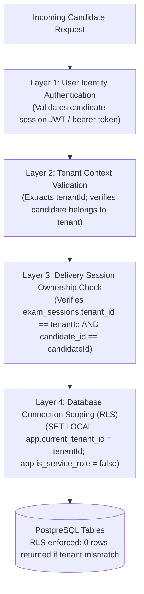
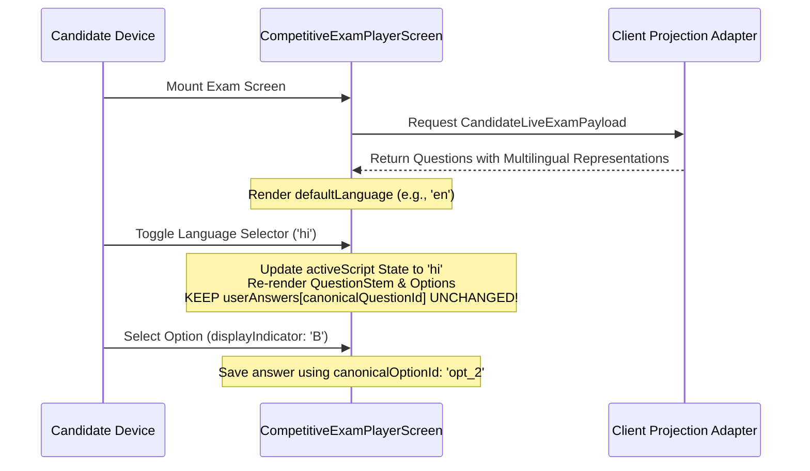

# UADUE Phase 3.6 — Client Projection Adapter Specification
**Document ID:** `UADUE-P3-ADAPT-011`  
**Version:** `1.2.0-CONSISTENCY-ALIGNED`  
**Status:** `DESIGN-ONLY / IMPLEMENTATION STRICTLY LOCKED`  
**Classification:** Client Presentation Gateway & Information Barrier Adapter  
**Authoritative Upstream References:**
- `docs/phase3/PHASE_3_PROJECTION_CONTRACT.md` (UADUE-P3-PROJ-006)
- `docs/phase3/PHASE_3_MULTI_TENANCY_MODEL.md` (UADUE-P3-TEN-010)
- `docs/phase3/PHASE_3_SUBMISSION_CONTRACT.md` (UADUE-P3-SUB-007)
- `docs/phase3/PHASE_3_SCORING_BOUNDARY.md` (UADUE-P3-SCORE-008)
- `docs/phase3/PHASE_3_FORMAL_INVARIANTS.md` (UADUE-P3-INV-005)
- `docs/uadue/assessment_policy/AP_DEC_013_AUTOMATED_POLICY_INGESTION.md` (FROZEN)

---

## 1. Executive Summary & Core Principle

This specification defines a **contract-preserving, air-gapped integration boundary** between the Phase 3.6 Canonical Projection Gateway (`CanonicalProjectionGateway`) and the candidate-facing React student player (`CompetitiveExamPlayerScreen`).

### 1.1 The Integration Problem
The Phase 3.6 Integration-Readiness Assessment determined a **RED** gate. The existing repository contains two completely disconnected pipelines:
1. **Server Core Pipeline (Phase 2D-8 & Phase 3):** Emits rich, multi-tier, content-addressed, air-gapped canonical structures (`StudentLivePackageProjection`, `CanonicalASTNode`, `CanonicalRepresentation`).
2. **React Student Player (`CompetitiveExamPlayerScreen`):** Expects flat legacy presentation models (`ExamPresentationPaper`, `CompetitiveQuestion`, `ContentBlock`), client-side in-memory answer stripping, and array-index option tracking.

Directly passing canonical projections to the current React player fails due to:
- Absence of HTTP/RPC delivery endpoints.
- Schema and naming impedance mismatches between `CanonicalASTNode` and `ContentBlock`.
- Omission of delivery session metadata (exam duration, sections, marking scheme).
- Critical security defect in `CanonicalProjectionGateway`: omission of tenant context causing PostgreSQL Row-Level Security (RLS) bypass via service-role fallback.
- Prohibited internal pipeline metadata (`logicalFamilyId`) leaked into candidate payloads in violation of existing contracts.

### 1.2 Core Architectural Principle (P3-I11)
**The adapter is strictly an untrusted transformation and serialization boundary.**
- It does **not** grant or hold policy authority.
- It does **not** alter canonical source truth.
- It does **not** invent or extrapolate missing facts.
- It strictly enforces the four-tier information barrier: under no circumstances do answer keys, scoring formulas, or internal relationship DAGs reach the candidate runtime.

---

## 2. Requirement Classification & Authoritative Traceability

To ensure that proposed designs are never silently promoted into approved policy, every requirement in this specification is formally classified under the following taxonomy:

- **Category A:** Required by an existing authoritative contract.
- **Category B:** Direct mathematical or logical consequence of an existing contract.
- **Category C:** Proposed implementation design choice (subject to architectural review).
- **Category D:** Unresolved Product Owner or governance decision (cannot be assumed approved).
- **Category E:** Unsupported or contradictory assumption (rejected).

### 2.1 Formal Requirement Classification Matrix

| Requirement / Boundary | Classification | Authoritative Source / Evidence | Technical Rationale & Scope |
|---|:---:|---|---|
| **1. Information Barrier (Stripping Answers & Solutions)** | **Category A** | `PHASE_3_PROJECTION_CONTRACT.md#L81-L86` | Candidate runtime must receive zero answer keys, solution ranges, or pedagogical explanations. |
| **2. Removal of `logicalFamilyId` from Tier 3** | **Category A** | `PHASE_3_PROJECTION_CONTRACT.md#L71` (`logicalQuestionFamilyId: DENY`) | Field is already formally prohibited. Its presence in `canonicalProjectionGateway.ts#L38` is a confirmed defect, not an open debate. |
| **3. Absolute Tenant Isolation & RLS Enforcement** | **Category A** | `PHASE_3_MULTI_TENANCY_MODEL.md#L11-L15` (P3-I09)<br/>`20261007_uadue_phase2d8_canonical.sql:251-265` | Every database query must execute within an authenticated, validated tenant context. |
| **4. Elimination of Service-Role Fallback on Projection Endpoints** | **Category B** | Direct consequence of P3-I09 and RLS architecture | Candidate-facing endpoints must never set `app.is_service_role = 'true'`. Missing tenant must fail closed. |
| **5. Option Identity Invariance across Multilingual Views** | **Category A** | `PHASE_3_PROJECTION_CONTRACT.md#L144-L145` | Options in dual-medium papers share identical `canonicalOptionId`s regardless of displayed language script. |
| **6. Preservation of `canonicalOptionId` in Submissions** | **Category B** | `PHASE_3_SUBMISSION_CONTRACT.md#L114-L115` | Submissions must transmit stable option UUIDs, eliminating ambiguities caused by presentation-layer shuffling. |
| **7. Absolute Prohibition of Client-Side Scoring** | **Category A** | `PHASE_3_PROJECTION_CONTRACT.md#L150` (P3-PR01) | Browser application must never execute JavaScript scoring or normalization algorithms. |
| **8. Raw-Score-Only Phase 3.5 Evaluation** | **Category A** | `PHASE_3_SCORING_BOUNDARY.md#L18-L22`<br/>`scoringEvaluationCore.ts:84-189` | Server evaluates total score strictly as $\sum \text{awardedMarks}$, with `totalNormalizedScore = null`. |
| **9. Ephemeral Session-Bound Asset Signing Protocol** | **Category A** | `PHASE_3_PROJECTION_CONTRACT.md#L153` (P3-PR03) | Assets must be accessed via signed, short-lived URLs bound to active session and tenant. |
| **10. Active-Exam Asset Expiration at Session Deadline** | **Category A** | `PHASE_3_PROJECTION_CONTRACT.md#L49,L153` | Asset access for live candidate player strictly bound to active examination session (`expiresAt = session.deadlineAt`). |
| **11. Transport Grace Extension for Assets (+15s)** | **Category C / D** | Proposed design choice (Unresolved Governance) | Extending asset viewing past `deadlineAt` is **not** authorized by the submission receipt grace contract. Flagged as proposed design choice pending governance approval. |
| **12. Decoupled Tier 4 Post-Exam Asset Retention** | **Category A** | `PHASE_3_PROJECTION_CONTRACT.md#L55` | Pedagogical review assets require `sessionState in ['SUBMITTED', 'EXPIRED']` and `packageResultReleased == TRUE`; completely distinct from Tier 3 tokens. |
| **13. AST-to-ContentBlock Translation Engine** | **Category C** | Proposed implementation bridge | Translates server `CanonicalASTNode` into React `ContentBlock` while preserving formula/table structures. |
| **14. Authoritative Provenance for Exam Metadata (`totalMarks`, `sections`)** | **Category B** | Direct consequence of AP-DEC-005 & P3-I11 | `totalMarks` and `sections` must originate from publication manifest; never inferred via `sum(positiveMarks)`. |
| **15. Authentic Option Label Preservation vs Presentation Fallback** | **Category A & C** | `contracts/canonicalQuestionIR.ts:16`<br/>`canonical/types.ts:312` | Authentic `sourceLabel` preserved (Cat A). Presentation indicators for unlabeled options are explicitly decoupled presentation artifacts (Cat C). |
| **16. Dual Quarantine Enforcement (Package vs Attempt)** | **Category A** | `canonicalLifecycleEngine.ts:120-125`<br/>`CANONICAL_ASSESSMENT_POLICY_CONFLICT_MODEL.md` | Distinguishes immutable package validation quarantine from attempt-level conflict quarantine. |

---

## 3. Security, Multi-Tenancy & Error-Response Architecture

### 3.1 Trace of the Verified RLS Bypass Defect
Direct inspection of the repository confirmed the mechanism of the Row-Level Security bypass:

```
[1] Incoming Projection Request
       │
       ▼
[2] CanonicalProjectionGateway.getTier3StudentLiveProjection(packageId)
       │ (Method does NOT accept or forward tenantId)
       ▼
[3] CanonicalPostgresPersistenceAdapter.reconstructPackage(packageId, tenantId = undefined)
       │ (Line 697: executes fallback branch because tenantId is falsy)
       ▼
[4] CanonicalPostgresPersistenceAdapter.setSessionContext(client, null, isServiceRole = true)
       │ (Line 1015: SELECT set_config('app.is_service_role', 'true', false))
       ▼
[5] PostgreSQL RLS Policy Evaluation (supabase/migrations/20261007_uadue_phase2d8_canonical.sql:256)
       │
       ├─► FUNCTION uadue_is_service_role() returns TRUE
       └─► Policy: "uadue_is_service_role() OR EXISTS (... tenant check ...)"
           Evaluates to TRUE unconditionally.
       │
       ▼
[6] Bypassed Table Scan
       Returns package and questions across ANY tenant, defeating multi-tenant isolation.
```

### 3.2 Four-Layer Authorization Model for Future Implementation
To achieve genuine tenant isolation, future implementations must enforce four decoupled authorization boundaries:



1. **Layer 1 — Authenticated User Identity:** Verifies candidate credentials (`candidateId`, JWT).
2. **Layer 2 — Authorized Tenant Context:** Extracts `tenantId` from verified claims; asserts non-empty string.
3. **Layer 3 — Session Ownership Gate:** Verifies that `examSessionId` is owned by `(tenantId, candidateId)`.
4. **Layer 4 — Database-Level RLS Scoping:** Connection checks out with `SET LOCAL ROLE uadue_app_user`, sets `app.is_service_role = 'false'`, and sets `app.current_tenant_id = tenantId`.

### 3.3 Mandatory Invariants for Tenant Scoping
- **Invariant P3-I09A (Fail-Closed Context):** Under no circumstances may candidate projection endpoints execute with `app.is_service_role = 'true'`. If `tenantId` is absent, invalid, or mismatched, the query must fail closed immediately with a Uniform 404 (`RESOURCE_NOT_FOUND`).
- **Invariant P3-I09B (Zero Platform Namespace):** No fallback to a "global" or "system" tenant namespace is permitted for tenant-private packages.

### 3.4 Disentangling Package-Level vs Attempt-Level Quarantine
The adapter must strictly separate and enforce two distinct quarantine mechanisms:
1. **Package-Level Quarantine (Phase 2D-8 / `canonicalLifecycleEngine.ts`):**  
   If `packageLifecycleState === 'QUARANTINED'` (due to invariant validation failure under Option A), the package is physically invalid and sealed against publication. The adapter must reject requests for quarantined packages with `PACKAGE_QUARANTINED` (Uniform 404 to candidate).
2. **Attempt-Level Quarantine (AP-DEC-009 / `CANONICAL_ASSESSMENT_POLICY_CONFLICT_MODEL.md`):**  
   If an individual candidate attempt is flagged (`isQuarantined == true`) due to policy version conflicts, dual active policies, or integrity anomalies, the attempt is quarantined in the delivery ledger. The candidate projection must fail closed.
3. **No Overrides:** The adapter holds zero authority to release or bypass either package or attempt quarantines.

### 3.5 Deterministic Error-Response Taxonomy & Uniform 404 Consistency
To prevent attackers or compromised devices from probing whether a resource exists, whether a session is valid, or whether an attempt is quarantined, error responses across all gateway and adapter boundaries are strictly classified:

| Failure Scenario | Exact Trigger Condition | HTTP Status | Error Code | Authoritative Contract Reference | Information Leakage Defense |
|---|---|:---:|---|---|---|
| **Missing or Invalid Tenant Context** | Request lacks valid tenant JWT claim | **404** | `E_RESOURCE_NOT_FOUND` | `PHASE_3_MULTI_TENANCY_MODEL.md#L66-L69` | Uniform 404: Does not reveal endpoint or resource structure. |
| **Cross-Tenant Resource Access** | Query resource belonging to Tenant B with Tenant A context | **404** | `E_RESOURCE_NOT_FOUND` | `PHASE_3_FORMAL_INVARIANTS.md#L78` | RLS yields 0 rows; uniform 404 prevents tenant resource enumeration. |
| **Missing or Unauthorized Asset** | Asset hash does not exist in tenant's storage namespace | **404** | `E_ASSET_NOT_FOUND` | `PHASE_3_MULTI_TENANCY_MODEL.md#L53` | Uniform 404: Does not confirm whether asset exists in another tenant. |
| **Invalid / Tampered Asset HMAC Token** | Signature does not match computed HMAC over canonical string | **401** | `E_TOKEN_INVALID` | `PHASE_3_ADVERSARIAL_SCENARIOS.md#L324` | Fails at token authentication boundary prior to storage lookup. |
| **Expired Asset Token** | Token timestamp `expiresAt` is in the past ($T > T_{\text{exp}}$) | **401** | `E_TOKEN_EXPIRED` | `PHASE_3_ADVERSARIAL_SCENARIOS.md#L324` | Token validation failure; evaluated before storage access. |
| **Session Expired (Active Projection Query)** | Session in state `EXPIRED` queries Tier 3 Live projection | **403** | `E_SESSION_EXPIRED` | `PHASE_3_ADVERSARIAL_SCENARIOS.md#L76`<br/>`sessionOrchestrator.ts:73-77` | Authenticated session is in valid tenant, but session lifecycle is terminated. |
| **Session Terminated (Proctor Intervention)** | Session in state `TERMINATED` queries projection | **403** | `E_SESSION_TERMINATED` | `sessionOrchestrator.ts:80-85` | Proctor intervention explicitly communicated to candidate. |
| **Package-Level Validation Quarantine** | Underlying package has state `QUARANTINED` | **404** | `E_PACKAGE_NOT_FOUND` | `canonicalLifecycleEngine.ts:120-125` | Unreleased package is non-existent to candidate runtime. |
| **Attempt-Level Conflict Quarantine** | Candidate attempt has `isQuarantined == true` | **404** *(Proposed)*<br/>*vs 403 (Unresolved)* | `E_ATTEMPT_UNAVAILABLE` | `CANONICAL_ASSESSMENT_POLICY_CONFLICT_MODEL.md` | **Unresolved Decision (GOV-04):** Uniform 404 prevents probing quarantine queue; 403 informs candidate of administrative hold. |

---

## 4. Candidate Information Barrier Verification

### 4.1 Strict Field Allow/Deny Compliance
In accordance with `PHASE_3_PROJECTION_CONTRACT.md#L65-L89`, candidate projections must omit all internal pipeline artifacts:

```typescript
// Formal Field Deny List for Candidate Projections (Governed by PHASE_3_PROJECTION_CONTRACT.md)
export const TIER_3_PROHIBITED_FIELDS = [
  // 1. Authoritative Answers & Keys
  'authoritativeAnswer',
  'authoritativeResolution',
  'correctAnswer',
  'correctAnswerIndex',
  'correctAnswerSet',
  'correctAnswerSets',
  'correctAnswerIndices',
  'answerCandidateResolutions',
  'answerRange',
  'answerRanges',
  'modelSolution',
  
  // 2. Pedagogical Explanations & Solutions
  'pedagogicalExplanation',
  'explanation',
  'rubrics',

  // 3. Internal Family & Pipeline DAG Metadata (Contract P3-I08)
  'logicalQuestionFamilyId', // Formally DENIED on Tier 3
  'logicalFamilyId',         // TS alias in canonicalPersistenceTypes.ts
  'familyRole',
  'synthesizedQuestionType',
  'canonicalFingerprint',
  'sourceDiscrepancies',
  'directRelationshipEvaluationIds',
  'quarantinedRelationships',

  // 4. Forensic Bounding Boxes & Intermediate Graphs
  'forensicEvidenceSnapshot',
  'documentGraphNodeId',
  'evidenceChain',

  // 5. Scoring Policies & Formula Details
  'markingScheme.penaltyFormula',
  'awardedMarks',
  'evaluationScore',
  'corrigendumHistory',
] as const;
```

### 4.2 Status of `logicalFamilyId`
The presence of `logicalFamilyId` in `canonicalProjectionGateway.ts#L38` is **not an open policy question**. It is an implementation defect that directly violates the frozen Tier 3 contract (`PHASE_3_PROJECTION_CONTRACT.md#L71`). The adapter must physically omit this field during projection construction.

---

## 5. Presentation-Field Provenance & Option Label Governance

### 5.1 Provenance Audit of Question & Exam Fields

| Presentation Field | Proposed Derivation in Draft | Adversarial Finding & Risk | Correct Authoritative Provenance |
|---|---|---|---|
| `paperMeta.totalMarks` | Sum of positive marks across scoring rules | 🔴 **UNSUPPORTED HEURISTIC.** Fails on exams with optional questions (e.g. JEE/GATE Section B "answer 5 of 10"), where summing all questions exceeds maximum possible paper marks. | **Authoritative Publication Manifest / Session Config** (`sessionConfiguration.totalMarks` or `ExamPaper.totalMarks`). If absent, marked `UNRESOLVED`. |
| `questions[i].sectionId` | Derived from scoring traits (`scoringTraits.sectionId`) | 🔴 **FRAGILE / INCORRECT.** Questions might not have scoring trait rules. Sections are structural publication components, not psychometric traits. | **Delivery Manifest Section Mapping** (`sessionConfiguration.sections` and question-section bindings). |
| `paperMeta.durationMinutes` | `Math.round(durationSeconds / 60)` | 🟡 **POTENTIAL DRIFT.** Rounding can distort exact countdown boundaries for non-standard exam durations. | **Display convenience only:** Timer authority operates strictly on server-authoritative integer `durationSeconds`. Display minutes = `Math.floor(durationSeconds / 60)`. |
| `questions[i].displayNumber` | `questionDisplayOrder` index + 1 | 🟢 **CONTRACT-COMPLIANT.** Directly derived from session-seeded deterministic shuffle order. | `ExamSessionProjectionRecord.questionDisplayOrder`. |
| `paperMeta.defaultLanguage` | `ExamSessionProjectionRecord.defaultLanguage` | 🟢 **CONTRACT-COMPLIANT.** Configured during session initialization. | `ExamSessionProjectionRecord.defaultLanguage`. |
| `manifestIntegrity` | `presentationManifestIntegrity` | 🟢 **CONTRACT-COMPLIANT.** Pre-computed SHA-256 seal over the session's presentation projection. | `ExamSessionProjectionRecord.presentationManifestIntegrity`. |

### 5.2 Option Label Provenance Architecture
To prevent the fabrication of source facts while providing clear UI navigation for candidate devices, option labeling is divided into three strictly decoupled layers:

```mermaid
flowchart TD
    Option["CanonicalOption (Server Truth)"]
    
    LabelCheck{"sourceLabel is present?"}
    Option --> LabelCheck
    
    LabelCheck -->|Yes: e.g. '(a)', '1', 'i'| Layer1["Layer 1: Authentic Source Label<br/>sourceLabel: '(a)' (Preserved verbatim from booklet)"]
    LabelCheck -->|No (Unlabeled Choice)| Layer2Check{"Presentation contract defines labels?"}
    
    Layer2Check -->|Yes: Booklet Schema| Layer2["Layer 2: Contractual Presentation Label<br/>contractualLabel: 'A' (Supplied by verified booklet schema)"]
    Layer2Check -->|No: Unlabeled Source| Layer3["Layer 3: Missing / Unlabeled Option<br/>sourceLabel: null<br/>displayIndicator: 'A' (Presentation-only UI card badge)"]
```

1. **Layer 1 — Authentic Source Labels (`sourceLabel: string | null`):**
   Originates from Tier 1 source documents (`CanonicalOption.sourceLabel`, e.g. `'(a)'`, `'1'`, `'A'`). It represents authentic source fact and is preserved verbatim. If absent, it is `null`.
2. **Layer 2 — Contractual Presentation Labels (`contractualLabel?: string`):**
   Supplied by an authorized publication manifest or profile presentation schema (e.g. standardizing labels for a specific competitive exam format).
3. **Layer 3 — Missing / Unlabeled Options (`unlabeled`):**
   If no source label exists and no presentation contract specifies one, the option is strictly unlabeled.
4. **Presentation Fallback (Category C — Proposed Design Choice):**
   The React player UI renders lettered buttons ('A', 'B', 'C', 'D') for MCQ options.
   If the adapter provides a visual indicator for unlabeled options, it must:
   - Be explicitly typed as `displayIndicator: string` (e.g. derived from deterministic display index $0 \to \text{'A'}$, $1 \to \text{'B'}$).
   - Be strictly separated from `sourceLabel: null`.
   - Never overwrite or imply source booklet provenance.
   - Never alter `canonicalOptionId` (which remains the invariant submission target).

---

## 6. Content Fidelity & Semantic Mapping Engine

### 6.1 AST to ContentBlock Translation Limits
The adapter translates server `CanonicalASTNode` structures into React `ContentBlock` structures. However, this translation has **inherent limitations** that must be explicitly acknowledged:

```mermaid
flowchart TD
    Node["CanonicalASTNode"]
    TypeCheck{"Node Type?"}
    
    Node --> TypeCheck
    
    TypeCheck -->|nodeType == 'TEXT'| TextBlock["ContentBlock<br/>type: 'text'<br/>content: rawContent"]
    TypeCheck -->|nodeType == 'MATH'| MathBlock["ContentBlock<br/>type: 'math'<br/>latex: rawContent<br/>content: rawContent"]
    TypeCheck -->|nodeType == 'TABLE'| TableCheck{"Table has merged cells<br/>(rowspan/colspan)?"}
    
    TableCheck -->|No (Standard Grid)| TableBlock["ContentBlock<br/>type: 'table'<br/>headers, rows: string[][]"]
    TableCheck -->|Yes (Complex Layout)| RawTableBlock["ContentBlock<br/>type: 'mixed'<br/>Preserve raw HTML/Markdown<br/>(Prevent cell flattening)"]
    
    TypeCheck -->|nodeType == 'DIAGRAM'<br/>nodeType == 'IMAGE'| AssetBlock["ContentBlock<br/>type: 'diagram' / 'image'<br/>assetUrl: Presigned HMAC URL"]
    TypeCheck -->|nodeType == 'MIXED'| MixedBlock["ContentBlock<br/>type: 'mixed'<br/>blocks: children mapped recursively"]
    TypeCheck -->|Unrecognized Structure| FallbackBlock["ContentBlock<br/>type: 'text'<br/>content: rawContent<br/>(Fail-safe text preservation)"]
```

### 6.2 Fidelity Preservation Rules
1. **Mathematical Expressions:**
   - Raw LaTeX syntax is preserved verbatim without macro expansion or string normalization.
   - If an expression contains macros unsupported by KaTeX, the adapter preserves the raw LaTeX content in `ContentBlock.content` rather than failing the question.
2. **Tables with Merged Cells (Rowspan / Colspan):**
   - The React `ContentBlock` schema represents tables as flat string matrices (`rows: string[][]`).
   - Flat string matrices **cannot** represent `rowspan` or `colspan` without data loss.
   - **Fidelity Rule:** If a canonical table contains merged cells, the adapter must **not** flatten it into a lossy string grid. It must preserve the raw structured Markdown or HTML representation in `content`, ensuring table layout fidelity is maintained.
3. **Reading Order Preservation:**
   - Reading order of nested and mixed AST blocks must follow the pre-computed document graph order established in Phase 2B. The adapter must never reorder child AST nodes.

---

## 7. Asset Signing & Authorization Protocol

### 7.1 Ephemeral Asset Signing Specification
In accordance with Prohibition P3-PR03, content-addressed assets must be delivered via session-bound, time-limited HMAC tokens:

$$\text{AssetToken} = \text{HMAC-SHA256}\left(\text{assetSigningSecret}, \text{CanonicalSigningString}\right)$$

Where the canonical signing string is strictly formatted with unambiguous delimiters:
$$\text{CanonicalSigningString} = \text{"tenant:"} \parallel \text{tenantId} \parallel \text{"\|asset:"} \parallel \text{assetHash} \parallel \text{"\|session:"} \parallel \text{examSessionId} \parallel \text{"\|exp:"} \parallel \text{expiresAt}$$

### 7.2 Resolution of Asset Expiration & Lifecycle Separation
* **Authoritative Baseline Contract (Category A):**  
  Under `PHASE_3_PROJECTION_CONTRACT.md#L49,L153`, Tier 3 student live player projections are strictly authorized during an active examination session (`sessionState == 'ACTIVE'`). The authoritative expiration cutoff for live asset access is the exam session deadline:
  $$\text{expiresAt}_{\text{baseline}} = \text{session.deadlineAt}$$
* **Proposed Transport Grace Extension (Category C / D — Unresolved Governance):**  
  The proposal to extend live asset token validity into the 15.000s submission receipt grace window (`session.deadlineAt + 15.000s`) is **not** an existing contractual requirement. While submission packets are accepted within 15 seconds to accommodate network latency, continued asset access after `deadlineAt` is an open policy question. It is classified as an **Unresolved Governance Decision (GOV-03)**.
* **Decoupled Tier 4 Post-Exam Pedagogical Assets (Category A):**  
  Under `PHASE_3_PROJECTION_CONTRACT.md#L55`, candidate access to pedagogical assets during post-exam review is an entirely separate lifecycle phase requiring:
  1. `sessionState in ['SUBMITTED', 'EXPIRED']`
  2. `packageResultReleased == TRUE`
  Tier 3 live tokens must **never** grant post-exam access. Tier 4 asset requests require freshly minted post-exam tokens bound to candidate results clearance.

### 7.3 Edge Verification Invariants
1. **Constant-Time Comparison:** Edge verification workers must validate tokens using constant-time cryptographic comparison to prevent timing side-channels.
2. **Tenant Scoping:** The edge worker validates that `tenantId` in the token matches the tenant context of the storage partition. Cross-tenant token reuse fails with `404 Not Found`.

---

## 8. Bilingual Presentation & Option Identity Invariance

### 8.1 Dual-Script Presentation Sequence
To support dual-medium examinations (e.g. English and Hindi in UPSC CSE, SSC CGL) without state corruption:



### 8.2 Invariance Invariants
- **Invariant P3-I12A (Option Identity Invariance):** Both English and Hindi option cards share the identical `canonicalOptionId`. Switching language alters only visual text and formulas; it **never** clears selection state or triggers network submission events.
- **Invariant P3-I12B (Zero AI Translation):** Projections deliver only authoritative representations present in the sealed canonical package. The adapter must never synthesize missing translations.

---

## 9. Scoring Authority & Submission Preservation

### 9.1 Absolute Client-Side Scoring Prohibition (P3-PR01)
1. The legacy client-side scoring routine `ExamService.calculateExamResult()` is **strictly quarantined and excluded** from the Phase 3.6 integration path.
2. The React client does not evaluate answers, compute partial marks, deduct penalties, or calculate totals.
3. Candidate responses are submitted exclusively via `SubmissionIngestionGateway.ingestSubmission()`.

### 9.2 Candidate Response Schema
The player maps UI option selections directly to canonical submission events:
```typescript
export interface CandidateResponsePayload {
  readonly canonicalQuestionId: string;
  readonly representationId: string;
  readonly userSelectedOptionIds: string[]; // Maps strictly to canonicalOptionId
  readonly userNumericalInput?: string;     // For NAT questions
  readonly isSkipped: boolean;
}
```

---

## 10. Testability & Verification Framework

To ensure that security and content-fidelity invariants are verifiable, the test framework explicitly separates observed baseline evidence from proposed test batteries:

### 10.1 Observed Baseline Test Evidence (Static Source Inspection)
* `canonicalPersistenceRoundtrip.test.ts#L340-L354`: Confirms server-side stripping of answer keys on Tier 3 projections.
* `canonicalPostgresIntegration.test.ts#L328-L365`: Confirms PostgreSQL RLS blocks cross-tenant package reads when `tenantId` is passed.
* `sessionOrchestration.test.ts#L149-L188`: Confirms FSM rejects transitions on terminal states (`SUBMITTED`, `EXPIRED`, `TERMINATED`).
* `scoringEvaluation.test.ts#L43-L150`: Confirms Phase 3.5 computes raw score strictly as deterministic sum of awarded marks.

### 10.2 Proposed Adapter Test Battery (Design Specification Only — Not Yet Executed)
1. **TEST-ADAPT-01 (Information Barrier Deny List):** Assert that 100% of candidate projection payloads omit all 23 fields in `TIER_3_PROHIBITED_FIELDS`.
2. **TEST-ADAPT-02 (RLS Fail-Closed Verification):** Execute projection query with `tenantId = undefined`, `tenantId = ''`, and mismatched `tenantId`; verify that 100% fail closed with Uniform 404 without invoking service-role context.
3. **TEST-ADAPT-03 (AST Mathematical Delimiter Fidelity):** Verify that LaTeX formulas containing `\frac`, `\sum`, `\int`, and matrices preserve exact delimiters during transformation to `ContentBlock`.
4. **TEST-ADAPT-04 (Table Layout Preservation):** Verify that tables with merged cells (`rowspan`/`colspan`) retain structured markup and are not flattened into lossy string grids.
5. **TEST-ADAPT-05 (Option Identity Invariance):** Verify that language script switching preserves `canonicalOptionId` mappings across 100% of candidate choices.
6. **TEST-ADAPT-06 (Asset Token Cryptographic Expiration):** Verify that asset URLs expire exactly at the ratified deadline cutoff, rejecting requests at `+0.001s` with `401 Unauthorized`.
7. **TEST-ADAPT-07 (Attempt Quarantine Isolation):** Verify that attempts with `isQuarantined == true` return uniform 404 with zero content leakage.

---

## 11. Open Governance Decisions & Technical Dependencies

The following table distinguishes settled contract requirements from open governance decisions:

| ID | Item | Classification | Authority Required | Status & Impact |
|---|---|:---:|---|---|
| **REQ-01** | Removal of `logicalFamilyId` from Tier 3 | **Category A** | Frozen Contract (`PHASE_3_PROJECTION_CONTRACT.md#L71`) | Settled requirement; code change locked pending implementation gate. |
| **REQ-02** | Mandatory Tenant Context on Gateway Interface | **Category A** | Frozen Contract (`PHASE_3_MULTI_TENANCY_MODEL.md#L11`) | Settled requirement; code change locked pending implementation gate. |
| **GOV-01** | Repository Re-Ratification of AP-DEC-001–012 | **Category D** | Product Owner / Repository Baseline | Pending baseline ratification governing statutory scoring policies. |
| **GOV-02** | Post-Exam Pedagogical Asset Retention Policy | **Category D** | Product Owner / Security Policy | Governs whether candidate devices may access diagram assets during Tier 4 post-exam review. |
| **GOV-03** | Active-Exam Asset Expiration Boundary | **Category D** | Product Owner / Security Policy | Resolves whether live asset access terminates at strict `deadlineAt` or extends +15s into transport grace window. |
| **GOV-04** | Quarantined Attempt Candidate Status Code | **Category D** | Product Owner / Security Policy | Resolves whether quarantined attempts return Uniform 404 (probing defense) or 403 (candidate notification). |
| **TECH-01** | Frontend Multilingual Script Switcher Component | **Category C** | Frontend Engineering | UI work in `CompetitiveExamPlayerScreen.tsx` to support representation selection. |
| **TECH-02** | Asset HMAC Verification Edge Service | **Category C** | Infrastructure / Backend | Edge worker required to validate HMAC asset signatures against object storage. |

---

## 12. Strict Lock State Affirmation

- **Implementation Status:** 🔒 **SPECIFICATION ONLY — ZERO IMPLEMENTATION AUTHORIZED.**
- **Application Source Code:** Unmodified.
- **Database Schemas & Migrations:** Unmodified.
- **Phase 3.6 Gateway:** 🔒 **READ-ONLY & LOCKED.**
- **Phase 3.5 Scoring Engine:** 🔒 **FROZEN (Raw-score only $\sum \text{awardedMarks}$).**
- **Assessment-Policy Layer:** 🔒 **STRICTLY LOCKED.**
