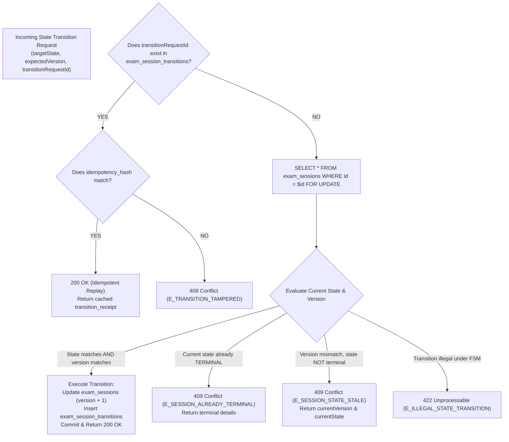

# UADUE Phase 3 — Architecture R2 Hardening Specification
**Document ID:** `UADUE-P3-HARD-R2-001`  
**Version:** `1.2.0-HARDENING-R2`  
**Status:** `DESIGN-ONLY / IMPLEMENTATION STRICTLY LOCKED`  
**Classification:** Micro-Hardening Architecture Specification  

---

## 1. Executive Summary & Governance Compliance

This document executes the **Phase 3 Architecture R2 Hardening**, resolving the six critical findings (R2-01 through R2-06) identified during architecture review. It definitively eliminates ambiguities in deadline grace enforcement, clarifies the client sequence trust boundary, designs a multi-tier cryptographic session key hierarchy for offline journals, formalizes transition request idempotency, calibrates historical reproducibility language, and conducts a cross-contract upstream verification.

**Governance Boundary:**
- 🚫 **IMPLEMENTATION REMAINS STRICTLY FORBIDDEN.**
- 🔒 **Phase 2A–2D8 upstream contracts remain frozen, immutable, and untouched.**
- 🚫 Zero production code, zero migrations, zero database modifications, zero UI/player changes.

---

## 2. R2-01 — Receipt-Based Deadline & Network Grace Architecture

### 2.1 Explicit Model Choice: Receipt-Based Grace Policy
Phase 3 formally and unambiguously adopts the **Receipt-Based Grace Policy**.

The architecture explicitly rejects the claim of "proving packets were already in flight before the deadline" because proving pre-deadline transmission without trusting client timestamps or specialized non-standard network hardware is physically unverifiable over general TCP/IP.

### 2.2 Formal Policy Definition
An incoming candidate submission event $e$ is formally accepted if and only if:
$$\text{AcceptedSubmission}(e) \iff T_{\text{receipt}}(e) \le T_{\text{cutoff}}$$

Where:
$$T_{\text{deadline}} = T_{\text{start}} + \text{Duration} + \text{AccumulatedPause}$$
$$T_{\text{cutoff}} = T_{\text{deadline}} + \Delta_{\text{receipt\_grace}}$$
$$\Delta_{\text{receipt\_grace}} = 15.000\text{ seconds}$$

### 2.3 Authoritative Temporal Rules
1. **Client Click Time is Advisory Metadata:** $T_{\text{client}}$ is recorded solely for client latency telemetry. It has **zero authority** over deadline compliance or scoring eligibility.
2. **Client Clock has Zero Authority:** Client device clock skews (fast, slow, manipulated) are completely ignored by the grading and ingestion boundary.
3. **Server Monotonic Receipt Time is Sole Authority:** $T_{\text{receipt}}$ is recorded at the server ingestion gateway network interface using high-resolution monotonic clocks synchronized via NTP chrony.
4. **Receipt Grace Period:** The 15-second window ($\Delta_{\text{receipt\_grace}}$) is an operational server arrival grace period.
5. **No False Transmission Claims:** The system explicitly does **NOT** claim to prove the packet was transmitted prior to $T_{\text{deadline}}$. If it arrives at or before $T_{\text{cutoff}}$, it is accepted; if it arrives after $T_{\text{cutoff}}$, it is rejected.

### 2.4 Battery of 10 Timing Adversarial Cases

```text
Exam Duration: 2 Hours (08:00:00 to 10:00:00)
T_deadline = 10:00:00.000
Receipt Grace = 15.000s
T_cutoff = 10:00:15.000
```

| Case ID | Scenario Description | Client Timestamp ($T_{\text{client}}$) | Server Receipt ($T_{\text{receipt}}$) | Evaluation Condition | System Verdict & Status Code |
| :--- | :--- | :---: | :---: | :---: | :--- |
| **TC-01** | Candidate clicks 1s before deadline; network delay of 6s. | 09:59:59.000 | 10:00:05.000 | $T_{\text{receipt}} \le T_{\text{cutoff}}$ ($10:00:05 \le 10:00:15$) | 🟢 **ACCEPTED (200 OK)**. Scored normally. |
| **TC-02** | Candidate clicks 2s after deadline during grace period; 2s transit. | 10:00:02.000 | 10:00:04.000 | $T_{\text{receipt}} \le T_{\text{cutoff}}$ ($10:00:04 \le 10:00:15$) | 🟢 **ACCEPTED (200 OK)**. Receipt-based policy accepts. |
| **TC-03** | Candidate clicks 20s before deadline; severe cellular bufferbloat delay. | 09:59:40.000 | 10:00:16.200 | $T_{\text{receipt}} > T_{\text{cutoff}}$ ($10:00:16.2 > 10:00:15$) | 🔴 **REJECTED (403 Forbidden)**. Dropped with `E_SUBMISSION_EXPIRED`. |
| **TC-04** | Client clock 1 hour slow (clicks 09:00:00); server time is 10:00:10. | 09:00:00.000 | 10:00:10.000 | $T_{\text{receipt}} \le T_{\text{cutoff}}$ ($10:00:10 \le 10:00:15$) | 🟢 **ACCEPTED (200 OK)**. Client clock ignored. |
| **TC-05** | Client clock 1 hour fast (clicks 11:00:00); server time is 09:59:30. | 11:00:00.000 | 09:59:30.000 | $T_{\text{receipt}} \le T_{\text{cutoff}}$ ($09:59:30 \le 10:00:15$) | 🟢 **ACCEPTED (200 OK)**. Normal in-flight acceptance. |
| **TC-06** | Exact boundary microsecond arrival. | 09:59:58.000 | 10:00:15.000 | $T_{\text{receipt}} = T_{\text{cutoff}}$ ($10:00:15.000 \le 10:00:15.000$) | 🟢 **ACCEPTED (200 OK)**. Boundary inclusion. |
| **TC-07** | Boundary miss by 1 millisecond. | 09:59:58.000 | 10:00:15.001 | $T_{\text{receipt}} > T_{\text{cutoff}}$ ($10:00:15.001 > 10:00:15.000$) | 🔴 **REJECTED (403 Forbidden)**. Boundary exclusion. |
| **TC-08** | Duplicate retry after cutoff (original accepted at 10:00:04). | 09:59:58.000 | 10:00:45.000 | Idempotency match on `clientEventId` | 🟢 **ACCEPTED (200 OK IDEMPOTENT)**. Returns cached receipt. Zero ledger write. |
| **TC-09** | Tampered retry after cutoff (same event ID, altered answer). | 09:59:58.000 | 10:00:20.000 | Conflicting payload fingerprint collision | 🔴 **REJECTED (409 Conflict)**. Fails with `E_PAYLOAD_TAMPERED`. |
| **TC-10** | Offline batch arriving 5 minutes post-deadline. | 09:55:00.000 | 10:05:00.000 | $T_{\text{receipt}} > T_{\text{cutoff}}$ ($10:05:00 > 10:00:15$) | 🔴 **REJECTED (403 Forbidden)**. Batch dropped with `E_SESSION_EXPIRED`. |

---

## 3. R2-02 — Client Sequence Trust Boundary & Authoritative Answer Reduction

### 3.1 Taxonomy of Sequence and Identity Properties

| Attribute | Authority | Domain Role | Trust Boundary |
| :--- | :---: | :--- | :--- |
| **`clientSequenceNumber`** | Client (Advisory) | Monotonically increasing counter per client journal. | **Untrusted for human intent.** Used solely as an advisory sequencing signal within an active lease. |
| **`serverSequenceNumber`** | Server (Authoritative) | PostgreSQL `BIGSERIAL` sequence assigned upon ledger commit. | **Authoritative.** Defines physical ledger order, linear auditability, and database serialization. |
| **`clientEventId`** | Client (Ephemeral) | UUIDv7 assigned per interaction event creation attempt. | **Untrusted identifier.** Used strictly as an idempotency deduplication key. |
| **`questionRevision`** | Client (Advisory) | Monotonic counter per question tracking candidate revisions. | **Advisory.** Bounded counter tracking edits to a specific question. |
| **`eventPayloadFingerprint`** | Computed (Server) | Hex SHA-256 of Canonical JSON serialization of response. | **Authoritative.** Cryptographic proof of response payload integrity. |

### 3.2 Formal Resolution of Sequence Edge Cases

1. **Duplicate `clientEventId` (Identical Payload):** Idempotent hit. Server verifies `eventPayloadFingerprint` matches; returns existing `SubmissionReceipt`; zero new rows written.
2. **Same `clientEventId` + Different Payload:** Collision/tamper. Server rejects immediately with `409 Conflict (E_PAYLOAD_TAMPERED)`.
3. **Duplicate `clientSequenceNumber` (Different Event ID):** Client state bug or split-brain tab. Database enforces `UNIQUE (exam_session_id, client_sequence_number)`. Transaction fails with `409 Conflict (E_DUPLICATE_CLIENT_SEQUENCE)`.
4. **Missing Sequence Numbers / Sequence Gaps:** Client sends sequence 1, 2, 4 (missing 3). Gateway accepts 4 into the ledger but marks `gap_detected = true`. The session cannot be evaluated until either: (a) sequence 3 arrives before $T_{\text{cutoff}}$, OR (b) candidate explicitly submits the exam with an acknowledged sequence summary, OR (c) session expires at $T_{\text{cutoff}}$, at which point missing sequences are presumed dropped and remaining events are evaluated.
5. **Out-of-Order Network Arrival:** Event with `clientSeq = 14` arrives before `clientSeq = 13`. Server persists both in physical arrival order (`serverSequenceNumber 101`, `102`). State reducer sorts per question by `clientSequenceNumber ASC`.
6. **Malicious Sequence Manipulation:** Attacker sends `clientSequenceNumber = 999999`. Gateway enforces bounded sequence progression:
   $$\text{clientSequenceNumber} \le \text{lastAcknowledgedSequence} + \text{MAX\_BATCH\_SIZE} \; (100)$$
   Requests jumping $> 100$ are rejected with `422 Unprocessable Entity (E_SEQUENCE_JUMP_EXCESSIVE)`.
7. **Multiple Active Browser Contexts:** Enforced by Single Active Lease. Tab B acquiring a lease revokes Tab A's lease. Any submission from Tab A fails with `401 Unauthorized (E_LEASE_REVOKED)`.
8. **Browser Crash / Replay:** Unflushed journal events re-submit upon reconnect. Server accepts uncommitted events and idempotently deduplicates previously committed events.
9. **Client Sequence Reset:** If a client restarts or clears storage, it contacts `GET /api/v1/sessions/{id}/state` and must resume from `serverLastAcknowledgedClientSequence + 1`. Sequence resets to 1 are rejected.

### 3.3 Authoritative Final-Answer Reduction Rule
The architecture explicitly rejects the statement that `clientSequenceNumber` is "proof of human cognitive intent."

Instead, the **Authoritative Final-Answer Reduction Rule** is defined as an operational deterministic function:
$$\text{EffectiveAnswer}(q, s) = \mathcal{R}_{\text{final}}\Big(\big\{ e \in \text{AcceptedEvents}(s) \;\big|\; e.\text{canonicalQuestionId} = q \land T_{\text{receipt}}(e) \le T_{\text{cutoff}} \big\}\Big)$$

Where:
$$\mathcal{R}_{\text{final}}(\mathcal{E}) = \arg\max_{e \in \mathcal{E}} \Big( e.\text{clientSequenceNumber} \Big)$$
- Because `(exam_session_id, client_sequence_number)` is strictly unique, ties are mathematically impossible.
- If an edge anomaly causes sequence ambiguity, the reducer falls back strictly to $\arg\max (e.\text{serverSequenceNumber})$.

---

## 4. R2-03 — Cryptographic Session Key Hierarchy for Offline Journals

### 4.1 Defect in Prior Design
Deriving the local encryption key directly from `sessionToken` failed because access tokens regularly rotate during long examinations (e.g. 15-minute refresh cycles), breaking journal decryption on browser restart.

### 4.2 Three-Tier Cryptographic Session Key Hierarchy

```mermaid
flowchart TD
    subgraph Server Security Boundary (HSM / KMS)
        MSEK["Master Session Encryption Key (MSEK)<br/>256-bit cryptographically secure random secret<br/>Generated once at session initialization<br/>Encrypted in PostgreSQL via KMS envelope"]
    end

    subgraph Transport Boundary (TLS 1.3)
        Lease["Active Lease Binding: (examSessionId, currentLeaseId)"]
    end

    subgraph Client Device Security Boundary (Browser / WebCrypto)
        DJK["Device Journal Key (DJK)<br/>Derived: HKDF-SHA256(MSEK, salt=examSessionId, info='DJK:' || leaseId)<br/>Held in memory as non-extractable CryptoKey (extractable=false)"]
        
        DSWK["Device Storage Wrapping Key (DSWK)<br/>Derived via PBKDF2 from candidate PIN/credential + local salt<br/>Used to wrap DJK in IndexedDB across restarts"]

        EAT["Ephemeral Auth Tokens (EAT)<br/>Short-lived JWT (15m TTL)<br/>Rotates continuously; ZERO impact on DJK"]
    end

    MSEK -->|Derivation upon Lease Issue| DJK
    DJK -->|Wrapped via DSWK| LocalStore["Encrypted IndexedDB Journal (AES-256-GCM)"]
    Lease -.-> DJK
```

### 4.3 Key Hierarchy Lifecycle Specifications
1. **Master Session Encryption Key (MSEK):** Generated server-side at session creation. 256 bits of cryptographic entropy. Stored in `exam_sessions.encrypted_msek` encrypted under the server's KMS master key. Never transmitted to the client in raw form.
2. **Device Journal Key (DJK):** Derived server-side per active lease:
   $$\text{DJK} = \text{HKDF-SHA256}(\text{MSEK}, \text{salt}=\text{examSessionId}, \text{info}=\text{"UADUE_DJK_V1:"} \parallel \text{currentLeaseId})$$
   Transmitted over TLS 1.3 to the candidate client upon successful session start or proctor-authorized terminal migration.
3. **Browser Memory & Storage:** WebCrypto imports the DJK with `extractable = false`. To survive browser restarts without re-contacting the server while offline:
   - Client generates a local wrapping key (DSWK) derived from candidate credentials (e.g. candidate session PIN).
   - DJK is wrapped using AES-KW (RFC 3394) and stored in IndexedDB.
   - On browser crash/restart, candidate enters their PIN; WebCrypto unwraps DJK locally.
   - If candidate is online, the client re-authenticates and server re-issues DJK over TLS 1.3.
4. **Key Revocation & Terminal Migration:** When a candidate is migrated to a new workstation, the proctor issues a new `currentLeaseId`. The server derives a new DJK for Lease 2. Lease 1 is revoked. Submissions encrypted under Lease 1 fail server decryption/verification with `401 Unauthorized (E_LEASE_REVOKED)`.
5. **Calibrated Client Security Boundary:** Encrypted IndexedDB protects offline data-at-rest against casual inspection, disk extraction, or browser cache sniffing. It does **NOT** protect against a fully compromised browser operating system, rooted device memory extraction, or malicious browser extensions operating in the live DOM memory space.

---

## 5. R2-04 — Session Transition Idempotency & Concurrency Governance

### 5.1 The Retry Race Defect
In naive optimistic concurrency (`UPDATE ... WHERE state_version = N`), if a candidate's `SUBMIT` succeeds at version 7 $\to$ 8, but the network drops before the response arrives, the client retries with `expectedVersion = 7`. The database returns 0 rows updated. If treated as a generic conflict, the candidate experiences false submission failure.

### 5.2 Formal Transition Request Envelope
Every session state transition request MUST include an immutable transition identity:
```json
{
  "transitionRequestId": "018f3a9e-8888-7d1a-8e5f-transreq00001",
  "examSessionId": "018f3a9e-4b2c-7d1a-8e5f-1a2b3c4d5e6f",
  "targetState": "SUBMITTED",
  "expectedStateVersion": 7,
  "transitionPayloadHash": "9f86d081884c7d659a2feaa0c55ad015a3bf4f1b2b0b822cd15d6c15b0f00a08"
}
```

### 5.3 Dedicated Transition Ledger (`exam_session_transitions`)
Transitions are committed inside an ACID transaction alongside the session update:
```sql
CREATE TABLE exam_session_transitions (
    transition_id           UUID PRIMARY KEY DEFAULT gen_random_uuid(),
    exam_session_id         UUID NOT NULL REFERENCES exam_sessions(exam_session_id),
    transition_request_id   UUID NOT NULL,
    from_state              VARCHAR(32) NOT NULL,
    to_state                VARCHAR(32) NOT NULL,
    from_version            INTEGER NOT NULL,
    to_version              INTEGER NOT NULL,
    idempotency_hash        CHAR(64) NOT NULL,
    transition_receipt      JSONB NOT NULL,
    recorded_at             TIMESTAMPTZ NOT NULL DEFAULT NOW(),
    CONSTRAINT uq_session_trans_req UNIQUE (exam_session_id, transition_request_id),
    CONSTRAINT uq_session_to_version UNIQUE (exam_session_id, to_version)
);
```

### 5.4 Exact Concurrency & Retry Resolution Matrix



Zero-row updates are **never** mapped to a generic error. Every outcome is precisely classified and deterministically handled.

---

## 6. R2-05 — Calibrated Reproducibility Language & Evaluation Contract

### 6.1 Replacement of Uncalibrated Language
The claim that the architecture "guarantees exact score reproduction across decades" is formally replaced.

**Calibrated Contract:**
> *"The evaluation is deterministic for identical immutable inputs and pinned evaluation contract."*  
> The architecture explicitly does **NOT** claim arbitrary future runtime equivalence across uncertified third-party execution environments without pinned runtime verification.

### 6.2 The Complete 11-Tuple Evaluation Contract
An evaluation run is reproducible if and only if all 11 dimensions of the evaluation contract $\mathcal{T}_{\text{eval\_contract}}$ are pinned:

$$\mathcal{T}_{\text{eval\_contract}} = \Big\langle \mathcal{P}_{\text{id}}, \mathcal{P}_{\text{seal}}, \mathcal{K}_{\text{ver}}, \Pi_{\text{ver}}, \mathcal{E}_{\text{id}}, \mathcal{E}_{\text{ver}}, \mathcal{S}_{\text{ver}}, \mathcal{N}_{\text{spec}}, \mathcal{C}_{\text{spec}}, \mathcal{R}_{\text{target}}, \mathcal{A}_{\text{snap}} \Big\rangle$$

Where:
1. $\mathcal{P}_{\text{id}}$: `packageId` (UUID)
2. $\mathcal{P}_{\text{seal}}$: `packageIntegritySeal` (SHA-256)
3. $\mathcal{K}_{\text{ver}}$: `answerResolutionVersion` (Phase 2D-5 pinned version)
4. $\Pi_{\text{ver}}$: `scoringPolicyVersion` (Phase 2D-5 pinned version)
5. $\mathcal{E}_{\text{id}}$: `evaluationAlgorithmId` (e.g., `UADUE_STANDARD_MCQ_EVALUATOR`)
6. $\mathcal{E}_{\text{ver}}$: `evaluationAlgorithmVersion` (Semantic version string)
7. $\mathcal{S}_{\text{ver}}$: `evaluationSchemaVersion` (Output scorecard schema version)
8. $\mathcal{N}_{\text{spec}}$: `numericSemanticsVersion` (Fixed-point 4-decimal arithmetic spec; avoids IEEE 754 floating-point divergence)
9. $\mathcal{C}_{\text{spec}}$: `canonicalSerializationVersion` (Canonical JSON RFC 8785)
10. $\mathcal{R}_{\text{target}}$: `runtimeEnvironmentTarget` (Pinned Node.js LTS / V8 engine target)
11. $\mathcal{A}_{\text{snap}}$: `attemptSnapshot` (Reduced candidate response map)

---

## 7. R2-06 — Cross-Contract Upstream Immutability Verification

A strict forensic check verifies that the R2 hardening specifications maintain zero changes to upstream Phase 2 contracts:

| Upstream Contract | Verification Status | Compliance Evidence |
| :--- | :---: | :--- |
| **Phase 2 Identities** | 🟢 UNALTERED | `packageId`, `canonicalQuestionId`, `logicalFamilyId`, `representationId`, `assetId` remain immutable. |
| **`packageIntegritySeal`** | 🟢 UNALTERED | Remains the sole, uncompromised canonical package authority. |
| **Answer Authority** | 🟢 UNALTERED | Phase 2D-5 answer resolution graph is consumed strictly read-only. |
| **Scoring Semantics** | 🟢 UNALTERED | Phase 2D-5 evaluation logic is executed as an immutable pure function. |
| **Persistence Model** | 🟢 UNALTERED | Phase 2D-8 tables (`canonical_packages`, `canonical_package_events`) are untouched. |
| **Ingestion Pipeline** | 🟢 UNALTERED | Zero re-parsing of raw PDFs, zero modifications to DocumentGraph/QuestionGraph. |

---

## 8. Summary Gate Verdict

| Area / Subsystem | Gate Verdict | Notes |
| :--- | :---: | :--- |
| **R2-01: Deadline / Grace Semantics** | 🟢 RESOLVED | Receipt-based grace policy adopted; 10 adversarial cases verified. |
| **R2-02: Client Sequence Trust** | 🟢 RESOLVED | Monotonic bounds enforced; final answer reduction formally defined. |
| **R2-03: Offline Journal Key Hierarchy** | 🟢 RESOLVED | 3-tier key hierarchy (MSEK $\to$ DJK $\to$ EAT) decouples token rotation. |
| **R2-04: Transition Idempotency** | 🟢 RESOLVED | Dedicated `exam_session_transitions` table & retry taxonomy. |
| **R2-05: Reproducibility Language** | 🟢 RESOLVED | Calibrated bounded contract with 11-tuple pinned evaluation tuple. |
| **R2-06: Cross-Contract Audit** | 🟢 RESOLVED | Zero Phase 2 upstream contract modification verified. |
| **Phase 3 Implementation Gate** | 🔒 STRICTLY LOCKED | Implementation remains completely locked pending authorization. |
