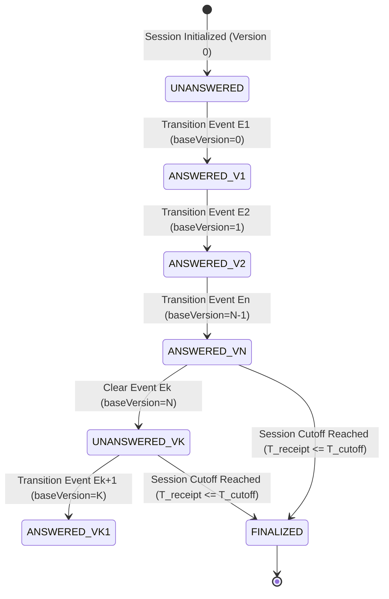
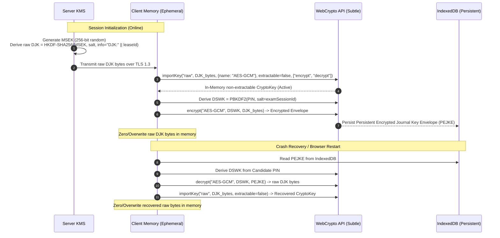

# UADUE Phase 3 — Architecture R3 Final Hardening Specification
**Document ID:** `UADUE-P3-HARD-R3-001`  
**Version:** `1.3.0-HARDENING-R3`  
**Status:** `DESIGN-ONLY / IMPLEMENTATION STRICTLY LOCKED`  
**Classification:** Final Architecture Micro-Hardening Specification  

---

## 1. Executive Summary & Governance Compliance

This specification executes the **Phase 3 Architecture R3 Final Hardening**, conclusively resolving all remaining architecture and consistency findings (R3-01 through R3-07). It eliminates client-sequence dependency in final answer scoring, replaces flawed `argmax()` rules with a Server-Authoritative Question State Machine, establishes a WebCrypto-compliant key wrapping envelope for offline journals, standardizes distributed-systems idempotency terminology, calibrates time-source semantics against PostgreSQL transaction engines, and bounds historical reproducibility claims.

**Governance Boundary:**
- 🚫 **IMPLEMENTATION REMAINS STRICTLY FORBIDDEN.**
- 🔒 **Phase 2A–2D8 upstream contracts remain frozen, immutable, and untouched.**
- 🚫 Zero production code, zero migrations, zero database modifications, zero UI/player changes.

---

## 2. R3-01 — Server-Authoritative Question Answer Reduction

### 2.1 The Architectural Defect in R2
In R2, the candidate's effective scored answer was computed via `EffectiveAnswer(q, s) = argmax(clientSequenceNumber)`. Because `clientSequenceNumber` originates from an untrusted client device, an adversary could forge or advance sequence numbers (even within bounded limits) to artificially force an answer to win.

**Fundamental Rule:** *An untrusted client-controlled ordering field MUST NEVER be the authoritative selector for final scored state.*

### 2.2 Taxonomy of Identity & Sequence Properties

| Attribute | Origin | Authority | Invariant / Boundary |
| :--- | :---: | :---: | :--- |
| **`clientEventId`** | Client | Ephemeral Identity | UUIDv7. Primary idempotency key. Duplicate with matching payload = idempotent replay; duplicate with altered payload = integrity violation (`409 Conflict`). |
| **`clientSequenceNumber`** | Client | Advisory Metadata | Counter within client process. Advisory telemetry only. **Never proof of human intent. Never sufficient by itself to determine scored answer.** |
| **`serverReceiptSequence`** | Server | Authoritative (Physical) | PostgreSQL `BIGSERIAL` in submission ledger. Establishes immutable arrival order and physical ledger sequence. |
| **`questionStateVersion`** | Server | Authoritative (Logical) | Strictly monotonic version ($N \in \mathbb{N}$) representing the server-authorized state transition count for question $q$. |
| **`payloadFingerprint`** | Server | Authoritative (Integrity) | Hex SHA-256 hash of Canonical JSON response payload. |

### 2.3 The Server-Authoritative Question State Machine

Rather than computing a post-hoc `argmax()` across client sequence numbers, question responses are governed by a **Server-Authoritative Question State Machine**:



### 2.4 State Storage & Transition Governance
Operational question states are maintained in a dedicated operational table:

```sql
CREATE TABLE candidate_question_states (
    state_id                UUID PRIMARY KEY DEFAULT gen_random_uuid(),
    exam_session_id         UUID NOT NULL REFERENCES exam_sessions(exam_session_id),
    canonical_question_id   UUID NOT NULL,
    current_state_version   INTEGER NOT NULL DEFAULT 0,
    selected_option_id      UUID,
    response_payload        JSONB,
    payload_fingerprint     CHAR(64),
    last_server_sequence    BIGINT NOT NULL REFERENCES candidate_submission_events(server_sequence_number),
    last_client_event_id    UUID NOT NULL,
    is_answered             BOOLEAN NOT NULL DEFAULT FALSE,
    updated_at              TIMESTAMPTZ NOT NULL DEFAULT NOW(),
    CONSTRAINT uq_session_question_state UNIQUE (exam_session_id, canonical_question_id)
);
```

### 2.5 Authoritative Scoring Eligibility Rule
> **Authoritative Scoring Rule (P3-I07-R3):**  
> *The candidate response eligible for scoring evaluation for question $q$ is strictly the value recorded in `candidate_question_states` at the instant the session transitions to terminal (`SUBMITTED` or `EXPIRED`).*  
> Client sequence numbers have **zero scoring authority**.

---

## 3. R3-02 — Multi-Context Client Sequence & Global Event Identity

### 3.1 Defect in Prior Unique Constraint
R2 enforced `UNIQUE(exam_session_id, client_sequence_number)`, which caused legitimate submissions to be rejected whenever a candidate had two browser tabs open, experienced connection flaps, or restarted a browser session with a reset counter.

### 3.2 Formal Resolution: Advisory Client Sequence & Global Event Identity
1. **Removal of Counter Constraint:** The database constraint `UNIQUE(exam_session_id, client_sequence_number)` is **PERMANENTLY REMOVED**.
2. **Global Event Identity:** Primary database idempotency is anchored strictly on:
   ```sql
   CONSTRAINT uq_session_client_event UNIQUE (exam_session_id, client_event_id)
   ```
3. **Multi-Context Scoping:** When advisory client sequence numbers are transmitted, they are bound to a client context identifier:
   $$\text{ClientEventEnvelope} = \Big\langle \text{clientContextId}, \text{clientSequenceNumber}, \text{clientEventId}, \dots \Big\rangle$$
4. **Edge Scenario Disambiguation:**
   - *Two Tabs:* Both tabs operate under the session. If Tab B initiates an active lease, Tab A's lease is revoked. Submissions carrying an invalidated lease token are rejected with `401 Unauthorized (E_LEASE_REVOKED)`.
   - *Browser Crash / Counter Reset:* If a client restarts and emits `clientSequenceNumber = 1` with a new `clientEventId`, the database accepts it cleanly because `clientSequenceNumber` is not unique in the database.
   - *Duplicate Batch / Network Retransmission:* Re-sent batches match `clientEventId`; existing receipts are returned with HTTP 200 OK without creating duplicate rows.
   - *Sequence Collisions Across Tabs:* Two tabs emitting sequence 5 with distinct `clientEventId` are both accepted into the raw event ledger; the authoritative question state machine sequences them by server transaction commit order.

---

## 4. R3-03 — WebCrypto-Compliant Offline Key Lifecycle

### 4.1 Resolution of WebCrypto Extractability Contradiction
In R2, the Device Journal Key (DJK) was stated to be both "non-extractable" and "locally wrapped via AES-KW". Under the W3C Web Cryptography API, `crypto.subtle.wrapKey()` throws an `InvalidAccessError` on any key with `extractable: false`.

### 4.2 WebCrypto Envelope Architecture (Model A)

Phase 3 resolves this by defining an **Encrypted Key Envelope Architecture**:



### 4.3 Complete Key Hierarchy & Lifecycle Taxonomy
1. **Master Session Encryption Key (MSEK):** 256-bit server secret generated at session creation. Encrypted in PostgreSQL using server KMS envelope encryption. Never leaves the server.
2. **Device Journal Key (DJK):** 256-bit AES-GCM raw key material derived server-side:
   $$\text{DJK} = \text{HKDF-SHA256}(\text{MSEK}, \text{salt}=\text{examSessionId}, \text{info}=\text{"UADUE_DJK_V1:"} \parallel \text{currentLeaseId})$$
3. **In-Memory Operational Key:** Created via `crypto.subtle.importKey()` with `extractable = false`. Used for all real-time journal entry encryption/decryption in DOM memory.
4. **Persistent Encrypted Journal Key Envelope (PEJKE):** Persisted in IndexedDB:
   $$\text{PEJKE} = \text{AES-256-GCM}_{\text{DSWK}}\big(\text{raw\_DJK\_bytes}\big)$$
   Where DSWK is derived from the candidate session PIN via PBKDF2 (`iterations = 100,000`, `salt = examSessionId`).
5. **Token Rotation Decoupling:** Ephemeral Auth Tokens (JWT) rotate independently every 15 minutes. Token rotation touches neither DJK, DSWK, nor PEJKE.
6. **Lease Revocation & Terminal Migration:** If a candidate moves to a new machine, the server derives a new DJK for `lease_2`. Submissions from Machine 1 (carrying `lease_1`) fail server decryption verification with `401 Unauthorized (E_LEASE_REVOKED)`.
7. **Journal Destruction:** Upon terminal session submission (`SUBMITTED`) or expiration, the client triggers `indexedDB.deleteDatabase()` and dereferences in-memory keys.
8. **Calibrated Threat Model:** Encrypted IndexedDB protects offline data-at-rest against casual disk inspection, device imaging, and offline cache harvesting. It does **NOT** protect against malicious browser extensions, rooted OS memory extraction, or DOM injection attacks while the in-memory key is active.

---

## 4. R3-04 — Distributed-Systems Idempotency & Exactly-Once Terminology

### 4.1 Terminology Calibration
The phrase "exactly-once transition semantics" is retired.

**Formal Distributed-Systems Model:**
- **Request Network Delivery:** **At-Least-Once** (accommodating retries, socket drops, and client reconnections).
- **State Transition Effect:** **Exactly-Once for a unique `(examSessionId, transitionRequestId)`**.

### 4.2 Formal Invariant (P3-I21-R3)
> **Transition Idempotency Invariant (P3-I21-R3):**  
> *For a given `examSessionId`, `transitionRequestId`, and payload fingerprint, at most one state transition effect may commit in the database.*  
> Repeated identical requests return the cached original receipt (HTTP 200 OK). Conflicting payloads with an identical transition request ID fail immediately with HTTP 409 Conflict (`E_TRANSITION_TAMPERED`).

---

## 5. R3-05 — Authoritative Time Source & Distributed Consistency

### 5.1 Deconstruction of Time Domains

| Time Domain | Mechanism / Source | Authority | Domain Role |
| :--- | :--- | :---: | :--- |
| **1. UTC Wall-Clock Timestamp** | NTP/Chrony synchronized UTC | Advisory / Audit | Recorded in `recorded_at` fields for human audit and statutory compliance logs. Bounded drift $\le 1\text{ms}$. |
| **2. Monotonic Process Duration** | `process.hrtime.bigint()` | Local Node Only | Used strictly for local in-process duration measurement, latency histograms, and socket timeouts. Never compared across servers. |
| **3. Database Sequence Ordering** | PostgreSQL `BIGSERIAL` / WAL LSN | Authoritative (Order) | Establishes the immutable physical ledger arrival order. |
| **4. Authoritative Deadline Evaluation** | PostgreSQL Transaction Clock (`clock_timestamp()`) | **Authoritative (Deadline)** | Sole trusted arbiter for exam deadline compliance and receipt grace eligibility. |

### 5.2 Authoritative PostgreSQL Deadline Evaluation Rule
Distributed application worker nodes **do not** make independent deadline authorization decisions using local process clocks.

Deadline compliance is evaluated exclusively within the PostgreSQL transaction boundary:
```sql
-- Evaluated atomically inside transaction
SELECT (clock_timestamp() <= scheduled_start_at + duration_interval + interval '15 seconds') AS is_within_grace
FROM exam_sessions
WHERE exam_session_id = :sessionId;
```
This guarantees that regardless of which distributed application pod handles an incoming HTTP request, the deadline cutoff is evaluated against a single, authoritative database transaction clock.

---

## 6. R3-06 — Bounded Historical Reproducibility Calibration

### 6.1 Distinction Between Architectural and Empirical Reproducibility
- **Architecturally Reproducible:** The system design permanently records all immutable inputs, algorithm versions, schemas, and arithmetic rounding rules in the 11-tuple $\mathcal{T}_{\text{eval\_contract}}$, ensuring the mathematical evaluation function has zero unpinned dependencies.
- **Empirically Reproduced:** The physical execution and verification of an evaluation run in a certified container environment at a future date.

### 6.2 Formal Statement
> *"The architecture records the immutable evaluation contract required for deterministic future reproduction. Runtime and container validation is an implementation-stage acceptance gate."*

---

## 7. R3-07 — Cross-Contract Upstream Freeze Verification

A strict forensic check verifies that R3 introduces **zero modifications** to upstream Phase 2 contracts:

```text
Phase 2 Identities:
  packageId                       -> 🟢 UNTOUCHED
  packageIntegritySeal            -> 🟢 UNTOUCHED (Sole canonical authority)
  canonicalQuestionId             -> 🟢 UNTOUCHED
  logicalFamilyId                 -> 🟢 UNTOUCHED
  representationId                -> 🟢 UNTOUCHED

Phase 2 Core Logic:
  Answer Authority Graph          -> 🟢 UNTOUCHED (Read-only consumer)
  Phase 2D-5 Scoring Evaluator    -> 🟢 UNTOUCHED (Pure function)
  PostgreSQL Persistence Schemas  -> 🟢 UNTOUCHED (No table/trigger edits)
  Raw PDF Ingestion Pipeline      -> 🟢 UNTOUCHED (Zero re-parsing)
```

Zero upstream contract conflicts detected.

---

## 8. Summary Gate Verdict

| Area ID | Area Title | Final Status |
| :--- | :--- | :---: |
| **R3-01** | Server-Authoritative Question State Machine | 🟢 RESOLVED |
| **R3-02** | Multi-Context Client Sequence & Global Event ID | 🟢 RESOLVED |
| **R3-03** | WebCrypto-Compliant Offline Key Hierarchy (Model A) | 🟢 RESOLVED |
| **R3-04** | Distributed Idempotency Terminology Calibration | 🟢 RESOLVED |
| **R3-05** | PostgreSQL Authoritative Deadline Evaluation Clock | 🟢 RESOLVED |
| **R3-06** | Calibrated Historical Reproducibility Contract | 🟢 RESOLVED |
| **R3-07** | Cross-Contract Upstream Freeze Audit | 🟢 RESOLVED |
| **Operational** | Empirical Container Runtime Verification | 🟡 BOUNDED |
| **Operational** | Empirical Database IOPS at 100k+ Scale | 🟡 BOUNDED |
| **Governance** | Phase 3 Implementation Authorization | 🔴 BLOCKED (Awaiting Explicit User Authorization) |

🔒 **PHASE 3 IMPLEMENTATION REMAINS STRICTLY LOCKED.**
