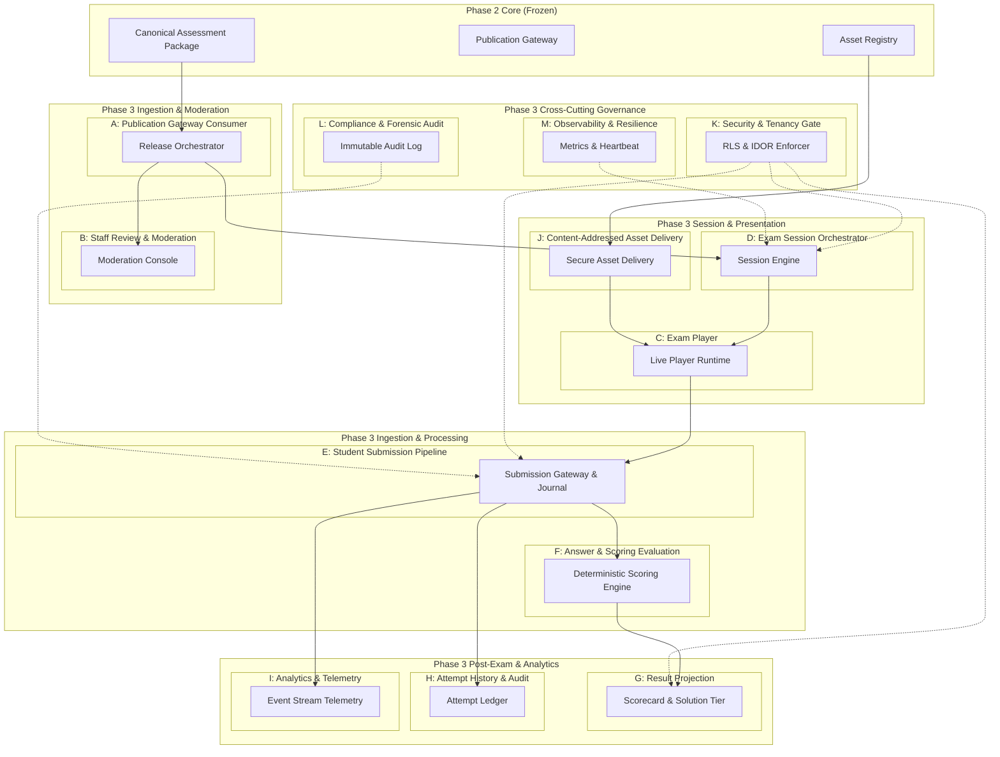
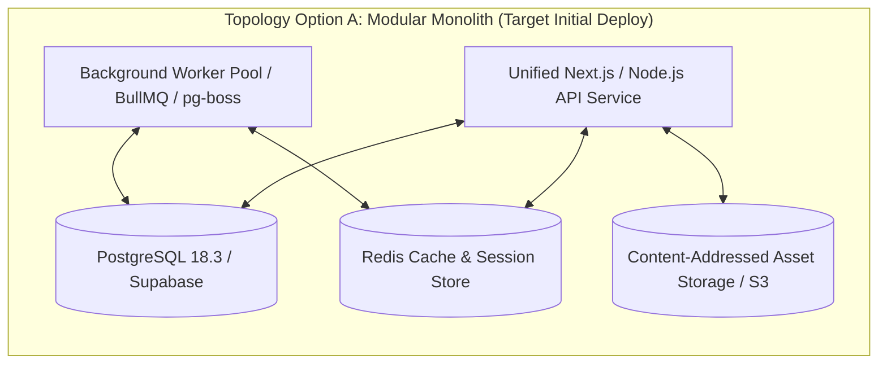
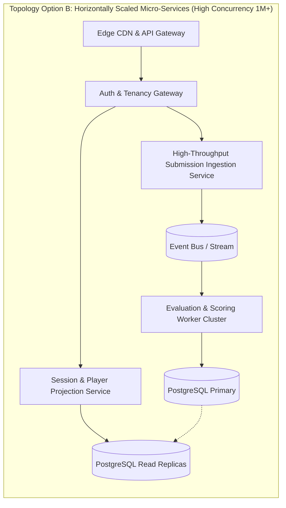

# UADUE Phase 3 — Master Architecture Specification
**Document ID:** `UADUE-P3-ARCH-001`  
**Version:** `1.0.0-SPECIFICATION`  
**Status:** `DESIGN-ONLY / IMPLEMENTATION STRICTLY LOCKED`  
**Upstream Contract Baseline:** Phase 2A–2D8 Frozen Canonical Pipeline (v7.3.1 / PostgreSQL 18.3)  
**Classification:** Universal Assessment Delivery & Unified Examination Architecture  

---

## 1. Executive Summary & Foundational Intent

Phase 2 (2A through 2D-8) successfully established the forensic, semantic, canonical, and persistent foundation of the Universal Assessment Delivery & Unified Examination (UADUE) architecture. In Phase 2D-8, the pipeline attained verified durable relational persistence on PostgreSQL 18.3, including:
- Immutable assessment package headers and dual integrity seals (`packageId`, `packageIntegritySeal`).
- Normalized, source-order-preserving question, representation, and logical family graphs.
- Server-authoritative answer resolutions and exact scoring models.
- Append-only lifecycle event ledgers with monotonic sequencing.
- Native database-level Row-Level Security (`FORCE ROW LEVEL SECURITY`) and tenant isolation.
- Content-addressed, cryptographic asset storage with bit-for-bit integrity verification.

**Phase 3 defines the operational examination delivery architecture.**
Its sole objective is to take sealed, validated, and persisted Canonical Assessment Packages and expose them safely to:
1. Authorized staff and moderation workflows.
2. High-concurrency student examination and player runtimes.
3. High-throughput, fault-tolerant student submission pipelines.
4. Deterministic, version-pinned evaluation and scoring engines.
5. Post-exam result, analytics, and corrigendum workflows.
6. Cryptographically audited compliance and observability streams.

---

## 2. Mandatory Core Architectural Invariants

### 2.1 The Non-Authoritative Client Principle
> **Invariant P3-I01 (Non-Authoritative Client):**  
> Under no circumstance shall the Exam Player, client browser, mobile app, or client-side JavaScript runtime serve as a source of truth for examination content, answer keys, timer authority, question identities, scoring policies, or evaluation outcomes.

The client is strictly an **ephemeral rendering engine and event emitter**. The client renders authorized projections (Tier 3 Student Live Projections) received from the server and emits timestamped, sequenced candidate interaction events. The server remains the sole arbiter of time, eligibility, state, correctness, and marks.

### 2.2 The Canonical Immutability Principle
> **Invariant P3-I02 (Canonical Immutability):**  
> Examination delivery, candidate submissions, candidate answers, and scoring calculations shall never mutate, patch, overwrite, or delete any record in the canonical assessment envelope (`canonical_assessment_packages`, `canonical_questions`, `canonical_question_representations`, `canonical_answer_authority_resolutions`).

Operational delivery records (sessions, attempts, response events, score sheets) are modeled as **orthogonal, decoupled relational and event-stream entities** that reference immutable canonical packages via cryptographic foreign keys (`packageId`, `packageIntegritySeal`).

### 2.3 Historical Reproducibility Principle
> **Invariant P3-I03 (Historical Reproducibility):**  
> Any examination attempt executed at time $T_0$ must remain deterministically re-evaluable and auditable at time $T_n$ for the same immutable input identities and pinned algorithm/policy versions, regardless of subsequent package supersessions, publication revocations, corrigenda, or institutional policy modifications.

To achieve this, every evaluation binds exclusively to:
$$\text{EvaluationResult} = \mathcal{F}_{\text{eval}}\Big(\mathcal{T}_{\text{eval}}\Big) = \mathcal{F}_{\text{eval}}\Big(\mathcal{P}_{\text{id}}, \mathcal{P}_{\text{seal}}, \mathcal{K}_{\text{ver}}, \Pi_{\text{ver}}, \mathcal{E}_{\text{id}}, \mathcal{E}_{\text{ver}}, \mathcal{S}_{\text{ver}}, \mathcal{N}_{\text{ver}}, \mathcal{C}_{\text{ver}}, \mathcal{A}_{\text{snap}}\Big)$$

---

## 3. Subsystem Decomposition & Logical Boundaries

Phase 3 is partitioned into thirteen distinct logical subsystems with strict encapsulation boundaries:

### Detailed Subsystem Inventory:
1. **Subsystem A: Publication / Release Gateway Consumer:** Consumes `PUBLISHED` events from Phase 2D-8. Exposes published assessment packages to authorized scheduling engines; enforces tenancy policies and validity windows.
2. **Subsystem B: Staff Review / Moderation Console:** Provides Tier 2 Staff Projections for academic reviewers, exam proctors, and quality controllers. Enables pre-flight verification, corrigenda drafting, and administrative holds.
3. **Subsystem C: Exam Player Runtime:** Ephemeral web/mobile user interface. Renders Tier 3 Student Live Projections. Enforces locked fullscreen, keyboard capture, and accessibility controls without exposing answers or scoring metadata.
4. **Subsystem D: Exam Session Orchestrator:** Manages the lifecycle of candidate exam sessions (`examSessionId`). Manages start times, server-authoritative countdown timers, paused states, dynamic section navigation, and auto-submission upon timeout.
5. **Subsystem E: Student Submission Pipeline:** High-throughput ingestion gateway. Accepts candidate answer submissions, flag changes, and section transitions. Emits append-only, deduplicated submission events with client and server monotonic sequence numbers.
6. **Subsystem F: Answer & Scoring Evaluation:** Consumes frozen Phase 2D-5 evaluation logic. Matches candidate submission events against authoritative answer keys and pinned scoring policies in a sandboxed, isolated environment.
7. **Subsystem G: Result Projection Gateway:** Generates Tier 4 Student Post-Exam Projections. Produces scorecards, section-wise accuracy breakdowns, percentile metrics, and authorized pedagogical solutions.
8. **Subsystem H: Attempt History Ledger:** Cryptographically sealed repository of all completed candidate attempts. Guarantees immutable preservation of raw student responses and associated environment metadata.
9. **Subsystem I: Analytics & Event Telemetry:** Real-time metrics pipeline tracking candidate behavior, question dwell times, option revision patterns, item difficulty indices (IRT parameter estimation), and proctoring telemetry.
10. **Subsystem J: Content-Addressed Asset Delivery Engine:** Secure proxy and CDN delivery engine for question diagrams, formulas, audio, and visual assets stored in Phase 2D-8 `canonical_assets`. Enforces signed token expiration and origin isolation.
11. **Subsystem K: Security & Tenancy Enforcement:** Policy enforcement layer handling authentication, role-based access control (RBAC), multi-tenant isolation, request signing, anti-tampering verification, and IDOR prevention.
12. **Subsystem L: Audit & Compliance Engine:** Append-only cryptographic audit logger recording administrative actions, session state overrides, proctor interventions, and scoring re-evaluations.
13. **Subsystem M: Observability & Reliability Infrastructure:** Distributed tracing, dead-letter queues, automated health checks, connection pool monitoring, and failover management.

---

## 4. Architectural Boundaries and Interfaces

### 4.1 Boundary 1: Upstream Ingestion Boundary (Phase 2D-8 $\to$ Phase 3)
- **Protocol:** Read-only relational querying and append-only event subscription.
- **Contract:** Phase 3 interacts with Phase 2D-8 exclusively via `reconstructPackage(packageId)`, `canonical_package_events`, and `canonical_assets`.
- **Constraint:** Phase 3 cannot call package creation, document parsing, OCR, or relationship evaluation routines. Phase 3 cannot modify canonical tables.

### 4.2 Boundary 2: Projection Security Boundary (Server $\to$ Client)
- **Protocol:** Strictly filtered JSON projections delivered over TLS 1.3 / HTTPS.
- **Contract:** 4-Tier Projection Model (detailed in `PHASE_3_PROJECTION_CONTRACT.md`).
- **Constraint:** Tier 3 (Student Live) mathematically strips all answer candidates, correct keys, scoring logic, and forensic OCR provenance before serialization.

### 4.3 Boundary 3: Ingestion Invariance Boundary (Client $\to$ Server)
- **Protocol:** Idempotent REST / WebSocket ingestion with dual sequence tracking.
- **Contract:** `SubmissionEventPayload` containing monotonic client sequence, client timestamp, response payload, and session auth token.
- **Constraint:** Server assigns canonical receipt IDs, computes server receipt sequence, validates session state, and persists to append-only journals. Client clocks are strictly untrusted.

### 4.4 Boundary 4: Scoring Evaluation Boundary (Sessions $\to$ Evaluator)
- **Protocol:** Asynchronous or synchronous evaluation service boundary consuming immutable attempt records.
- **Contract:** Consumes frozen Phase 2D-5 scoring evaluators (`AnswerCandidateEvaluator`, `ExactNumericEvaluator`, `ScoringEvaluator`).
- **Constraint:** Re-evaluation does not mutate original attempt records; it generates a new immutable `EvaluationRunRecord` linked to a specific corrigendum or re-evaluation authority event.

---

## 5. Architectural Topology & Deployment Strategy (Design Only)

Phase 3 is designed for logical decoupling with unified deployment flexibility. It supports two physical deployment topologies without altering architectural boundaries:

Phase 3 interface contracts are specified using language-agnostic data schemas (JSON Schema / TypeScript Interfaces), ensuring that transitioning from Topology A to Topology B requires zero redesign of domain logic, state machines, or data contracts.

---

## 6. Document Roadmap (Phase 3 Deliverables)

The complete Phase 3 specification consists of the following 18 dedicated architecture documents:

1. `PHASE_3_ARCHITECTURE_SPECIFICATION.md` (This master document)
2. `PHASE_3_SCOPE_BOUNDARY.md` (Strict execution & functional boundaries)
3. `PHASE_3_DOMAIN_MODEL.md` (Ubiquitous language & entity definitions)
4. `PHASE_3_STATE_MACHINES.md` (Formal lifecycle FSMs & transitions)
5. `PHASE_3_DATA_FLOW.md` (End-to-end data pipelines & choreography)
6. `PHASE_3_PROJECTION_CONTRACT.md` (4-Tier projection specifications & security)
7. `PHASE_3_SUBMISSION_CONTRACT.md` (Submission models & idempotency protocols)
8. `PHASE_3_SCORING_BOUNDARY.md` (Consumption of Phase 2D-5 scoring engines)
9. `PHASE_3_SECURITY_THREAT_MODEL.md` (Threat vectors, STRIDE & mitigations)
10. `PHASE_3_MULTI_TENANCY_MODEL.md` (Tenant boundary isolation & RLS)
11. `PHASE_3_FAILURE_RECOVERY_MODEL.md` (Resilience, crashes, & offline journals)
12. `PHASE_3_OBSERVABILITY_MODEL.md` (Telemetry, audit logs, & privacy-safe metrics)
13. `PHASE_3_PERFORMANCE_METHODOLOGY.md` (Scaling & benchmark methodology 1k–1M)
14. `PHASE_3_DATABASE_ARCHITECTURE.md` (Relational schema design & constraints)
15. `PHASE_3_ADVERSARIAL_SCENARIOS.md` (40 comprehensive attack/failure scenarios)
16. `PHASE_3_FORMAL_INVARIANTS.md` (Mathematical invariants P3-I01–P3-I20)
17. `PHASE_3_ADR_PROPOSALS.md` (Architectural Decision Records ADR-001–ADR-010)
18. `PHASE_3_ARCHITECTURE_TRACEABILITY.md` (Traceability to Phase 2 contracts)
