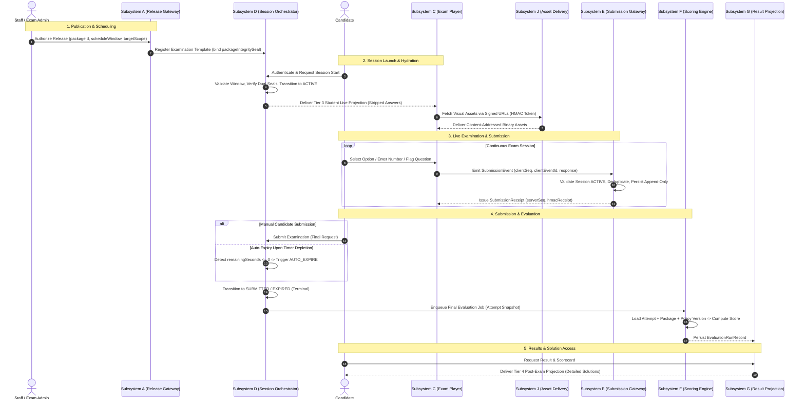

# UADUE Phase 3 — End-to-End Data Flow Specification
**Document ID:** `UADUE-P3-FLOW-005`  
**Version:** `1.0.0-SPECIFICATION`  
**Status:** `DESIGN-ONLY / IMPLEMENTATION STRICTLY LOCKED`  
**Classification:** System Architecture & Data Pipelines  

---

## 1. End-to-End Examination Lifecycle Flow

The complete flow from Canonical Assessment Package publication to final scorecard projection spans eight distinct operational pipelines:

---

## 2. Granular Data Pipeline Specifications

### 2.1 Pipeline 1: Session Hydration & Projection Delivery
1. **Request:** Candidate provides JWT authentication and session invitation code.
2. **Pre-flight Audit:**
   - Verify `current_time` falls within authorized examination schedule window.
   - Verify candidate identity matches assigned tenancy and organization.
   - Verify candidate has zero prior `ACTIVE`, `SUBMITTED`, or `EXPIRED` sessions for this package.
3. **Dual-Seal Integrity Check:**
   - Server recomputes `packageId` and `packageIntegritySeal` against relational rows in `canonical_questions` and `canonical_question_representations`.
   - Fails closed if computed hash differs from `canonical_assessment_packages`.
4. **Projection Synthesis:**
   - Invokes `CanonicalProjectionGateway.getTier3StudentLiveProjection(packageId)`.
   - Filters out `authoritativeAnswers`, candidate DAG resolutions, and moderation notes.
   - Signs temporary HMAC tokens for all embedded asset URLs pointing to Subsystem J.
5. **State Advancement:** Session transitions from `INITIALIZED` to `ACTIVE`. Authoritative start time recorded.

### 2.2 Pipeline 2: High-Throughput Submission Event Ingestion
1. **Client Event Formulation:**
   - Player records candidate interaction in memory and appends to local IndexedDB journal.
   - Assigns monotonically increasing `clientSequenceNumber` (e.g., 1, 2, 3...).
   - Generates unique `clientEventId` (UUIDv7).
2. **Transport Transmission:**
   - Transmitted via HTTPS POST `/api/v1/session/{id}/submission` (or persistent WebSocket).
3. **Ingestion Gateway Processing (Subsystem E):**
   - **Step A (Session Check):** Confirms `sessionStatus == ACTIVE` and `remainingSeconds > 0`.
   - **Step B (Idempotency Audit):** Checks if `(examSessionId, clientEventId)` already exists. If yes, returns cached receipt.
   - **Step C (Persistence):** Inserts row into `operational_submission_events` table using `serverSequenceNumber = MAX(seq) + 1`.
   - **Step D (Receipt Signing):** Computes HMAC-SHA256 signature over `(serverSequenceNumber, clientEventId, responseHash)`.
   - **Step E (Ack):** Returns `SubmissionReceipt` to client within $\le 50\text{ ms}$.

### 2.3 Pipeline 3: Asynchronous Scoring & Result Generation
1. **Trigger:** Session enters terminal state `SUBMITTED` or `EXPIRED`.
2. **Snapshot Assembly:**
   - Reduce all `operational_submission_events` for the session to determine the final chosen response per `canonicalQuestionId`.
   - Freeze final payload as an immutable `ExamAttemptSnapshot`.
3. **Scoring Invocation (Subsystem F):**
   - Scoring worker retrieves authoritative answer keys from `canonical_answer_authority_resolutions`.
   - Applies frozen Phase 2D-5 evaluation logic:
     - MCQ: `AnswerCandidateEvaluator.evaluate()`
     - Numeric: `ExactNumericEvaluator.evaluate()`
     - Overall: `ScoringEvaluator.evaluate()`
4. **Receipt & Persistence:**
   - Inserts `EvaluationRunRecord` into `operational_evaluation_runs`.
   - Emits message to Subsystem I for analytics and item difficulty calculation.
