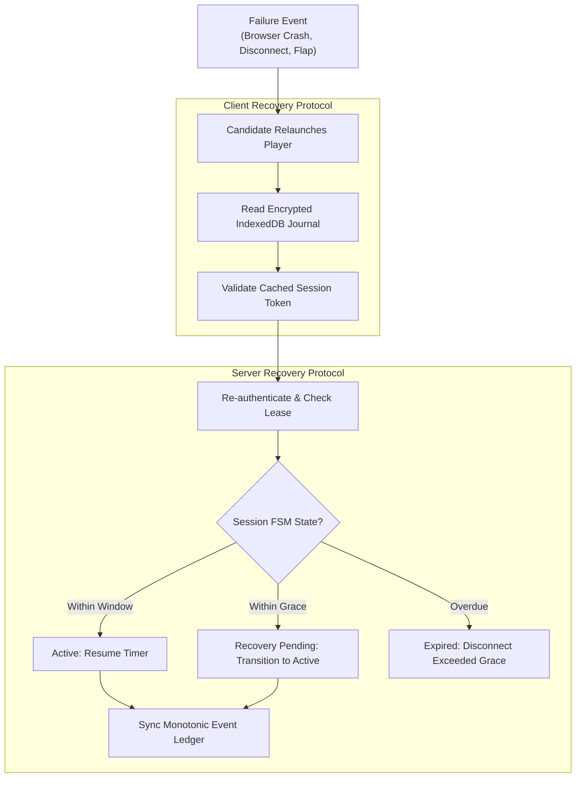

# UADUE Phase 3 — Failure Recovery & Offline Resilience Model
**Document ID:** `UADUE-P3-REC-011`  
**Version:** `1.0.0-SPECIFICATION`  
**Status:** `DESIGN-ONLY / IMPLEMENTATION STRICTLY LOCKED`  
**Classification:** Fault Tolerance & Disaster Recovery Specification  

---

## 1. Executive Summary & Recovery Philosophy

Real-world test-taking environments are fraught with edge-case disruptions: flaky mobile cellular connections, sudden Wi-Fi dropouts, power outages, browser crashes, accidental tab closures, and Operating System updates. 

**Core Recovery Philosophy:** *Zero Candidate Data Loss.* A candidate who answers a question must never lose that answer due to a transient failure. Simultaneously, fault tolerance must never become a vector for cheating, clock tampering, or post-deadline answering.

---

## 2. Examination Continuity Modes (Hybrid Offline-Tolerant Model)

Phase 3 implements an **Online-Seeded, Hybrid Offline-Tolerant Model**:
1. **Initial Online Handshake (Mandatory):** A session must be initialized while online. The candidate device downloads the authorized Tier 3 question projection and establishes an active lease.
2. **Transient Disconnection Tolerance:** If the network drops during the exam, the candidate can continue answering questions, flagging items, and navigating the paper uninterrupted. Interactions are appended to a secure local journal in browser storage (IndexedDB).
3. **Background & Final Reconciliation:** The client continuously polls for connectivity. As soon as connectivity returns, buffered events are submitted in an atomic batch.
4. **Air-Gapped Offline Exams (Boundary Note):** Pure air-gapped offline delivery (e.g., remote centers without internet) is supported exclusively via dedicated, pre-seeded local proctor servers, not unmanaged browser environments.

---

## 3. Failure Modes & Recovery Protocols

The table below catalogs primary failure modes and their exact system recovery workflows:



### 3.1 Detailed Failure Scenarios

#### Scenario 1: Accidental Browser Tab Close or Refresh
- **Event:** Candidate accidentally hits F5 or closes the browser window.
- **Client Protocol:**
  - On page unload (`beforeunload`), candidate responses are safely stored in IndexedDB.
  - On reload, the player reads cached credentials and contacts `GET /api/v1/sessions/{id}/state`.
- **Server Protocol:**
  - Verifies session token and lease.
  - Returns current server time, elapsed time, remaining seconds, and the last processed `serverSequenceNumber`.
  - Player updates its local view to match server state without losing un-flushed clicks.

#### Scenario 2: Network Flap / Intermittent Wi-Fi Disconnection
- **Event:** Wi-Fi drops for 4 minutes during a 120-minute examination.
- **Client Protocol:**
  - The player UI indicates "Offline Mode — Answers Saved Locally" in amber.
  - Interactions increment `clientSequenceNumber` and append to the encrypted IndexedDB journal.
  - The client runs a background ping loop every 3 seconds.
- **Reconnection Protocol:**
  - Once ping succeeds, the client sends a `POST /api/v1/sessions/{id}/submissions/batch` containing all events where `clientSequenceNumber > lastAcknowledgedSequence`.
- **Server Protocol:**
  - Validates that the session is still within the allowable window.
  - Executes batch insertion inside a single transaction.
  - Returns a batch receipt acknowledging all accepted sequences.
  - Player turns status indicator to green "Synced".

#### Scenario 3: Device Crash / Hardware Failure (Terminal Swap)
- **Event:** Candidate's computer shuts down completely due to hardware defect. Proctor moves candidate to a backup workstation.
- **Proctor Authorization Protocol:**
  - Proctor logs into Proctor Console and selects "Authorize Device Migration" for candidate.
  - Proctor generates a one-time migration authorization code (OTAC).
- **Candidate Login on New Device:**
  - Candidate logs into the backup machine and provides credentials + OTAC.
  - Server revokes the old lease and assigns a new active lease to the new hardware fingerprint.
  - Server hydrates the candidate's last known server-committed answers.
  - Exam resumes with remaining server time intact.

#### Scenario 4: Deadline Expiration During Disconnection
- **Event:** Candidate goes offline 5 minutes before the exam ends and remains offline until 10 minutes after the official end time.
- **Enforcement:**
  - Server timer is authoritative. At $T = \text{Deadline}$, server transitions session from `ACTIVE` to `EXPIRED`.
  - **Grace Window Rule:** The server permits a **15-second network inflight grace period** for packets in transit.
  - If a disconnected client reconnects 10 minutes late, the batch submission is **REJECTED** with `403 Forbidden (E_SESSION_EXPIRED)`.
  - The candidate's scorecard is evaluated strictly on events received prior to official expiry.

---

## 4. Encrypted Local Storage Protocol

To prevent candidate tampering with offline answers in browser developer tools:
1. **Key Derivation:** At session launch, a symmetric AES-256-GCM key is derived from the candidate's session token and an ephemeral server entropy seed:
   $$\text{StorageKey} = \text{HKDF-SHA256}(\text{sessionToken}, \text{salt}=\text{examSessionId})$$
2. **Encrypted Records:** Every event written to IndexedDB is encrypted with AES-256-GCM:
   ```json
   {
     "clientEventId": "018f3a9e-8888-7d1a-8e5f-clientevt00001",
     "iv": "d34b8c9a01f82736451299ef",
     "ciphertext": "a1b2c3d4e5f6...encrypted_bytes...",
     "authTag": "f9e8d7c6b5a41234"
   }
   ```
3. **Session Purge:** Upon successful submission receipt or session termination, the local IndexedDB database is wiped cleanly.

---

## 5. Prohibitions & Anti-Patterns

1. **PROHIBITION P3-REC01:** Never allow client-recorded timestamps to extend an expired session deadline. Server time is the sole authority.
2. **PROHIBITION P3-REC02:** Unencrypted browser storage (such as plain `localStorage`) must never store candidate answers or question projections.
3. **PROHIBITION P3-REC03:** No candidate may resume an exam on a new device without explicit proctor authorization or multi-factor lease invalidation.
