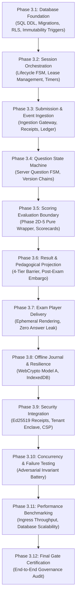

# UADUE Phase 3 — Master Implementation Plan
**Document ID:** `UADUE-P3-PLAN-001`  
**Version:** `1.0.0-AUTHORIZED`  
**Status:** `IMPLEMENTATION AUTHORIZED — INCREMENTAL EXECUTION GATE`  
**Classification:** Engineering Roadmap & Incremental Gate Protocol  

---

## 1. Executive Summary & Governance Boundaries

On October 7, 2026, the Phase 3 R3 Final Architecture Specification was approved and Phase 3 implementation was officially authorized under an **incremental, vertical testing protocol**.

**Non-Negotiable Governance Rules:**
1. **Zero Upstream Modifications:** Phase 2A through Phase 2D-8 remains strictly frozen and immutable. No modifications to `packageIntegritySeal`, `canonicalQuestionId`, `logicalFamilyId`, `representationId`, answer authority, scoring engines, or canonical persistence schemas.
2. **Phase 3 is Strictly a Consumer:** Phase 3 delivers packages; it never acts as a secondary ingestion or parsing engine.
3. **Vertical, Tested Increments:** Work is executed in 12 discrete increments. Each increment must pass its complete test suite before proceeding to the next gate.
4. **Server-Authoritative State:** `candidate_question_states` is the sole authority for scored answer state. Client sequence is advisory telemetry.
5. **No Premature Certification Claims:** Passing unit tests indicates verification of specific invariants, not overall production certification.

---

## 2. Twelve Vertical Implementation Increments

### Increment Breakdown:
1. **Phase 3.1 — Database Foundation:** Relational schema, DDL migration, immutability triggers, and RLS policies for all Phase 3 tables. *(CURRENT GATE)*
2. **Phase 3.2 — Session Orchestration:** Server FSM (`INITIALIZED` $\to$ `ACTIVE` $\to$ `SUBMITTED`), lease locks, and monotonic timer countdowns.
3. **Phase 3.3 — Submission & Event Ingestion:** High-throughput event ingestion gateway, cryptographic dual receipts, idempotency deduplication.
4. **Phase 3.4 — Candidate Question State Machine:** Operational question state transitions, monotonic state versions, and answer reduction rules.
5. **Phase 3.5 — Scoring & Evaluation Boundary:** Pure deterministic adapter wrapping frozen Phase 2D-5 evaluators with 11-tuple parameterization.
6. **Phase 3.6 — Result & Pedagogical Projection:** Ephemeral 4-Tier projection generators and post-exam embargo gates.
7. **Phase 3.7 — Exam Player Delivery:** Web/React player components with zero client-side scoring or answer leakage.
8. **Phase 3.8 — Offline Journal & Recovery:** WebCrypto Model A encryption envelope, IndexedDB journal, and reconnection batch flushing.
9. **Phase 3.9 — Security Integration:** Ed25519 receipt signing, tenant isolation verification, and API authorization enclaves.
10. **Phase 3.10 — Concurrency & Failure Testing:** Execution of the 40 adversarial scenarios against live PostgreSQL.
11. **Phase 3.11 — Performance Benchmarking:** Empirical throughput testing across 1k to 10k load tiers.
12. **Phase 3.12 — Full Phase 3 Certification:** Complete audit against all 20 formal invariants and final report generation.

---

## 3. Phase 3.1 Execution Mandate (Current Gate)

### Objectives:
- Create physical PostgreSQL migration file: `supabase/migrations/20261007_uadue_phase3_database_foundation.sql`.
- Create tables:
  1. `exam_sessions`
  2. `exam_session_transitions`
  3. `exam_session_projections`
  4. `candidate_submission_events`
  5. `candidate_question_states`
  6. `candidate_evaluation_runs`
  7. `candidate_question_scores`
  8. `candidate_scoring_disputes`
  9. `audit_events`
- Apply foreign key constraints referencing `canonical_assessment_packages(package_id)` with `ON DELETE RESTRICT`.
- Apply immutability triggers on append-only tables (`candidate_submission_events`, `candidate_evaluation_runs`, `exam_session_transitions`, `audit_events`).
- Enable PostgreSQL Row-Level Security (RLS) on all Phase 3 tables keyed by `current_setting('app.current_tenant_id')`.
- Author TypeScript contracts in `web/src/services/uadue/delivery/deliveryTypes.ts`.
- Author database adapter in `web/src/services/uadue/delivery/deliveryPostgresAdapter.ts`.
- Author comprehensive integration suite in `web/src/services/uadue/delivery/deliveryDatabaseFoundation.test.ts`.
- Execute migration and verify all tests pass against local PostgreSQL (`mockai_uadue_test`).
- Halt and report before starting Phase 3.2.
