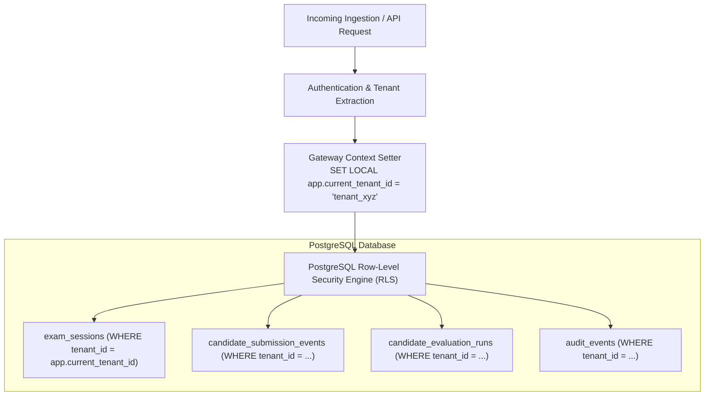

# UADUE Phase 3 — Multi-Tenancy & Data Isolation Model
**Document ID:** `UADUE-P3-TEN-010`  
**Version:** `1.0.0-SPECIFICATION`  
**Status:** `DESIGN-ONLY / IMPLEMENTATION STRICTLY LOCKED`  
**Classification:** Multi-Tenancy Architecture & Boundary Isolation  

---

## 1. Executive Summary & Core Principle

UADUE delivers examination services across diverse, independent institutional clients (e.g., educational boards, government recruitment commissions, universities, testing agencies). Data belonging to one tenant must be completely invisible and inaccessible to any other tenant.

**Core Principle (P3-I09):** *Absolute Tenant Hermeticism.* No tenant may infer the identity, examination content, candidate volume, activity timing, or existence of another tenant through direct queries, error codes, timing side-channels, or shared caches.

---

## 2. Multi-Tenancy Taxonomy & Partitioning Strategy

Phase 3 adopts a **Shared-Database / Isolated-Schema / Row-Level Partitioned Architecture** with strict database-level enforcement.



### 2.1 Scope of Tenant Segregation
The following table outlines tenancy boundaries across all primary data domains:

| Subsystem / Domain | Tenancy Boundary | Isolation Mechanism |
| :--- | :--- | :--- |
| **Packages & Publications** | Tenant-scoped or Globally Licensed | Every package row stores `tenant_id`. Global packages (e.g., standard public past papers) store `tenant_id = 'SYSTEM_GLOBAL'` with read-only access. |
| **Exam Sessions** | Strictly Tenant-isolated | Every session row requires `tenant_id`. Candidates cannot view or bind sessions outside their tenant. |
| **Candidate Identity** | Strictly Tenant-isolated | Candidate credentials and student profiles are partitioned by `tenant_id`. Candidate IDs do not collide across tenants. |
| **Submission Event Ledger** | Strictly Tenant-isolated | Every submission row requires `tenant_id`. Submission receipts are cryptographically signed with tenant-specific key pairs. |
| **Evaluation & Results** | Strictly Tenant-isolated | Evaluation scorecards and question scores are stored with mandatory `tenant_id` foreign keys. |
| **Content-Addressed Assets** | Tenant-scoped Access Rights | While underlying binary assets in object storage are deduplicated by SHA-256 hash, asset signed URLs are authorized only if the requesting session's tenant owns rights to the package. |
| **Audit Logs & Telemetry** | Strictly Tenant-isolated | All operational logs, access logs, and performance metrics are tagged and partitioned by `tenant_id`. |

---

## 3. Defense Against Cross-Tenant Inference Vectors

Adversaries frequently exploit subtle side-channels to deduce information about competing organizations. Phase 3 explicitly mitigates all known inference vectors:

### 3.1 ID Enumeration & Collision
- **Vector:** Sequential integers allow an attacker in Tenant A to predict IDs in Tenant B.
- **Defense:** Universal UUIDv7 IDs. Monotonic counters (such as submission sequence numbers) are scoped strictly per session: `UNIQUE (exam_session_id, client_sequence_number)`.

### 3.2 Error Code Differentiation (Uniform 404 Policy)
- **Vector:** An API returning `403 Forbidden` for a resource existing in Tenant B, but `404 Not Found` for non-existent IDs, allows an attacker to probe resource existence.
- **Defense (Uniform 404):** Any query for a resource that does not exist within the requester's active tenant MUST return `404 Not Found`. `403 Forbidden` is reserved solely for operations within the tenant where the user lacks adequate permissions.

### 3.3 Cache Partitioning & Namespace Collision
- **Vector:** Shared Redis or Memcached instances allowing cross-tenant key overwriting or reading.
- **Defense:** All cache keys MUST be strictly namespaced with the tenant identifier:
  $$\text{CacheKey} = \text{"tenant:"} \parallel \text{tenantId} \parallel \text{":entity:"} \parallel \text{entityType} \parallel \text{":"} \parallel \text{entityId}$$
  Multi-tenant Redis instances use role-based key patterns or separate logical DB indexes.

### 3.4 Timing Side-Channels
- **Vector:** Database queries that scan cross-tenant indexes exhibiting variable latency depending on other tenants' data volumes.
- **Defense:** All database queries utilize compound indexes with `tenant_id` as the leading index column:
  ```sql
  CREATE INDEX idx_sessions_tenant_candidate 
  ON exam_sessions (tenant_id, candidate_id, created_at DESC);
  ```
  This ensures the B-tree traversal is confined solely to the tenant's subtree.

### 3.5 Global Aggregate Leakage
- **Vector:** Metric endpoints displaying platform-wide numbers (e.g., "50,000 active test-takers online").
- **Defense:** Public and tenant-facing dashboards only display tenant-scoped metrics. Cross-tenant aggregation is accessible exclusively to super-administrators in dedicated, isolated reporting clusters.

---

## 4. PostgreSQL Row-Level Security (RLS) Specification

All operational tables enforce PostgreSQL Row-Level Security.

### 4.1 Connection Initialization Protocol
When a database connection is checked out from the pool to handle a request, the middleware executes:
```sql
-- Enforce tenant context in transaction scope
SET LOCAL app.current_tenant_id = '018f3a9e-1111-7d1a-8e5f-tenant000001';
```

### 4.2 Standard RLS Policy Definition
```sql
-- Enable RLS on exam_sessions table
ALTER TABLE exam_sessions ENABLE ROW LEVEL SECURITY;

-- Tenant Isolation Policy
CREATE POLICY tenant_isolation_policy ON exam_sessions
    FOR ALL
    USING (
        tenant_id = current_setting('app.current_tenant_id', true)::uuid
    )
    WITH CHECK (
        tenant_id = current_setting('app.current_tenant_id', true)::uuid
    );
```
If a query attempts to read or write without setting `app.current_tenant_id`, the function returns null/empty, causing the transaction to fail closed.

---

## 5. Prohibitions & Anti-Patterns

1. **PROHIBITION P3-TEN01:** No production query may omit `tenant_id` from its primary filtering criteria.
2. **PROHIBITION P3-TEN02:** Super-admin accounts must not be used to service student examination requests. Student traffic must use strictly bounded tenant connection pools.
3. **PROHIBITION P3-TEN03:** Cross-tenant asset URLs are prohibited. A signed URL generated for Candidate X under Tenant A must be rejected if accessed from an IP or session belonging to Tenant B.
