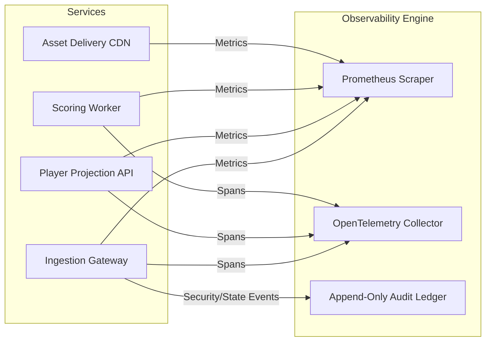

# UADUE Phase 3 — Observability, Telemetry & Audit Model
**Document ID:** `UADUE-P3-OBS-012`  
**Version:** `1.0.0-SPECIFICATION`  
**Status:** `DESIGN-ONLY / IMPLEMENTATION STRICTLY LOCKED`  
**Classification:** Telemetry, Metrics & Compliance Logging Specification  

---

## 1. Executive Summary & Privacy Principles

The Observability Subsystem provides complete, real-time insight into the health, performance, security, and integrity of Phase 3 examination delivery.

**Core Privacy Principles (P3-I15):**
1. **Zero Answer Leakage in Telemetry:** Telemetry logs, traces, and metrics MUST NEVER output answer keys, candidate response strings, or question stems.
2. **Zero PII in Distributed Traces & Metrics:** Candidate personal identifiable information (names, emails, phone numbers) is strictly prohibited in metric labels, log messages, and tracing spans. Entities are tracked solely by UUIDv7 identifiers.
3. **Cardinality Safety:** Metric labels must have bounded cardinality. Never use `candidateId`, `examSessionId`, or `clientEventId` as Prometheus labels.

---

## 2. Core Prometheus Metrics Specification

Metrics are exposed via standard Prometheus-compatible `/metrics` endpoints.



### 2.1 Prometheus Metric Catalog

| Metric Name | Type | Labels / Dimensions | Description |
| :--- | :--- | :--- | :--- |
| `uadue_sessions_active_total` | Gauge | `tenant_id`, `state` | Current active examination sessions by lifecycle state. |
| `uadue_session_creations_total` | Counter | `tenant_id`, `status` (`success`, `rejected`) | Cumulative count of session creation attempts. |
| `uadue_question_projections_total` | Counter | `tenant_id`, `projection_tier` | Question projections served to candidates or staff. |
| `uadue_submissions_received_total` | Counter | `tenant_id`, `event_type` | Total submission events received at gateway. |
| `uadue_submissions_persisted_total` | Counter | `tenant_id`, `status` (`new`, `idempotent_duplicate`) | Submissions durably persisted to PostgreSQL ledger. |
| `uadue_submissions_rejected_total` | Counter | `tenant_id`, `reason` (`expired`, `tampered`, `schema`) | Rejected submissions by reason category. |
| `uadue_submission_latency_seconds` | Histogram | `tenant_id`, `handler` | End-to-end ingestion and receipt signing latency. Buckets: `[0.005, 0.01, 0.025, 0.05, 0.1, 0.25, 0.5, 1.0, 2.5]`. |
| `uadue_scoring_evaluations_total` | Counter | `tenant_id`, `status` (`success`, `failed`) | Completed scoring engine evaluations. |
| `uadue_scoring_duration_seconds` | Histogram | `tenant_id` | Scoring execution duration per candidate attempt. |
| `uadue_security_violations_total` | Counter | `tenant_id`, `violation_type` | Security anomalies (e.g., `cross_tenant_attempt`, `lease_tampering`, `seal_mismatch`). |
| `uadue_asset_integrity_failures_total` | Counter | `tenant_id` | SHA-256 asset checksum mismatches detected at runtime. |

---

## 3. Distributed Tracing & W3C TraceContext

Every request crossing the system boundary carries a standard W3C `traceparent` header. Spans are propagated across the microservice / modular monolith call graph:

1. **Ingress Span (`gateway.submission_ingress`):** Records incoming HTTP payload size, client IP subnet, and route.
2. **Validation Span (`fsm.session_validation`):** Measures session FSM state checking and cryptographic lease validation.
3. **Database Ledger Span (`postgres.append_event`):** Measures physical transaction execution and row lock acquisition.
4. **Receipt Generation Span (`crypto.sign_receipt`):** Measures Ed25519 signature computation.
5. **Egress Span (`gateway.response_egress`):** Records outgoing status code and response payload size.

---

## 4. Structured Audit Log Event Schema

High-consequence governance and security events are recorded in an append-only PostgreSQL table `audit_events`.

```json
{
  "$schema": "https://json-schema.org/draft/2020-12/schema",
  "title": "UADUEAuditEvent",
  "type": "object",
  "required": [
    "auditEventId",
    "tenantId",
    "eventType",
    "severity",
    "actorType",
    "actorId",
    "resourceType",
    "resourceId",
    "eventPayload",
    "recordedTimestamp"
  ],
  "properties": {
    "auditEventId": { "type": "string", "format": "uuid" },
    "tenantId": { "type": "string", "format": "uuid" },
    "eventType": {
      "type": "string",
      "enum": [
        "PACKAGE_PUBLISHED",
        "SESSION_INITIALIZED",
        "SESSION_ACTIVE",
        "SESSION_PAUSED",
        "SESSION_RESUMED",
        "SESSION_SUBMITTED",
        "SESSION_EXPIRED",
        "SESSION_TERMINATED",
        "SUBMISSION_TAMPER_DETECTED",
        "CROSS_TENANT_ACCESS_DENIED",
        "SCORING_RUN_COMPLETED",
        "CORRIGENDUM_APPLIED",
        "DISPUTE_LOGGED"
      ]
    },
    "severity": { "type": "string", "enum": ["INFO", "WARN", "CRITICAL", "FATAL"] },
    "actorType": { "type": "string", "enum": ["CANDIDATE", "PROCTOR", "STAFF", "SYSTEM"] },
    "actorId": { "type": "string", "format": "uuid" },
    "resourceType": { "type": "string" },
    "resourceId": { "type": "string", "format": "uuid" },
    "eventPayload": { "type": "object" },
    "recordedTimestamp": { "type": "string", "format": "date-time" }
  }
}
```

---

## 5. Prohibitions & Anti-Patterns

1. **PROHIBITION P3-OBS01:** Never include unmasked `candidateResponse` or `authoritativeAnswer` strings in log messages or OpenTelemetry span attributes.
2. **PROHIBITION P3-OBS02:** Never log candidate session authentication tokens or private signing keys.
3. **PROHIBITION P3-OBS03:** Do not allow audit logs to be updated or deleted. Enforce append-only rules via database role privilege restrictions (`REVOKE UPDATE, DELETE ON audit_events`).
