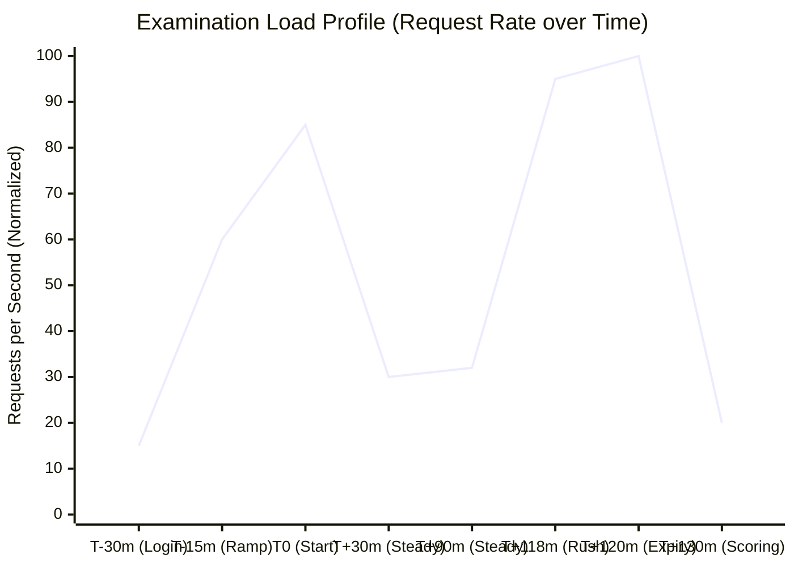

# UADUE Phase 3 — Performance Architecture & Benchmark Methodology
**Document ID:** `UADUE-P3-PERF-013`  
**Version:** `1.0.0-SPECIFICATION`  
**Status:** `DESIGN-ONLY / IMPLEMENTATION STRICTLY LOCKED`  
**Classification:** Scalability Analysis & Benchmark Engineering  

---

## 1. Executive Summary & Calibration Policy

High-stakes national examinations produce extreme, bursty traffic patterns: hundreds of thousands of candidates authenticate simultaneously, work concurrently for several hours, and submit in massive waves within the final 120 seconds of the exam window.

**Strict Calibration Policy:** *No unverified numerical performance claims are permitted.* Rather than asserting hypothetical throughput capacities, this document establishes the formal **Benchmark Methodology, Traffic Profiles, Bottleneck Taxonomy, and Scalability Architecture** necessary to evaluate system behavior under real load prior to production certification.

---

## 2. Load Testing Profiles & Concurrency Tiers

Phase 3 defines four standardized testing tiers to evaluate system resilience:

| Tier | Concurrent Candidates | Simulated Workload Focus | Primary Scalability Objective |
| :--- | :--- | :--- | :--- |
| **Tier 1 (1k)** | 1,000 | Single institutional examination; standard local / regional center. | Validate sub-10ms p99 latency on single database node. |
| **Tier 2 (10k)** | 10,000 | Large university or regional state commission exam. | Validate connection pooling, Redis caching, read replica offload. |
| **Tier 3 (100k)** | 100,000 | National centralized recruitment prelims (e.g., SSC CGL / CHSL). | Validate table partitioning, asynchronous queue backpressure, edge CDN. |
| **Tier 4 (1M)** | 1,000,000 | Megascale national examination (e.g., UPSC, NEET, JEE Mains). | Validate distributed sharding, edge ingestion, multi-region database clustering. |

---

## 3. Examination Traffic Phase Models

A realistic benchmark must simulate the four distinct temporal phases of an examination:

1. **Pre-Exam Ingress Surge ($T - 30\text{m}$ to $T_0$):**
   - High read volume: session authentication, token issuance, Tier 3 question projection downloads, asset pre-fetching.
   - Target Bottleneck: Edge CDN bandwidth, auth token signing CPU overhead, database connection pool exhaustion.
2. **Steady-State In-Flight ($T_0$ to $T + 115\text{m}$):**
   - Distributed writes: candidates answer questions at an average pace of 1 interaction every 45–90 seconds.
   - Heartbeat pings every 30 seconds per candidate.
   - Target Bottleneck: Background queue throughput, database lock contention.
3. **End-of-Exam Rush & Auto-Expiry Spike ($T + 115\text{m}$ to $T + 120\text{m}$):**
   - "Thundering Herd": 80–90% of candidates submit explicitly in the final 2 minutes; remaining 10–20% are automatically expired at the final second.
   - Extreme write surge: millions of submission receipts generated simultaneously.
   - Target Bottleneck: PostgreSQL write-ahead log (WAL) sync, monotonic sequence lock contention.
4. **Post-Exam Evaluation Phase ($T + 120\text{m}$ onwards):**
   - Asynchronous batch evaluation: scoring workers consume raw event streams, execute Phase 2D-5 evaluation logic, and emit scorecards.
   - Target Bottleneck: CPU worker saturation, batch database insert latency.

---

## 4. Architectural Bottleneck Taxonomy & Mitigations

To survive high-scale examinations, the architecture eliminates known single points of congestion:

### 4.1 Write Contention on Append-Only Ledger
- **Bottleneck:** Inserting millions of rows into a single `candidate_submission_events` table causes extreme index B-tree lock contention and WAL bottlenecking.
- **Phase 3 Design Mitigation:**
  - **Declarative Hash/List Partitioning:** Partition `candidate_submission_events` by `tenant_id` and hash of `exam_session_id` into 64 physical sub-tables.
  - **Unlogged Ingestion Staging (Optional Distributed Path):** Submissions can be acknowledged into a durable Redis Streams / Kafka buffer with multi-worker batch persistence to PostgreSQL.

### 4.2 Read Amplification on Question Projections
- **Bottleneck:** 100,000 candidates requesting question stems and option layouts simultaneously would query the database 100,000 times for the exact same canonical content.
- **Phase 3 Design Mitigation:**
  - **Edge Caching of Immutable Projections:** Tier 3 projections are cryptographically sealed and immutable. They are cached at the edge CDN using Cache-Control: `public, max-age=86400, immutable`.
  - The origin database serves the projection exactly once per package version.

### 4.3 Asset Bandwidth Exhaustion (Diagrams & Images)
- **Bottleneck:** High-resolution diagrams (e.g., visual reasoning questions, engineering schematics) saturating server network interfaces.
- **Phase 3 Design Mitigation:**
  - Binary assets are stored directly in Cloudflare R2 / AWS S3 and distributed via globally distributed CDNs.
  - Origin application servers never proxy binary asset bytes.

### 4.4 Connection Pool Exhaustion
- **Bottleneck:** Thousands of application worker pods opening direct connections to PostgreSQL, exceeding `max_connections` (e.g., 500–1000).
- **Phase 3 Design Mitigation:**
  - Mandatory transaction-level connection pooling via **PgBouncer** or **Supabase Supavisor**.
  - Worker pods hold connections only for the microsecond duration of the transaction, supporting 50,000+ active client HTTP connections on 200 physical database connections.

---

## 5. Metrics & Acceptance Thresholds

Prior to production authorization, test suites must demonstrate:

$$\text{Error Rate} < 0.001\% \quad \text{at peak load}$$
$$\text{Submission Ingestion } p95 < 25\text{ms}, \quad p99 < 75\text{ms}$$
$$\text{Recovery Time from Client Crash} < 2.0\text{s}$$
$$\text{Zero Lost Submission Events Across All Tiers}$$
