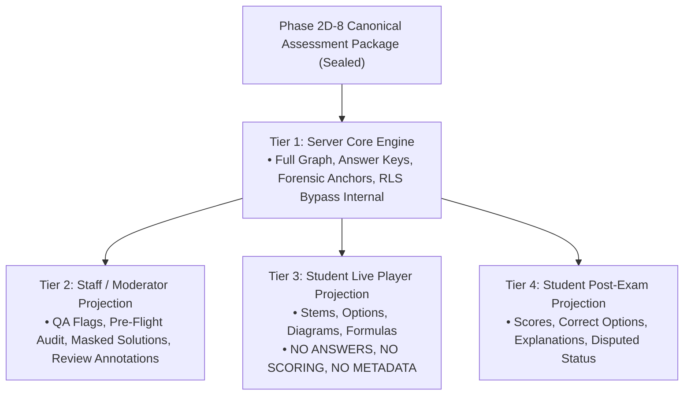

# UADUE Phase 3 — Question & Package Projection Contract
**Document ID:** `UADUE-P3-PROJ-006`  
**Version:** `1.0.0-SPECIFICATION`  
**Status:** `DESIGN-ONLY / IMPLEMENTATION STRICTLY LOCKED`  
**Classification:** Information Barrier & Projection Models  

---

## 1. Executive Summary & Core Principle

In the Unified Assessment Delivery & User Experience (UADUE) architecture, the client (Exam Player) is **strictly an untrusted rendering target**. Canonical Assessment Packages produced and sealed by Phase 2D-8 contain complete forensic evidence, candidate answer resolution graphs, scoring policies, and administrative metadata.

**Core Principle:** *A client receives only the minimum projection required for its active role and phase.* Under no circumstances does raw canonical package data get transmitted directly to candidate devices.

---

## 2. Four-Tier Information Barrier Model

Phase 3 defines four distinct, mathematically enforced projection tiers:



### 2.1 Tier Definitions

1. **Tier 1 — Server Core Engine (Authoritative Truth):**
   - **Audience:** Internal execution engines (Scoring Evaluator, Package Validator, Persistence Adapter).
   - **Scope:** Complete Canonical Package Envelope, including forensic snapshots, OCR bounding boxes, resolved answer graphs, candidate ambiguities, raw PDF coordinates, and canonical cryptographic seal (`packageIntegritySeal`).
   - **Exposure:** Never exposed to HTTP/WebSocket endpoints without filtering.

2. **Tier 2 — Staff / Moderator Projection:**
   - **Audience:** Examination proctors, subject matter experts (SMEs), psychometricians, platform admins.
   - **Scope:** Complete stems, options, and editorial flags. Answers and solution DAGs are masked by default unless the moderator has explicit `EXAM:SOLUTION_AUDIT` privilege. Allows verification of rendering anomalies without exposing answer keys across unprivileged proctor consoles.
   - **Exposure:** Authenticated staff back-office endpoints over mutual TLS / role-restricted sessions.

3. **Tier 3 — Student Live Player Projection (Strictly Sanitized):**
   - **Audience:** Candidate devices during an active examination session (`sessionState == 'ACTIVE'`).
   - **Scope:** Only the visible question presentation artifacts: question stem, options, diagrams, formulas, tables, marks allocated, candidate response schema, and presentation manifest (`presentationManifestIntegrity`).
   - **Sanitization Guarantee:** Zero answer keys, zero correct option markers, zero explanation text, zero forensic provenance, zero internal database IDs.
   - **Exposure:** Time-bound, session-bound ephemeral student token.

4. **Tier 4 — Student Post-Exam Projection (Result & Pedagogical Review):**
   - **Audience:** Candidate devices after exam conclusion and administrative result release (`sessionState in ['SUBMITTED', 'EXPIRED']` AND `packageResultReleased == TRUE`).
   - **Scope:** Complete Tier 3 presentation + Candidate's recorded response + Authoritative correct answer + Official pedagogical explanation + Final evaluation score + Corrigendum notices.
   - **Exposure:** Authenticated candidate portal.

---

## 3. Comprehensive Field Allow/Deny Matrix

The following matrix formally specifies field access across the four projection tiers. Any field not explicitly marked **ALLOW** is strictly **DENIED (stripped at server serialization)**:

| Field / Component | Tier 1 (Server) | Tier 2 (Staff) | Tier 3 (Student Live) | Tier 4 (Student Post) | Justification / Security Boundary |
| :--- | :---: | :---: | :---: | :---: | :--- |
| `packageId` | ALLOW | ALLOW | ALLOW | ALLOW | Unique package identifier (UUID). |
| `packageIntegritySeal` | ALLOW | ALLOW | ALLOW | ALLOW | SHA-256 seal used to verify canonical package immutability. |
| `presentationManifestIntegrity` | ALLOW | ALLOW | ALLOW | ALLOW | Ephemeral SHA-256 projection manifest hash (Option A). |
| `canonicalQuestionId` | ALLOW | ALLOW | ALLOW | ALLOW | Stable question UUID for submission association. |
| `logicalQuestionFamilyId` | ALLOW | ALLOW | DENY | DENY | Internal grouping identifier; stripped from candidate. |
| `representationId` | ALLOW | ALLOW | ALLOW | ALLOW | Mandatory language representation candidate identity. |
| `sourceQuestionNumber` | ALLOW | ALLOW | ALLOW | ALLOW | Official booklet numbering (e.g., "Q.27"). |
| `questionStem` (Text/Markdown) | ALLOW | ALLOW | ALLOW | ALLOW | The actual question prompt. |
| `diagrams` (Content-Addressed) | ALLOW | ALLOW | ALLOW | ALLOW | Diagram assets via secure signed URL. |
| `tables` / `mathematicalFormulas`| ALLOW | ALLOW | ALLOW | ALLOW | LaTeX / MathML markup. |
| `options` (Option Keys & Content) | ALLOW | ALLOW | ALLOW | ALLOW | Presentation option stems. |
| `markingScheme.positiveMarks` | ALLOW | ALLOW | ALLOW | ALLOW | Necessary for candidate test strategy. |
| `markingScheme.negativeMarks` | ALLOW | ALLOW | ALLOW | ALLOW | Necessary for candidate test strategy. |
| `markingScheme.penaltyFormula` | ALLOW | ALLOW | DENY | ALLOW | Internal evaluation formula hidden during live. |
| **`authoritativeAnswer`** | **ALLOW** | **MASKED\*** | **DENY** | **ALLOW** | **P3-I08: Absolute live student leakage prevention.** |
| **`answerCandidateResolutions`** | **ALLOW** | **DENY** | **DENY** | **DENY** | Internal dispute DAG from Phase 2D-5. |
| **`forensicEvidenceSnapshot`** | **ALLOW** | **DENY** | **DENY** | **DENY** | Raw PDF coordinates, bounding boxes, OCR spans. |
| **`documentGraphNodeId`** | **ALLOW** | **DENY** | **DENY** | **DENY** | Pipeline intermediate identity. |
| **`pedagogicalExplanation`** | **ALLOW** | **ALLOW** | **DENY** | **ALLOW** | Solution breakdown; strictly hidden during live. |
| **`corrigendumHistory`** | **ALLOW** | **ALLOW** | **DENY** | **ALLOW** | Official post-exam amendments. |
| `candidateSelectedResponse` | ALLOW | ALLOW | ALLOW | ALLOW | Candidate's own recorded answer. |
| `awardedMarks` / `evaluationScore`| ALLOW | ALLOW | **DENY** | **ALLOW** | Live scoring is strictly forbidden. |

*\*Masked in Tier 2: Stored answers are obscured (e.g., `[REDACTED]`) unless the staff member possesses elevated auditor clearance.*

---

## 4. Question & Option Shuffling Model

To preserve examination integrity while maintaining absolute historical auditability, Phase 3 defines a **Deterministic Session-Seeded Shuffling Algorithm**.

### 4.1 Permitted Presentation Ordering
A package configuration determines one of three ordering policies:
1. `SOURCE_ORDER`: Questions and options appear in exact order of the original source booklet.
2. `CANONICAL_ORDER`: Ordered by ascending `canonicalQuestionId`.
3. `SHUFFLED_DETERMINISTIC`: Questions and options are shuffled pseudo-randomly per session.

### 4.2 Deterministic Shuffling Specification
When `SHUFFLED_DETERMINISTIC` is active:
1. **The Seed:** The shuffle sequence is derived strictly on the server:
   $$\text{SessionQuestionSeed} = \text{HMAC-SHA256}(\text{sessionEntropyKey}, \text{examSessionId} \parallel \text{packageIntegritySeal})$$
2. **Per-Question Option Seed:**
   $$\text{OptionSeed}_q = \text{HMAC-SHA256}(\text{SessionQuestionSeed}, \text{canonicalQuestionId})$$
3. **Algorithm:** Knuth (Fisher-Yates) shuffle parameterized by the derived pseudo-random byte stream.
4. **Immutability Contract:**
   - The computed sequence mapping $(\text{displayIndex} \leftrightarrow \text{canonicalQuestionId})$ is generated once at session initialization and stored in `exam_session_projections`.
   - The client **NEVER** re-shuffles questions or options locally.
   - The submission payload maps candidate choices to `canonicalOptionId`, eliminating ambiguities from presentation shuffling.

---

## 5. Multilingual & Bilingual Presentation Model

Many national examinations (e.g., UPSC CSE, SSC CGL) are published bilingually (e.g., English and Hindi). Phase 2D-5 established logical question families containing language representation candidates.

### 5.1 Projection Rules for Bilingual Papers
1. **Single Canonical Entity:** A bilingual question has a single `canonicalQuestionId`.
2. **Language Representations:** The Tier 3 projection delivers representations keyed by language code:
   ```json
   {
     "canonicalQuestionId": "018f3a9e-4b2c-7d1a-8e5f-1a2b3c4d5e6f",
     "sourceQuestionNumber": 27,
     "representations": {
       "en": {
         "language": "en",
         "stem": "Which of the following numbers is prime?",
         "options": [{"id": "opt_1", "text": "57"}, {"id": "opt_2", "text": "53"}]
       },
       "hi": {
         "language": "hi",
         "stem": "निम्नलिखित में से कौन सी संख्या अभाज्य है?",
         "options": [{"id": "opt_1", "text": "57"}, {"id": "opt_2", "text": "53"}]
       }
     },
     "defaultLanguage": "en"
   }
   ```
3. **Option Identity Invariance:** Both English and Hindi option cards share the identical `id` (`opt_1`, `opt_2`). Switching language in the UI re-renders text without changing selection pointers or triggering submission events.
4. **Prohibition:** UI cannot fabricate, translate, or synthesize missing language representations. If a question is unilingual in the canonical package, only that representation is delivered.

---

## 6. Prohibitions & Anti-Patterns

1. **PROHIBITION P3-PR01:** The Exam Player must never execute client-side scoring logic. No JavaScript evaluation bundles may be bundled with the web application.
2. **PROHIBITION P3-PR02:** The client must never receive the full canonical package manifest. Only the session-specific projection is serialized.
3. **PROHIBITION P3-PR03:** Content-addressed asset URLs delivered to the player must be short-lived, signed, and bound to the candidate's session IP/subnet and tenant ID.
4. **PROHIBITION P3-PR04:** The player must not store unencrypted question projections in persistent client storage (such as `localStorage`). In-memory rendering and ephemeral indexed memory only.
