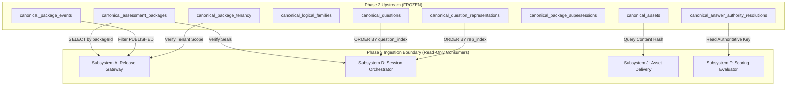

# UADUE Phase 3 — Scope & Boundary Specification
**Document ID:** `UADUE-P3-SCOPE-002`  
**Version:** `1.0.0-SPECIFICATION`  
**Status:** `DESIGN-ONLY / IMPLEMENTATION STRICTLY LOCKED`  
**Classification:** Governance & Scope Enforcement  

---

## 1. Absolute Execution & Governance Boundary

Phase 3 is governed by strict execution boundaries. This gate is exclusively an **Architecture & Design Gate**. Implementation of any kind is strictly prohibited until formal review, adversarial audit, and explicit authorization are granted.

### 1.1 Strictly Prohibited Actions (Non-Negotiable)
1. 🔴 **No Code Modifications:** Do NOT write TypeScript, JavaScript, or any runtime code for player, submissions, or scoring.
2. 🔴 **No Database Migrations:** Do NOT create SQL migration scripts, execute DDL, alter tables, or create operational tables in PostgreSQL/Supabase.
3. 🔴 **No UI / Player Modifications:** Do NOT modify existing React components, exam screens, or player widgets.
4. 🔴 **No Upstream Mutation:** Do NOT alter, refactor, or loosen any frozen contract from Phase 2A through 2D-8.
5. 🔴 **No Second Ingestion Engine:** Phase 3 must NEVER parse PDFs, perform OCR, detect columns, reconcile bilingual pairs, or synthesize canonical questions.

---

## 2. In-Scope vs. Out-of-Scope Taxonomy

```text
+-----------------------------------------------------------------------------------------+
|                                    IN-SCOPE (PHASE 3)                                   |
+-----------------------------------------------------------------------------------------+
| 1. Architecture of Exam Session Orchestration (Start, Pause, Resume, Expire, Submit).   |
| 2. Design of 4-Tier Projection Gateways (Server Core, Staff, Student Live, Post-Exam).  |
| 3. Design of Ephemeral Student Player presentation models (layout, accessibility, timer)|
| 4. Architecture of High-Throughput Student Submission Pipeline (dedup, monotonic seq).  |
| 5. Design of Evaluation & Scoring consumption boundary (invoking frozen Phase 2D-5).    |
| 6. Architecture of Post-Exam Result projections (Scorecards, Solution views, Analytics).|
| 7. Design of Content-Addressed Asset Delivery proxy and signed URL cache strategy.      |
| 8. Design of Offline Exam Journaling, reconnection synchronization, & crash recovery.  |
| 9. Design of Multi-Tenant Security, RBAC, RLS policies, and anti-leakage barriers.     |
| 10. Design of Observability, distributed telemetry, and non-PII performance metrics.   |
| 11. Design of Operational and Historical Database schemas (DDL design only, no scripts).|
+-----------------------------------------------------------------------------------------+
|                                  OUT-OF-SCOPE (PHASE 3)                                 |
+-----------------------------------------------------------------------------------------+
| 1. Document ingestion, PDF parsing, OCR, bounding box detection (Phase 2A/2B).         |
| 2. Question identity assignment, bilingual reconciliation, graph building (Phase 2C).   |
| 3. Logical question family grouping, relationship semantic evaluation (Phase 2D-1..3). |
| 4. Canonical Question IR transformation and schema definition (Phase 2D-4).             |
| 5. Core mathematical answer evaluation and scoring algorithms (Phase 2D-5).            |
| 6. Dual-seal cryptographic hashing algorithm alterations (Phase 2D-6).                 |
| 7. Relational package persistence schema and lifecycle FSM redesign (Phase 2D-7/2D-8). |
| 8. Payment gateway integrations, billing systems, proctor recruitment systems.         |
| 9. Long-term student social networking, discussion forums, or LMS course management.   |
+-----------------------------------------------------------------------------------------+
```

---

## 3. Upstream Contract Consumption Boundaries

Phase 3 operates strictly downstream of the Phase 2D-8 PostgreSQL relational repository. The exact consumption points are defined below:



### Consumption Rules:
1. **Zero Transformation on Ingestion:** Phase 3 consumes `CanonicalAssessmentPackage` exactly as persisted in PostgreSQL. It does not normalize, re-parse, or modify strings or ASTs.
2. **Read-Only Relational Access:** Phase 3 services connect to PostgreSQL using roles that have strictly `SELECT` permissions on canonical tables (`canonical_assessment_packages`, `canonical_questions`, `canonical_question_representations`, `canonical_package_events`, etc.). Triggers created in Phase 2D-8 ensure that any accidental `UPDATE` or `DELETE` attempt fails closed immediately (`P0001`).
3. **Seal Re-Verification on Package Hydration:** Before an examination session is provisioned from a package, the Session Orchestrator independently recomputes `packageId` and `packageIntegritySeal` using Phase 2D-6 hashing algorithms. If the recomputed seal does not match the database header, session provisioning is immediately aborted.

---

## 4. Preservation of Source Fidelity and Truth Authority

A primary risk in examination delivery systems is "semantic drift"—where the player software modifies presentation or interprets questions in ways that diverge from authentic source documents.

### 4.1 Strict Authority Boundaries
| Domain Concern | Authoritative Component | Non-Authoritative Component | Forbidden Behavior |
| :--- | :--- | :--- | :--- |
| **Question Text & Structure** | Frozen `CanonicalQuestionIR` | Exam Player UI | Client re-parsing markdown/LaTeX or re-synthesizing stems. |
| **Option Ordering** | Canonical Representation Order | Client Browser | Client randomly shuffling options without server-governed session seed. |
| **Language Selection** | Candidate Session Preference | Client Engine | Dynamic client translation or fallback substitution not defined in canonical representation. |
| **Examination Duration** | Server Session Orchestrator | Client Timer (JS `setInterval`) | Client determining when exam expires or allowing submission after server expiration. |
| **Answer Key & Marks** | Authoritative Answer Resolution | Student Submission Pipeline | Client computing marks, showing real-time correctness, or submitting scores. |
| **Session State** | Server Session FSM | Client LocalStorage / IndexedDB | Client dictating that an exam is "Resumed" when server marks it "Terminated". |

---

## 5. Summary of Boundary Constraints

Any proposal, architecture artifact, or future implementation plan that violates these boundaries shall be deemed **invalid and non-compliant with the UADUE governance protocol**. Phase 3 remains strictly locked for implementation until this architecture specification passes complete adversarial review.
