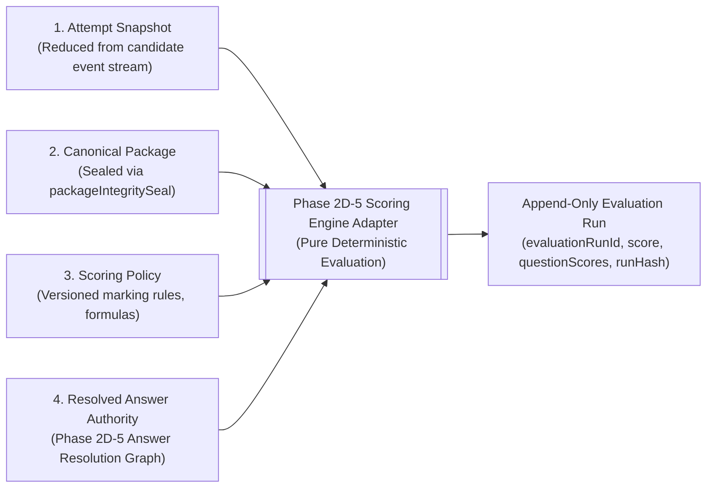
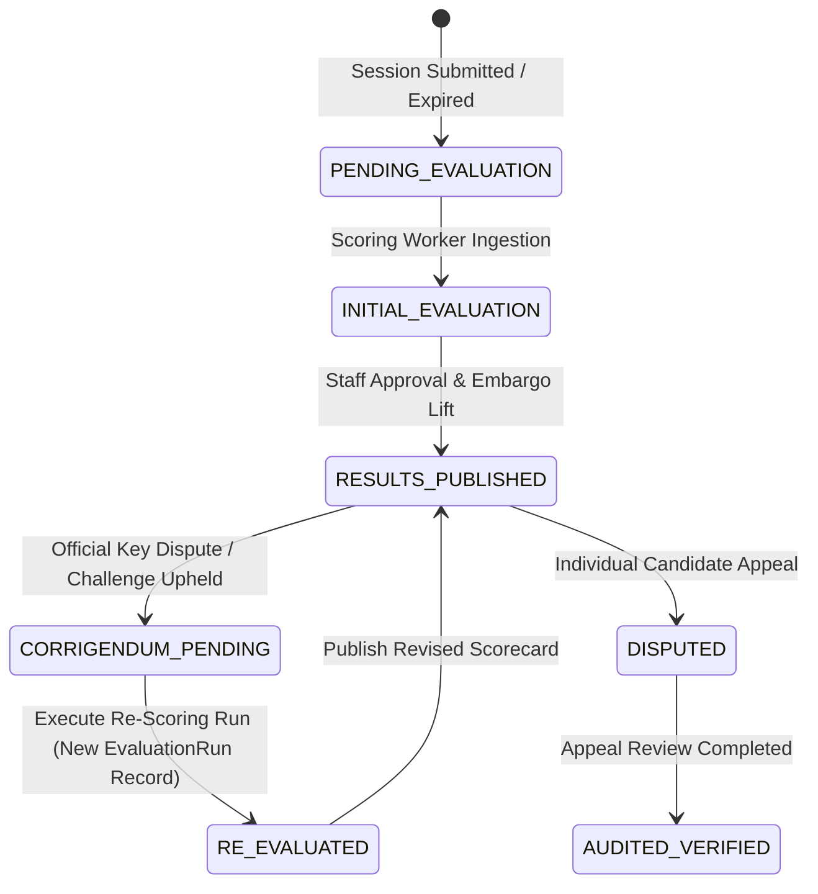

# UADUE Phase 3 — Scoring Evaluation & Result Boundary Contract
**Document ID:** `UADUE-P3-SCORE-008`  
**Version:** `1.0.0-SPECIFICATION`  
**Status:** `DESIGN-ONLY / IMPLEMENTATION STRICTLY LOCKED`  
**Classification:** Evaluation Engine Boundary & Historical Immutability  

---

## 1. Executive Summary & Core Invariant

The Phase 3 Scoring Evaluation Subsystem is a pure, deterministic consumption boundary that wraps the upstream scoring engines frozen in Phase 2D-5. It calculates official marks, penalizes incorrect responses, accounts for sectional cutoffs, and generates auditable candidate scorecards.

**Core Invariant (P3-I07 & P3-I10):** *Scoring evaluation is a pure, idempotent, side-effect-free function of four immutable parameters: $(AttemptSnapshot, PackageSnapshot, ScoringPolicyVersion, AnswerKeyVersion)$. Prior evaluations are NEVER mutated in place; any corrigendum, re-scoring, or policy amendment spawns a new, append-only `EvaluationRun` linked via a cryptographic DAG.*

---

## 2. Evaluation Parameterization & Input Immutability

Every evaluation run is parameterized by four strictly frozen entities:

### 2.1 Formal Parameter Tuple
An evaluation run $E$ is formally defined as:
$$E = \mathcal{F}_{\text{eval}}(\mathcal{A}, \mathcal{P}, \Pi, \mathcal{K})$$
Where:
- $\mathcal{A}$: **Attempt Snapshot** — Immutable final state of candidate responses reduced from the session submission event stream at terminal state (`SUBMITTED` or `EXPIRED`).
- $\mathcal{P}$: **Package Snapshot** — The exact Phase 2D-8 package identified by `(packageId, packageIntegritySeal)`.
- $\Pi$: **Scoring Policy Version** — Mathematical rules governing positive marks, negative penalties, fractional rounding, and sectional constraints (frozen in Phase 2D-5).
- $\mathcal{K}$: **Answer Authority Version** — The verified answer resolution graph derived from authoritative keys and dispute resolutions.

---

## 3. Evaluation Lifecycle & Corrigendum Architecture

Examinations frequently encounter post-exam answer key challenges, revised official answer keys (corrigenda), and withdrawn/cancelled questions. The system handles all such changes without violating historical reproducibility.

### 3.1 Append-Only Evaluation Record Schema
To prevent mutable data corruption, evaluations are stored across two append-only tables:

#### Table: `candidate_evaluation_runs`
- `evaluationRunId` (UUIDv7, PK)
- `examSessionId` (UUIDv7, FK)
- `packageId` (UUIDv7, FK)
- `packageIntegritySeal` (CHAR(64))
- `scoringPolicyVersion` (VARCHAR(32))
- `answerKeyVersion` (VARCHAR(32))
- `runIteration` (INTEGER, default 1, strictly monotonic)
- `supersedesEvaluationRunId` (UUIDv7, NULLable, FK to previous run)
- `totalRawScore` (NUMERIC(8,4))
- `totalNormalizedScore` (NUMERIC(8,4), NULLable)
- `questionsAttempted` (INTEGER)
- `questionsCorrect` (INTEGER)
- `questionsIncorrect` (INTEGER)
- `questionsUnanswered` (INTEGER)
- `evaluationSignature` (CHAR(64), SHA-256 seal of complete scorecard payload)
- `createdAt` (TIMESTAMPTZ, server default NOW())

#### Table: `candidate_question_scores`
- `questionScoreId` (UUIDv7, PK)
- `evaluationRunId` (UUIDv7, FK)
- `canonicalQuestionId` (UUIDv7, FK)
- `candidateResponseRaw` (JSONB)
- `resolvedCorrectKey` (JSONB)
- `isCorrect` (BOOLEAN)
- `isPartiallyCorrect` (BOOLEAN)
- `marksAwarded` (NUMERIC(6,4))
- `penaltyDeducted` (NUMERIC(6,4))
- `netScore` (NUMERIC(6,4))
- `disposition` (VARCHAR(32)) — `['NORMAL', 'FULL_MARKS_AWARDED', 'DROPPED_CANCELLED', 'BONUS_MARKS']`

---

## 4. Special Scoring Policies: Withdrawn, Dropped, & Multi-Key Questions

National competitive exams (e.g., SSC, UPSC, GATE, JEE) have specific statutory conventions for handling flawed questions:

### 4.1 Withdrawn / Dropped Question Modes
When a question is flagged with an error in the source stem, the policy specifies one of three resolutions:
1. `BONUS_TO_ALL` (Full Marks Awarded):
   - Every candidate who sat for the paper receives full positive marks, regardless of whether they attempted the question.
   - $\text{netScore}_q = \text{markingScheme.positiveMarks}$
   - $\text{disposition} = \text{'FULL_MARKS_AWARDED'}$
2. `DROPPED_FROM_EVALUATION` (Pro-Rata Rescaling):
   - The question is eliminated from the denominator.
   - Total exam marks are rescaled pro-rata based on remaining valid questions:
     $$\text{FinalScore} = \text{RawScoreValid} \times \left(\frac{\text{TotalOriginalMarks}}{\text{TotalValidMarks}}\right)$$
   - $\text{disposition} = \text{'DROPPED_CANCELLED'}$
3. `AWARD_TO_ATTEMPTED_ONLY`:
   - Full marks awarded only to candidates who recorded an attempt, zero to unattempted.

### 4.2 Multi-Key / Ambiguous Options
If an official corrigendum determines that both Option B and Option C are valid:
- The Phase 2D-5 Answer Authority updates $\mathcal{K}$ with a multi-key set: `validOptions: ['opt_2', 'opt_3']`.
- The evaluation marks any candidate selecting either option as `isCorrect: true`.

---

## 5. Candidate Dispute & Appeal Protocol

1. **Appeal Ingestion:** A candidate files an appeal against question $Q$ within the authorized challenge window.
2. **Appeal Record:** An immutable record is created in `candidate_scoring_disputes` referencing `(candidateId, examSessionId, canonicalQuestionId, evaluationRunId, reason)`.
3. **Audit Verification:** The server reconstructs the evaluation run:
   - Fetches the exact `AttemptSnapshot` at session close.
   - Runs Phase 2D-5 evaluation under the historical parameter tuple.
   - Verifies that recomputed `evaluationSignature` matches the stored database signature.
4. **Resolution:** If the appeal is upheld at the institutional level, a Corrigendum is issued, triggering a batch re-scoring run ($Iteration = Iteration + 1$) for all affected candidates.

---

## 6. Prohibitions & Anti-Patterns

1. **PROHIBITION P3-SCORE01:** Updating an existing row in `candidate_evaluation_runs` or `candidate_question_scores` is strictly prohibited by database RLS and triggers. All corrections must be append-only.
2. **PROHIBITION P3-SCORE02:** Scoring must never consume live or unversioned answer data. An explicit `answerKeyVersion` string/hash is mandatory.
3. **PROHIBITION P3-SCORE03:** Candidates must never see provisional scores while an exam window is active. Result projection (Tier 4) remains locked until official embargo release.
