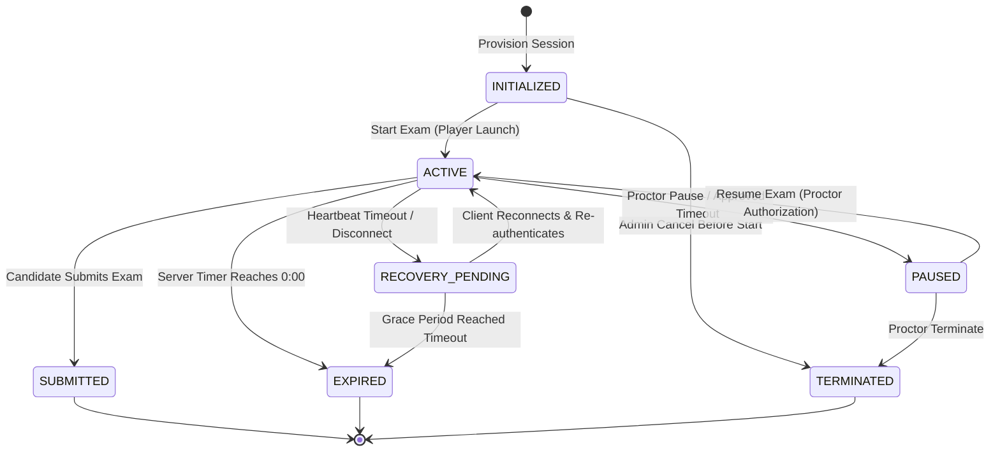
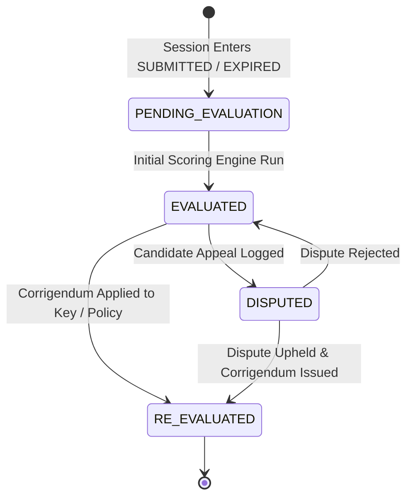

# UADUE Phase 3 — State Machines & Lifecycle Formalisms
**Document ID:** `UADUE-P3-FSM-004`  
**Version:** `1.0.0-SPECIFICATION`  
**Status:** `DESIGN-ONLY / IMPLEMENTATION STRICTLY LOCKED`  
**Classification:** Formal Transition Models  

---

## 1. Exam Session Lifecycle Finite State Machine (FSM)

The examination session is the primary operational state machine in Phase 3. Every state transition is atomic, server-governed, recorded in an append-only session audit log, and validated against strict preconditions.

### 1.1 State Definitions
- **`INITIALIZED` (Initial):** Session record created and assigned to candidate; configuration and package bound; timer not yet started.
- **`ACTIVE`:** Candidate has entered the examination room/player; server-authoritative timer is running; submissions accepted.
- **`PAUSED` (Reversible):** Examination temporarily halted (e.g., approved technical timeout, hardware swap, proctor pause); countdown frozen; submissions rejected.
- **`RECOVERY_PENDING` (Reversible):** Heartbeat lost or unexpected client disconnection detected; candidate grace period active; submissions queued or rejected.
- **`SUBMITTED` (Terminal):** Candidate explicitly finished and submitted the examination; all further submission events rejected; ready for evaluation.
- **`EXPIRED` (Terminal):** Server countdown reached zero without explicit submission; auto-submission trigger executed; attempt sealed.
- **`TERMINATED` (Terminal):** Administrative cancellation due to proctor dismissal, malfeasance, security breach, or tenant cancellation; no evaluation generated.

### 1.2 State Transition Diagram



### 1.3 Formal State Transition Relation Matrix

| Current State | Event Trigger | Next State | Condition / Authority | Transition Class |
| :--- | :--- | :--- | :--- | :--- |
| **`INITIALIZED`** | `START_SESSION` | **`ACTIVE`** | Current time $\ge$ Scheduled window start; Valid candidate credentials. | Valid |
| **`INITIALIZED`** | `TERMINATE_SESSION` | **`TERMINATED`** | Authorized staff action with recorded reason. | Valid |
| **`ACTIVE`** | `PAUSE_SESSION` | **`PAUSED`** | Proctor authorization; pause count $<$ `maxAllowedPauses`. | Valid |
| **`ACTIVE`** | `HEARTBEAT_LOST` | **`RECOVERY_PENDING`**| Server elapsed time since last heartbeat $>$ threshold. | Valid |
| **`ACTIVE`** | `SUBMIT_EXAM` | **`SUBMITTED`** | Candidate submission request with active session token. | Valid (Terminal) |
| **`ACTIVE`** | `TIMER_EXPIRED` | **`EXPIRED`** | Server-computed remaining seconds $\le 0$. | Valid (Terminal) |
| **`PAUSED`** | `RESUME_SESSION` | **`ACTIVE`** | Proctor re-authorization token. | Valid (Reversible) |
| **`PAUSED`** | `TERMINATE_SESSION` | **`TERMINATED`** | Administrative cancellation. | Valid (Terminal) |
| **`RECOVERY_PENDING`**| `RECONNECT_SESSION`| **`ACTIVE`** | Valid session token, matching device fingerprint, within grace period. | Valid (Reversible) |
| **`RECOVERY_PENDING`**| `GRACE_EXPIRED` | **`EXPIRED`** | Disconnect duration exceeded maximum allowed grace window. | Valid (Terminal) |
| **`SUBMITTED`** | *ANY EVENT* | **REJECTED** | Terminal state. Throws `SessionAlreadySubmittedError` (409). | **FORBIDDEN** |
| **`EXPIRED`** | *ANY EVENT* | **REJECTED** | Terminal state. Throws `SessionExpiredError` (409). | **FORBIDDEN** |
| **`TERMINATED`** | *ANY EVENT* | **REJECTED** | Terminal state. Throws `SessionTerminatedError` (403). | **FORBIDDEN** |

### 1.4 Session Concurrency Invariant (P3-I21) & Single-Writer Protocol
> **Invariant P3-I21:** *At most one authoritative session-state transition may commit for a given session state version.*

To enforce this without table-level bottlenecks:
1. The `exam_sessions` table includes `state_version INTEGER NOT NULL DEFAULT 1`.
2. Every transition executes via conditional optimistic update:
   ```sql
   UPDATE exam_sessions
   SET session_state = :targetState, state_version = state_version + 1, updated_at = NOW()
   WHERE exam_session_id = :id AND session_state = :expectedState AND state_version = :expectedVersion;
   ```
3. If concurrent transactions race (e.g., candidate `SUBMIT` vs server timer `EXPIRE`), the first commit succeeds; the second observes 0 rows updated, detects terminal state, and fails closed with `409 Conflict`.

---

## 2. Submission Ingestion & Event Stream Reducer

Student responses are not stored as mutable cells in a table. They are modeled as an **ordered append-only event stream**.

### 2.1 Submission Reducer Formalism
For an exam session $S$, the effective state of answers at sequence $N$ is reduced as follows:
$$\text{State}_N = \text{reduce}(\text{State}_{N-1}, \text{SubmissionEvent}_N)$$

Where $\text{SubmissionEvent}$ can be:
1. `RESPONSE_RECORDED`:
   $$\text{State}[q] \leftarrow \text{CandidateResponseValue}$$
2. `RESPONSE_CLEARED`:
   $$\text{State}[q] \leftarrow \text{UNANSWERED}$$
3. `MARKED_FOR_REVIEW`:
   $$\text{ReviewFlags}[q] \leftarrow \text{TRUE}$$
4. `UNMARKED_FOR_REVIEW`:
   $$\text{ReviewFlags}[q] \leftarrow \text{FALSE}$$

### 2.2 Replay Idempotency Contract
When the server receives a `SubmissionEvent` with an existing `(examSessionId, clientEventId)`:
1. If the payload is identical: Return the existing `SubmissionReceipt` without appending a duplicate row (**Idempotent Replay**).
2. If the payload differs: Reject with `SubmissionConflictError` (**Tampered Replay Rejection**).

---

## 3. Evaluation & Corrigendum Lifecycle FSM



### 3.1 Corrigendum Semantics:
- An existing `EvaluationRun` record is **never updated in place**.
- Applying a corrigendum (e.g., question cancelled, multiple options accepted) triggers a new `EvaluationRun` linked to the `CorrigendumAuthorityEvent`.
- Both runs remain permanently accessible in the database, allowing candidates and auditors to inspect the exact historical before-and-after diff.
