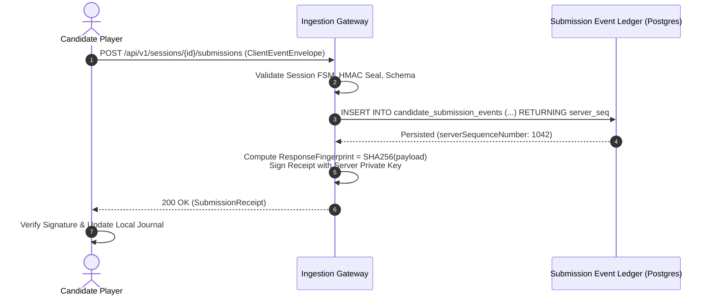

# UADUE Phase 3 — Student Submission Pipeline Contract
**Document ID:** `UADUE-P3-SUB-007`  
**Version:** `1.0.0-SPECIFICATION`  
**Status:** `DESIGN-ONLY / IMPLEMENTATION STRICTLY LOCKED`  
**Classification:** Ingestion Gateway & Event Stream Contracts  

---

## 1. Executive Summary & Core Invariant

The Student Submission Pipeline is the high-throughput, fault-tolerant ingestion subsystem of UADUE Phase 3. It accepts, validates, sequences, and durably records candidate examination interactions.

**Core Invariant (P3-I06):** *All candidate submission interactions are modeled as immutable, monotonic append-only events. The client is strictly non-authoritative over scores, answer keys, question validity, marks, and timing authority.*

---

## 2. Granular Submission Event Payloads

Submissions are processed through strongly typed event payloads. Every submission event references immutable identities established upstream in Phase 2D-8.

### 2.1 Universal Submission Event Envelope Schema
Every submission request submitted to the ingestion gateway MUST conform to the following schema:

```json
{
  "$schema": "https://json-schema.org/draft/2020-12/schema",
  "title": "UADUESubmissionEventEnvelope",
  "type": "object",
  "required": [
    "clientEventId",
    "examSessionId",
    "sessionToken",
    "packageId",
    "packageIntegritySeal",
    "canonicalQuestionId",
    "presentationRepresentation",
    "clientSequenceNumber",
    "eventType",
    "payload",
    "clientTimestamp"
  ],
  "properties": {
    "clientEventId": {
      "type": "string",
      "format": "uuid",
      "description": "Client-generated UUIDv7 uniquely identifying this interaction event."
    },
    "examSessionId": {
      "type": "string",
      "format": "uuid",
      "description": "Identifier of the active examination session."
    },
    "sessionToken": {
      "type": "string",
      "description": "Cryptographically signed JWT/bearer token bound to this session and candidate."
    },
    "packageId": {
      "type": "string",
      "format": "uuid",
      "description": "Target canonical assessment package identifier."
    },
    "packageIntegritySeal": {
      "type": "string",
      "pattern": "^[a-f0-9]{64}$",
      "description": "Hex SHA-256 seal of the package to prevent cross-version desynchronization."
    },
    "canonicalQuestionId": {
      "type": "string",
      "format": "uuid",
      "description": "Target canonical question identifier."
    },
    "presentationRepresentation": {
      "type": "string",
      "enum": ["SOURCE_ORDER", "CANONICAL_ORDER", "SHUFFLED_DETERMINISTIC"],
      "description": "The ordering mode under which the candidate viewed this question."
    },
    "clientSequenceNumber": {
      "type": "integer",
      "minimum": 1,
      "description": "Strictly monotonic sequence counter maintained by the client session journal."
    },
    "eventType": {
      "type": "string",
      "enum": [
        "SINGLE_CHOICE_SELECT",
        "MULTIPLE_CHOICE_SELECT",
        "NUMERICAL_VALUE_ENTRY",
        "SUBJECTIVE_TEXT_ENTRY",
        "CLEAR_RESPONSE",
        "MARK_FOR_REVIEW",
        "UNMARK_FOR_REVIEW"
      ]
    },
    "payload": {
      "type": "object",
      "description": "Type-specific payload containing candidate response choices or values."
    },
    "clientTimestamp": {
      "type": "string",
      "format": "date-time",
      "description": "Advisory client wall clock time (NOT authoritative for grading or timing)."
    }
  },
  "additionalProperties": false
}
```

### 2.2 Granular Event Type Payloads

#### A. Single Choice Selection (`SINGLE_CHOICE_SELECT`)
```json
{
  "eventType": "SINGLE_CHOICE_SELECT",
  "payload": {
    "selectedOptionId": "018f3a9e-4b2c-7d1a-8e5f-1a2b3c4d5e01"
  }
}
```

#### B. Multiple Choice Selection (`MULTIPLE_CHOICE_SELECT`)
```json
{
  "eventType": "MULTIPLE_CHOICE_SELECT",
  "payload": {
    "selectedOptionIds": [
      "018f3a9e-4b2c-7d1a-8e5f-1a2b3c4d5e01",
      "018f3a9e-4b2c-7d1a-8e5f-1a2b3c4d5e03"
    ]
  }
}
```

#### C. Numerical Value Entry (`NUMERICAL_VALUE_ENTRY`)
```json
{
  "eventType": "NUMERICAL_VALUE_ENTRY",
  "payload": {
    "enteredValue": "3.14159",
    "unit": null
  }
}
```

#### D. Clear Response (`CLEAR_RESPONSE`)
```json
{
  "eventType": "CLEAR_RESPONSE",
  "payload": {
    "clearedQuestionId": "018f3a9e-4b2c-7d1a-8e5f-1a2b3c4d5e6f"
  }
}
```

#### E. Mark for Review (`MARK_FOR_REVIEW` / `UNMARK_FOR_REVIEW`)
```json
{
  "eventType": "MARK_FOR_REVIEW",
  "payload": {
    "flagged": true
  }
}
```

---

## 3. Dual Receipt & Acknowledgment Architecture

To guarantee end-to-end auditability and provide mathematically irrefutable proof of submission, the Ingestion Gateway issues a **Signed Cryptographic Submission Receipt** for every accepted event.



### 3.1 Submission Receipt Specification
```json
{
  "receiptId": "018f3a9e-9999-7d1a-8e5f-receipt000001",
  "examSessionId": "018f3a9e-4b2c-7d1a-8e5f-1a2b3c4d5e6f",
  "clientEventId": "018f3a9e-8888-7d1a-8e5f-clientevt00001",
  "clientSequenceNumber": 14,
  "serverSequenceNumber": 1042,
  "canonicalQuestionId": "018f3a9e-4b2c-7d1a-8e5f-question0001",
  "responseFingerprint": "9f86d081884c7d659a2feaa0c55ad015a3bf4f1b2b0b822cd15d6c15b0f00a08",
  "serverTimestamp": "2026-10-07T14:52:00.123Z",
  "validationStatus": "ACCEPTED",
  "serverSignature": "ed25519:abcdef123456...server_signature_bytes..."
}
```

---

## 4. Edge Case & Adversarial Handling Matrix

The pipeline is hardened against network instability, client manipulation, and adversarial disruption:

| Failure / Attack Mode | Gateway Behavior | Ingestion Response | Event Ledger State |
| :--- | :--- | :--- | :--- |
| **Identical Duplicate / Network Retry** | Detects existing `(examSessionId, clientEventId)` with identical payload hash. | **200 OK** (Returns cached original `SubmissionReceipt`). | Zero duplicate row appended. Idempotency preserved. |
| **Tampered Duplicate** | Detects existing `clientEventId` with conflicting response payload. | **409 Conflict** (`E_PAYLOAD_TAMPERED`). | Rejected. Security audit alert logged. |
| **Out-of-Order Client Events** | Client sends sequence 16 before sequence 15 (e.g., race across sockets). | **202 Accepted** (Stored in ledger; server sequence preserves ingress order; reducer reconciles monotonically). | Both appended. State reducer evaluates strictly by client sequence. |
| **Offline Submission Batch** | Candidate reconnects after temporary outage and flushes journal array. | **200 OK Batch Receipt** (Atomic transaction verifies sequence chain and persists array). | All batch events appended in atomic transaction. |
| **Late Submission (Receipt-Based Policy)** | Evaluates $T_{\text{receipt}} \le T_{\text{deadline}} + 15.000\text{s}$. Client clock has zero authority. | If $T_{\text{receipt}} \le T_{\text{cutoff}}$, **200 OK** (Accepted); if $T_{\text{receipt}} > T_{\text{cutoff}}$, **403 Forbidden** (`E_SUBMISSION_EXPIRED`). | Appended if $T_{\text{receipt}} \le T_{\text{cutoff}}$. Dropped if after cutoff. |
| **Manipulated Client Clock** | Candidate adjusts device time backwards to simulate early response. | **Ignored** (Server monotonic receipt timestamp is authoritative; client timestamp logged purely for telemetry). | Appended with server timestamp. Evaluation uses server window only. |
| **Package Seal Mismatch** | Submission specifies `packageIntegritySeal` differing from active session. | **400 Bad Request** (`E_PACKAGE_SEAL_MISMATCH`). | Rejected immediately. Potential package injection attack thwarted. |
| **Concurrent Device Submission** | Multiple browser tabs or devices submit simultaneously for same session. | **Single-Active-Lease Validation**: Only the token matching the latest lease ID is accepted. | Stale device rejected with **401 Unauthorized** (`E_LEASE_REVOKED`). |
| **Non-Existent Question ID** | Submission references question UUID not in the active package. | **422 Unprocessable Entity** (`E_QUESTION_NOT_IN_PACKAGE`). | Rejected. |
| **Malformed Response Payload** | String value sent for single-choice option; or out-of-range numerical value. | **400 Bad Request** (`E_SCHEMA_VALIDATION_FAILED`). | Rejected at gateway schema filter. |

---

## 5. Offline Examination & Client Journaling Contract

In scenarios where low-bandwidth or spotty connectivity is expected:
1. **Local IndexedDB Journal:** Every user click is appended locally to an encrypted IndexedDB event journal with an incremental `clientSequenceNumber`.
2. **Dual Tracking:** The client tracks:
   - `lastFlushedSequenceNumber`: The highest sequence acknowledged by a valid server receipt.
   - `lastLocalSequenceNumber`: The highest sequence produced by the user.
3. **Flushing Protocol:**
   - As soon as connectivity is restored, the client posts unacknowledged events in contiguous batches.
   - The server processes the batch inside a single PostgreSQL transaction:
     ```sql
     INSERT INTO candidate_submission_events (...) VALUES (...), (...);
     ```
   - If any event in the batch fails validation, the entire batch is rolled back and the specific offending event ID is returned.

---

## 6. Prohibitions & Anti-Patterns

1. **PROHIBITION P3-SUB01:** Under no circumstances may client-side logic alter past events in the journal. Updates to answers must always be modeled as new append events (`RESPONSE_RECORDED` or `CLEAR_RESPONSE`).
2. **PROHIBITION P3-SUB02:** The submission gateway must never execute synchronous scoring during ingestion. Scoring is completely asynchronous to prevent denial-of-service bottlenecks.
3. **PROHIBITION P3-SUB03:** The client must never calculate `awardedMarks`, `penaltyMarks`, or `isCorrect`.
