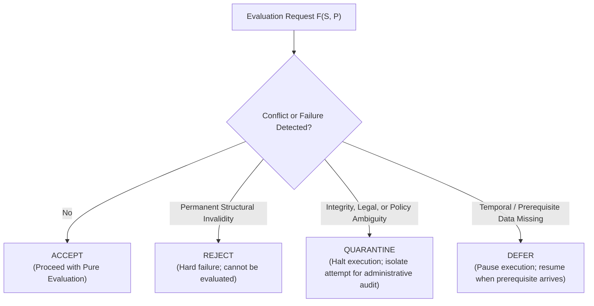

# Canonical Assessment-Policy Layer — Conflict & Failure Isolation Model
**Document Identifier:** `UADUE-SPEC-AP-CONFLICT-001`  
**Security Classification:** Restricted Engineering Specification  
**Status:** Architecture Specification Only — Zero Implementation  
**Gate:** Canonical Assessment-Policy Governance Gate (Steps 12 & 16)

---

## 1. The Fail-Closed Governance Imperative

In high-stakes examination processing, **silent fallbacks, heuristic best-guesses, and implicit policy selections are catastrophic security and legal vulnerabilities**. 

If a scoring policy is ambiguous, if two conflicting policies apply, if an answer key corrigendum has incomplete parameters, or if cohort data is incomplete:
- The system must **NEVER silently pick a policy**.
- The system must **NEVER default to a naive pro-rata multiplier**.
- The system must **FAIL CLOSED**.

Every evaluation request either resolves to an authoritative, cryptographically verified result, or transitions into an explicit non-evaluable state: **`REJECT`**, **`QUARANTINE`**, or **`DEFER`**.

---

## 2. Action Taxonomy: REJECT vs QUARANTINE vs DEFER



### 2.1 The Four Resolution States

1. **`ACCEPT`**:
   All inputs $S$ and policy $P$ are cryptographically verified, structurally complete, temporally valid, and unconflicted. Deterministic evaluation proceeds.
2. **`REJECT`**:
   The evaluation request is structurally or mathematically invalid, violates statutory preconditions, or attempts an illegal operation. The evaluation is terminated with a fatal rejection error. No retry without request remediation.
3. **`QUARANTINE`**:
   The attempt or policy exhibits potential tampering, cryptographic digest mismatch, legal dispute, or unresolved policy conflict. The evaluation is immediately halted, and the attempt is locked in a quarantined ledger to prevent score publication or rank leakage. Requires human examination controller sign-off to release.
4. **`DEFER`**:
   The evaluation cannot proceed yet because an external statutory dependency is pending (e.g., multi-shift cohort equating requires all shifts to complete exam upload). Execution is parked cleanly without error, awaiting the completion trigger.

---

## 3. Conflict Resolution Matrix (Step 12)

The system enforces deterministic fail-closed rules across all 11 conflict conditions:

| Conflict Scenario | Description | Action | Detailed System Behavior & Invariant |
|---|---|---|---|
| **1. Two Applicable Policies** | Database or configuration resolves two active policies with identical precedence for an attempt. | **`QUARANTINE`** | System halts evaluation immediately. Raises `POLICY_AMBIGUOUS`. Never chooses arbitrarily. |
| **2. Missing Policy** | No active policy exists matching the paper or exam cycle. | **`REJECT`** | Raises `POLICY_NOT_FOUND`. No default policy may be assumed. Attempt remains uncalculated. |
| **3. Conflicting Policy Versions** | An attempt matches two distinct versions of the same policy family simultaneously. | **`QUARANTINE`** | Raises `POLICY_VERSION_MISMATCH`. Isolate attempt for version pin resolution. |
| **4. Contradictory Source Documents** | Tier 1 source documents (e.g., initial notification vs corrigendum) contradict each other without formal resolution. | **`QUARANTINE`** | Raises `PROVENANCE_CONTRADICTION`. Requires academic committee Tier 2 interpretation sign-off. |
| **5. Incomplete Cohort Data** | Normalization policy requires multi-shift cohort matrix $\mathcal{C}$, but shift 3 is still ongoing or missing. | **`DEFER`** | Raises `INSUFFICIENT_COHORT_DATA`. Attempt placed in deferred queue until all shifts are sealed. |
| **6. Unsupported Policy Operation** | Policy AST contains an operation not supported by the evaluation engine (e.g., non-linear cubic spline equating). | **`REJECT`** | Raises `UNSUPPORTED_POLICY`. Engine refuses execution; does not attempt approximation. |
| **7. Invalid Numerical Inputs** | Negative maximum marks, division by zero, non-integer rational components, or invalid score ranges. | **`REJECT`** | Raises `INVALID_NUMERICAL_INPUT`. Evaluator fails fast before computing. |
| **8. Expired Policy** | Attempt timestamp is after the `effectiveUntil` statutory cutoff of the policy. | **`REJECT`** | Raises `POLICY_EXPIRED`. Refuses evaluation under expired rules. |
| **9. Withdrawn Policy** | Policy has been formally revoked (`status: WITHDRAWN`) due to legal/statutory order. | **`QUARANTINE`** | Raises `POLICY_WITHDRAWN`. Quarantines all attempts referencing this policy. |
| **10. Policy/Source Mismatch** | Paper ID, question count, or section count in policy $P$ does not match the canonical paper in $S$. | **`REJECT`** | Raises `POLICY_SOURCE_MISMATCH`. Rejects invalid pairing. |
| **11. Applicability Ambiguity** | Candidate category or attempt mode cannot be definitively classified under policy eligibility rules. | **`QUARANTINE`** | Raises `APPLICABILITY_AMBIGUOUS`. Requires candidate credential verification. |

---

## 4. Comprehensive Failure Taxonomy (Step 16)

```typescript
export enum PolicyEvaluationFailureCode {
  // Discovery & Resolution Failures
  POLICY_NOT_FOUND = "POLICY_NOT_FOUND",
  POLICY_AMBIGUOUS = "POLICY_AMBIGUOUS",
  POLICY_NOT_APPLICABLE = "POLICY_NOT_APPLICABLE",
  POLICY_EXPIRED = "POLICY_EXPIRED",
  POLICY_WITHDRAWN = "POLICY_WITHDRAWN",
  POLICY_VERSION_MISMATCH = "POLICY_VERSION_MISMATCH",

  // Input & Data Integrity Failures
  INVALID_INPUT = "INVALID_INPUT",
  INVALID_NUMERICAL_INPUT = "INVALID_NUMERICAL_INPUT",
  POLICY_SOURCE_MISMATCH = "POLICY_SOURCE_MISMATCH",
  INSUFFICIENT_COHORT_DATA = "INSUFFICIENT_COHORT_DATA",
  COHORT_DATA_CORRUPTED = "COHORT_DATA_CORRUPTED",

  // Execution & Mathematical Failures
  NUMERICAL_OVERFLOW = "NUMERICAL_OVERFLOW",
  DIVISION_BY_ZERO = "DIVISION_BY_ZERO",
  UNSUPPORTED_POLICY = "UNSUPPORTED_POLICY",

  // Trust, Provenance & Cryptographic Failures
  PROVENANCE_FAILURE = "PROVENANCE_FAILURE",
  PROVENANCE_CONTRADICTION = "PROVENANCE_CONTRADICTION",
  INTEGRITY_FAILURE = "INTEGRITY_FAILURE",
  SIGNATURE_VERIFICATION_FAILED = "SIGNATURE_VERIFICATION_FAILED",
  TENANT_ISOLATION_VIOLATION = "TENANT_ISOLATION_VIOLATION",
}
```

### 4.1 Failure Action Mapping Table

| Failure Code | Classification | Final Result State | Action Taken by Evaluation Service |
|---|---|---|---|
| `POLICY_NOT_FOUND` | Resolution Defect | `REJECT` | Halts evaluation; logs audit error; candidate attempt status remains `EVALUATION_PENDING_POLICY`. |
| `POLICY_AMBIGUOUS` | Policy Conflict | `QUARANTINE` | Moves attempt to `QUARANTINE_QUEUE`; notifies Examination Controller; alerts on dual active policy. |
| `POLICY_NOT_APPLICABLE` | Mismatch | `REJECT` | Terminates evaluation; logs rejection with rule criteria details. |
| `POLICY_EXPIRED` | Temporal Invalidation | `REJECT` | Halts evaluation; rejects attempt; requests active cycle policy. |
| `POLICY_WITHDRAWN` | Statutory Revocation | `QUARANTINE` | Locks attempt; halts batch processing; alerts legal compliance officer. |
| `POLICY_VERSION_MISMATCH` | Inconsistent Linkage | `QUARANTINE` | Halts attempt; flags attempt lineage record for forensic audit. |
| `INVALID_INPUT` | Structural Defect | `REJECT` | Halts attempt; returns schema violation details. |
| `INVALID_NUMERICAL_INPUT` | Domain Violation | `REJECT` | Halts evaluation; logs rational overflow or denominator violation. |
| `POLICY_SOURCE_MISMATCH` | Binding Error | `REJECT` | Halts evaluation; returns mismatched paper/item count details. |
| `INSUFFICIENT_COHORT_DATA` | Upstream Prerequisite | `DEFER` | Moves attempt to `DEFERRED_COHORT_WAITING`; registers wake-up hook on cohort seal event. |
| `COHORT_DATA_CORRUPTED` | Integrity Breach | `QUARANTINE` | Locks entire cohort batch; alerts psychometrics team. |
| `NUMERICAL_OVERFLOW` | Algorithmic Error | `REJECT` | Halts execution; fails safe before emitting corrupt number. |
| `DIVISION_BY_ZERO` | Mathematical Singularity | `REJECT` | Emits zero-denominator alert; refuses evaluation. |
| `UNSUPPORTED_POLICY` | Engine Limitation | `REJECT` | Refuses evaluation; requires engine upgrade before attempting. |
| `PROVENANCE_FAILURE` | Audit Violation | `QUARANTINE` | Locks policy and attempt; alerts governance gate. |
| `PROVENANCE_CONTRADICTION` | Legal Conflict | `QUARANTINE` | Halts scoring runs; requires academic committee review. |
| `INTEGRITY_FAILURE` | Tamper Detection | `QUARANTINE` | Raises critical security incident; locks tenant pipeline. |
| `SIGNATURE_VERIFICATION_FAILED` | Cryptographic Defect | `QUARANTINE` | Rejects policy package; raises security breach alarm. |
| `TENANT_ISOLATION_VIOLATION` | Security Breach | `QUARANTINE` | Terminates session; writes forensic breach record to security log. |

---

## 5. Quarantine Management & Remediation Protocol

When an attempt or policy is quarantined:
1. **Isolation Guarantee**:
   The attempt is marked `isQuarantined: true` in the policy evaluation store. No projection gateway (Phase 3.6), public API, or reporting tool may read scores from quarantined records.
2. **Immutability of Quarantine Log**:
   Every transition to quarantine writes an un-deletable audit log:
   `quarantine_id`, `attempt_id`, `failure_code`, `timestamp_utc`, `system_state_digest`.
3. **Explicit Human De-Quarantine**:
   An attempt can only exit quarantine via a signed **Governance Release Order**:
   - Issued by authorized `POLICY_REVOKER` or `POLICY_ACTIVATOR`.
   - Accompanied by a corrected policy version or confirmed input dataset.
   - Re-evaluation executes from scratch through the pure evaluation function $\mathcal{F}(S, P_{\text{remediated}})$.
