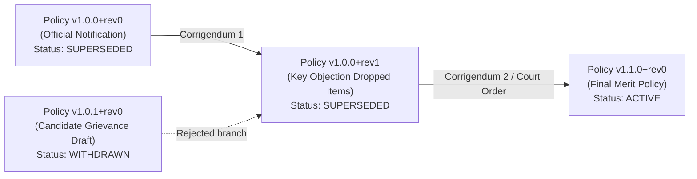
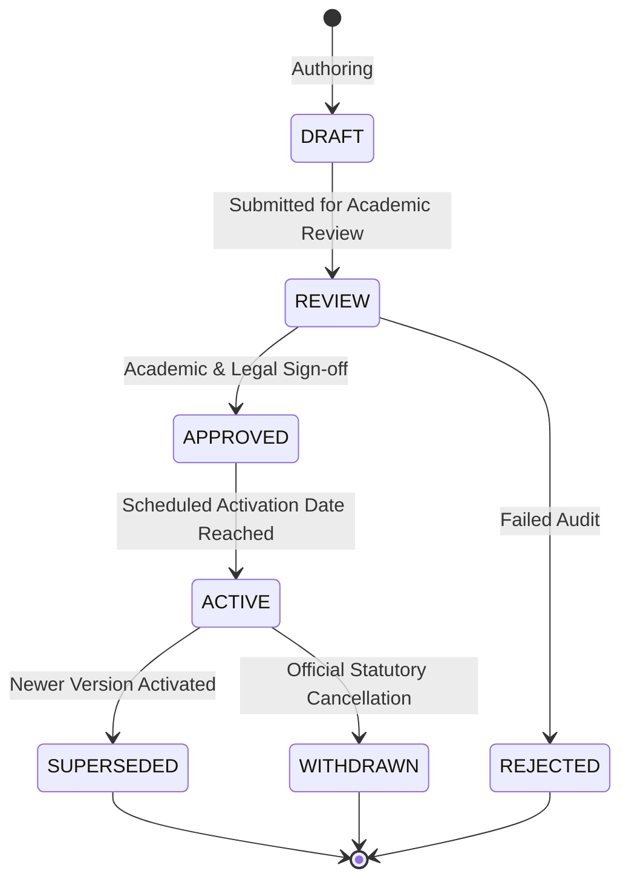

# Canonical Assessment-Policy Layer — Policy Versioning & Lineage Specification
**Document Identifier:** `UADUE-SPEC-AP-VERSIONING-001`  
**Security Classification:** Restricted Engineering Specification  
**Status:** Architecture Specification Only — Zero Implementation  
**Gate:** Canonical Assessment-Policy Governance Gate (Step 5)

---

## 1. Immutability Mandate

In the Canonical Assessment-Policy Layer, **policy definitions are strictly immutable**. 

1. **Zero In-Place Mutation**:
   Once a policy definition is authored, sealed, and approved, its database record, AST, parameters, and metadata become read-only forever. No SQL `UPDATE` statement may modify any operational attribute of a policy.
2. **Cryptographic Identity**:
   A policy’s identity is intrinsically bound to its RFC 8785 Canonical JSON SHA-256 digest $\mathcal{H}_{\text{policy}}$. Any change in a single whitespace, digit, or rule produces a distinct digest and constitutes an entirely new policy entity.
3. **Audit Ledger Permanence**:
   Historical policy records cannot be deleted (`DELETE` prohibited). They remain indefinitely in the policy ledger for forensic audit, RTI (Right to Information) requests, and statutory dispute defense.

---

## 2. Policy Versioning Scheme

Policy versions must follow a strict, non-ambiguous semantic versioning format augmented with revision sequence metadata:

$$\text{Version} = \langle \text{Major} \rangle . \langle \text{Minor} \rangle . \langle \text{Patch} \rangle + \text{rev} \langle \text{Revision} \rangle$$

### 2.1 Version Transition Semantics

| Level | Semantic Meaning | Example Triggers | Invalidation Scope |
|---|---|---|---|
| **Major** (`X.0.0`) | **Statutory / Structural Overhaul** | Examination body changes the exam pattern (e.g., UPSC introducing CSAT qualifying cutoffs, SSC changing tier structure, GATE adopting new normalization formula). | Incompatible with previous attempts. Requires re-binding of exam paper templates. |
| **Minor** (`X.Y.0`) | **Rule / Weighting Adjustments** | Corrigendum changing category reservation cutoffs, section mark allocations, or negative marking fractions without structural changes. | Compatible with paper structure. Historical attempts retain previous minor version unless re-evaluation authorized. |
| **Patch** (`X.Y.Z`) | **Clarifications / Precision Rules** | Clarification on tie-breaking ordering or statutory rounding precision (e.g., specifying truncation vs half-up at the 4th decimal place). | Backward-compatible precision adjustment. |
| **Revision** (`+revN`) | **Corrigendum / Key Dispute Resolution** | Post-exam corrigendum (e.g., dropping 2 questions post-objection window and triggering pro-rata rescale). | Specific to an examination cycle or session. |

---

## 3. Directed Acyclic Graph (DAG) of Policy Lineage

Policies form an immutable Directed Acyclic Graph (DAG) tracking the complete historical chain of evolution:



### 3.1 Lineage Fields in Policy Entity

Each policy version records explicit bidirectional linkage pointers:

```typescript
interface PolicyLineageMetadata {
  /** The immutable primary key and canonical ID of this policy version */
  readonly policyVersionId: string;

  /** Canonical family identifier that spans all versions of this policy */
  readonly policyFamilyId: string;

  /** Semver string */
  readonly versionString: string;

  /** ID of the policy version that this version directly supersedes (null if initial) */
  readonly supersedesPolicyId: string | null;

  /** IDs of policy versions that supersede this version (populated as new versions are activated) */
  readonly supersededByPolicyIds: readonly string[];

  /** Statutory reason for supersession or branch creation */
  readonly lineageTransitionRationale: string;

  /** Cryptographic hash of the predecessor policy (asserts unbroken cryptographic chain) */
  readonly predecessorDigest: string | null;
}
```

---

## 4. Policy Lifecycle & State Machine



### 4.1 State Definitions
1. **`DRAFT`**: Being authored; cannot be evaluated against candidate attempts.
2. **`REVIEW`**: Locked for review; undergoing automated formal verification and peer review.
3. **`APPROVED`**: Formally sealed with cryptographic signature; waiting for effective date.
4. **`ACTIVE`**: The currently applicable policy for new evaluations within its validity window.
5. **`SUPERSEDED`**: Replaced by a newer policy version; permanently archived for historical evaluation.
6. **`WITHDRAWN`**: Revoked by administrative or legal authority; cannot be applied to future attempts.
7. **`REJECTED`**: Defective draft rejected during gate certification.

---

## 5. Effective Date Intervals & Temporal Applicability

A policy's legal applicability is bounded by statutory time intervals:

```typescript
interface PolicyTemporalValidity {
  /** Timestamp from which this policy legally applies (inclusive, UTC) */
  readonly effectiveFrom: string; // ISO-8601 UTC

  /** Timestamp until which this policy legally applies (exclusive, UTC, null if open) */
  readonly effectiveUntil: string | null; // ISO-8601 UTC

  /** The specific exam cycle / session code to which this policy applies */
  readonly applicableExamCycle: string; // e.g., "CSE_2023_PRELIMS"
}
```

### 5.1 Temporal Resolution Rules
When an attempt is evaluated:
1. **Pinned Historical Attempts**:
   If an attempt was previously evaluated under Policy Version $V_A$, re-evaluations for audit reproduction **must explicitly request Version $V_A$**, ignoring current time or newer versions.
2. **Official Re-Scoring / Normalization Runs**:
   When an examination authority orders a mass re-scoring under a new corrigendum, the evaluation pipeline explicitly executes against the newly activated Policy Version $V_B$, recording the new score alongside the superseded score in an immutable ledger.
3. **Ambiguity Prevention**:
   At any given timestamp $t$, there must exist **at most ONE** active policy version for a given `(tenantId, examCycle, paperId)` tuple. If overlapping active policies are detected, the system fails closed with `POLICY_AMBIGUOUS`.

---

## 6. Policy Withdrawal Semantics

If an examination notice or policy is struck down by a court order or cancelled by an exam authority:

1. **Non-Destructive Revocation**:
   The policy is flagged as `status: "WITHDRAWN"`. The record remains in the database.
2. **Signed Justification**:
   The withdrawal must record:
   - `withdrawnAt`: UTC timestamp.
   - `withdrawnBy`: Identity of the statutory authority.
   - `withdrawalInstrument`: Legal document citation (e.g., `"High Court Order W.P. No. 1284/2023"`).
   - `withdrawalDigest`: Cryptographic signature of the withdrawal instrument.
3. **Evaluation Behavior**:
   Attempting to evaluate an attempt against a `WITHDRAWN` policy returns a fail-closed status: `POLICY_WITHDRAWN`. No scores may be computed.
